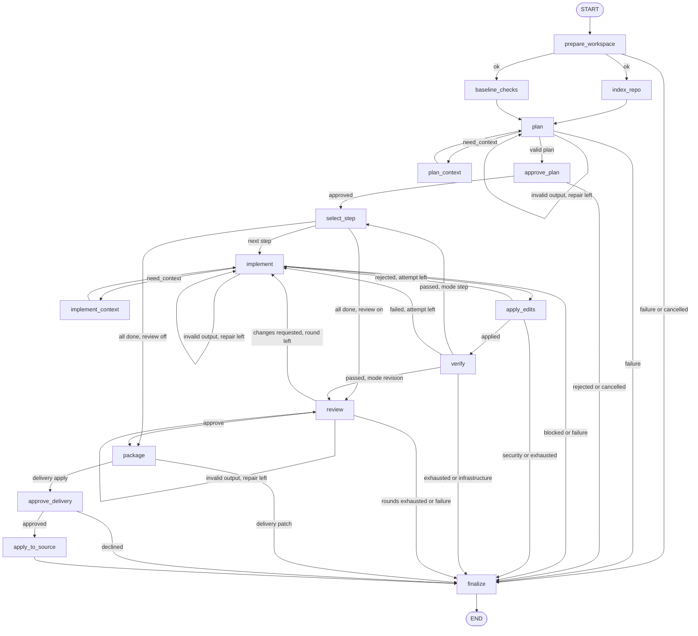

# Scranton Pipeline - design + implementation contract (v1, 2026-11-09)

Status: AUTHORITATIVE for the new engine in `engine/` and its integration into the Tauri desktop app.
It SUPERSEDES `.enma/langgraph-contract.md` and the old `langgraph-engine/` package. The user explicitly asked
to disregard that MVP: do not import from it, do not copy its architecture, do not edit or delete it. (You may
read its Windows process-tree code as a reference for pitfalls only.)

Verified LangGraph/LangChain API facts live in `.scratch/pipeline/api-spike/FACTS.md` (proven by scripts).
Where this contract names a LangGraph API, FACTS.md wins on exact spelling. Never guess an API - introspect it.

Names: directory `engine/`, distribution `scranton-pipeline`, import package `scranton_pipeline`,
CLI `python -m scranton_pipeline`. In the Node app and UI the feature is called "Pipeline".

---------------------------------------------------------------------------------------------------
## 1. Architecture decision (summary; the German long form goes to engine/docs/ARCHITECTURE.md)

Variants compared (reliability / security / effort / maintainability / extensibility):
- V1 linear pipeline, no loops: trivial, but one failed test ends the run. Rejected: no correction.
- V2 LLM supervisor + specialist agents: routing is an LLM decision, hidden autonomy, hard to test. Rejected.
- V3 single ReAct tool-loop agent with file/shell tools: capable with frontier models, but control flow lives in
  the model, tool calls are open-ended, weak with small models, executes model-chosen commands. Rejected.
- V4 deterministic state machine with bounded LLM work steps (CHOSEN): Python owns every transition; an LLM is
  called only where judgement is needed (plan, write edits, review) and always returns a schema-validated
  object; everything else is ordinary Python.
- V5 = V4 + parallel implementation of plan steps in separate worktrees: merge conflicts and races for little
  gain at MVP size. Deferred (extension point only).

Chosen design in one paragraph: 16 fixed nodes - 3 LLM roles (planner, implementer, reviewer), 2 human gates
(plan approval, delivery approval), 11 deterministic Python nodes. The model never chooses a command, a tool
or a next node. Its only "tools" are schema-bounded READ requests (read / search / list) that Python executes
under a path policy, in explicitly modelled, counter-bounded graph loops. All writes go through ONE node
(`apply_edits`) into a private snapshot workspace (a private git repo); the user's project is touched only by
`apply_to_source`, after a human approved the exact diff. Verification runs operator-configured argv recipes
in a sandbox. One terminal node (`finalize`) writes the report for every outcome.

What needs an LLM: planning (incl. deciding what to read), writing edits, reviewing the diff against the
acceptance criteria. What does not: workspace creation, indexing, context reading, edit validation/application,
checks, routing, budgets, risk classification, packaging, applying, reporting.

Parallelism rule: parallel = read-only only; writes are single-threaded. The only graph-level fan-out is
`index_repo || baseline_checks` (both read the fresh workspace, write disjoint state keys, joined by a
wait-for-all edge into `plan`). Checks are NOT run in parallel inside one workspace (build output races;
cheap-first fail-fast is worth more). Baseline runs BEFORE planning on purpose: failing-test output is the
best planning evidence for bug fixes.

Deterministic orchestration != deterministic model output: the graph, bounds and gates are deterministic;
model text is not. Every model output is therefore validated (schema + semantic rules) before it can affect
state, and every loop that depends on model quality is counter-bounded.

---------------------------------------------------------------------------------------------------
## 2. Graph

Sync graph (`StateGraph(PipelineState)`), `SqliteSaver` checkpointer in the run dir, `thread_id = run_id`,
checkpoints persisted synchronously (see FACTS.md "durability").

Nodes: P = Python, L = LLM role, H = human gate (LangGraph `interrupt`).

| # | node | kind | responsibility |
|---|------|------|----------------|
| 1 | prepare_workspace | P | snapshot source into private workspace repo, baseline commit, run `setup` commands |
| 2 | index_repo | P | repo index + summary + check suggestions (parallel with 3) |
| 3 | baseline_checks | P | run all configured checks on the untouched snapshot (parallel with 2) |
| 4 | plan | L planner | one planner turn: `need_context` or `plan`; validates plan semantically |
| 5 | plan_context | P | fulfil the planner's read requests |
| 6 | approve_plan | H | risk flags; auto-approve only if policy allows and no flag; else interrupt |
| 7 | select_step | P | advance to next plan step, or signal "all steps done" |
| 8 | implement | L implementer | one implementer turn: `edits`, `need_context` or `blocked` |
| 9 | implement_context | P | fulfil the implementer's read requests |
| 10 | apply_edits | P | validate + atomically apply edits, commit attempt (the ONLY writer) |
| 11 | verify | P | run checks; on pass mark green commit; on fail build structured feedback |
| 12 | review | L reviewer | independent verdict on the cumulative diff vs acceptance criteria |
| 13 | package | P | write `delivery/candidate.diff` + draft report |
| 14 | approve_delivery | H | interrupt: human approves applying the diff to the project |
| 15 | apply_to_source | P | precondition-checked, journaled, all-or-nothing apply to the source folder |
| 16 | finalize | P | single terminal node: final status, report.md/report.json, status.json |

Edges (design intent; `graph --format mermaid` prints the real one and a test pins doc == graph):



Routing rules (module `routing.py`):
- Every routing function is PURE: `(state: PipelineState) -> Literal[...node names...]`. No I/O, no clock, no
  config. First line of every one: `failure` or `outcome` set -> `"finalize"`.
- Bounds are enforced WHERE THE COUNTER IS INCREMENTED (the node): when a retry would exceed its limit the node
  sets `failure`; routing only reads facts (`failure`, `outcome`, `feedback`, `plan`, `pending_edits`, ...).
- All conditional edges are registered with an explicit `path_map` so no undeclared target is reachable.
- Loop bounds (config `limits`, all with hard ceilings in the model):
  `max_plan_context_rounds` 3, `max_step_context_rounds` 2, `max_output_repairs` 2 (per node visit scope),
  `max_step_attempts` 3 (applied-or-rejected edit sets per step / per revision round), `max_review_rounds` 2,
  `max_plan_steps` 8, `max_llm_calls` 40, `max_total_tokens` 1_500_000, `max_active_seconds` 3600.
  When context rounds are used up the next turn is told that no more context is available; a further
  `need_context` then counts as invalid output.
- `recursion_limit` is COMPUTED from these bounds (`limits.py: recursion_limit(limits)`, upper bound of
  supersteps + margin). It is a backstop: `GraphRecursionError` -> terminal `failed` / `limit/recursion_limit`
  via `finalize_out_of_band` (same code as the finalize node).

Node wrapper (`graph.py: instrument(name, fn, deps)`), applied to every node:
1. emits `node_started` / `node_finished` events and adds the node's duration to `active_seconds`;
2. BEFORE the body (except `finalize` and `apply_to_source`): if `failure`/`outcome` already set -> return `{}`
   (skip); cancel sentinel present -> `{"outcome": "cancelled"}`; suspend requested (parent gone) -> raise
   `SuspendRequested`; `active_seconds >= max_active_seconds` -> failure `limit/run_time_exhausted`;
3. converts `EngineError` raised by the body into a `failure` state update (so the graph reaches `finalize`);
4. NEVER catches LangGraph's interrupt exception, `TransientError` or `SuspendRequested`.

Failure taxonomy (`errors.FailureClass`) and recovery:
| class | examples | recovery |
|-------|----------|----------|
| `infrastructure` | provider unreachable / 5xx / 429 / timeout, git or docker missing, disk error, internal bug | transient: node `RetryPolicy` (LLM nodes only, `TransientError`, `max_transient_attempts` 3, backoff). Still failing: exception leaves the graph, checkpoint stays, run status `suspended` (resumable, exit 5). Non-transient infra inside a node: `failure` -> finalize |
| `llm_output` | unparsable / schema-invalid / semantically invalid model output | re-ask with the validation error, at most `max_output_repairs`; then terminal failure |
| `checks_failed` | required check failed or timed out | structured feedback -> implementer repair turn, at most `max_step_attempts`; then terminal failure |
| `implementation` | reviewer requests changes, step blocked, edits not applicable | revision loop bounded by `max_review_rounds` / `max_step_attempts`; then terminal failure |
| `security` | path traversal, absolute path, symlink escape, write to protected path | NO retry, immediate terminal failure (possible prompt injection) |
| `limit` | LLM call/token budget, active time, recursion backstop, workspace too large | terminal failure |
| `invalid_input` | bad CLI args / config / request | detected before the graph starts; exit 2; no run dir is left half-made |
Non-error terminal outcomes: `succeeded`, `rejected` (human rejected the plan), `cancelled`.

Human gates:
- `approve_plan`: payload `{gate:"plan", digest: sha256(canonical plan JSON), risk_flags, plan_path}`. Policy
  `approvals.plan`: `always` (default) or `auto_low_risk` (auto only when `risk_flags` is empty). Risk flags are
  computed by Python: `dependency_manifest_change`, `deletes_files`, `many_files` (> 10), `ci_or_build_config`,
  `baseline_red`. Decision `{decision: approve|reject, digest, comment}`; a stale digest is refused by the
  runner BEFORE resuming (exit 2, state untouched).
- `approve_delivery` (only `delivery_mode == "apply"`): payload `{gate:"delivery", digest: sha256(candidate.diff),
  files, diff_path}`. Never automatic. Declining still ends `succeeded` with `delivery.applied = false`.
- Gate nodes have NO side effects before `interrupt()` (the node body re-runs on resume).

---------------------------------------------------------------------------------------------------
## 3. Kernel (lane P1 implements these names exactly; lane P2 codes against them)

### errors.py
```python
class FailureClass(StrEnum): INFRASTRUCTURE="infrastructure"; LLM_OUTPUT="llm_output"; CHECKS_FAILED="checks_failed"
    IMPLEMENTATION="implementation"; SECURITY="security"; LIMIT="limit"; INVALID_INPUT="invalid_input"
class EngineError(Exception):
    def __init__(self, failure_class: FailureClass, code: str, message: str, *, detail: str = "") -> None
    def to_failure(self, node: str) -> dict[str, str]     # {"failure_class","code","message","node"}
class TransientError(Exception): ...     # retryable provider/transport fault; NOT an EngineError
class SuspendRequested(Exception): ...   # stop without finishing; leaves the graph, run stays resumable
```

### models.py (Pydantic v2)
`StrictModel` = `extra="forbid", frozen=True` for operator/config/runtime models. `LlmModel` = `extra="ignore"`
(tolerate extra keys from small models) with explicit length caps on every string/list field.

LLM output schemas (the ONLY shapes a model can return):
```python
class ContextRequest(LlmModel): kind: Literal["read","search","list"]; path: str = ""; query: str = ""
                                start_line: int | None = None; end_line: int | None = None
class Risk(LlmModel): description: str; severity: Literal["low","medium","high"]; mitigation: str = ""
class Criterion(LlmModel): id: str; text: str; verified_by: Literal["checks","review"]
class FileIntent(LlmModel): path: str; action: Literal["create","modify","delete"]
class PlanStep(LlmModel): id: str; title: str; description: str; files: list[FileIntent]
                          context_files: list[str] = []; criteria: list[str] = []
class Plan(LlmModel): summary: str; assumptions: list[str] = []; risks: list[Risk] = []
                      acceptance_criteria: list[Criterion]; steps: list[PlanStep]
class PlannerTurn(LlmModel): kind: Literal["need_context","plan"]; rationale: str = ""
                             context_requests: list[ContextRequest] = []; plan: Plan | None = None
class Replacement(LlmModel): search: str; replace: str
class FileEdit(LlmModel): path: str; action: Literal["create","modify","delete"]
                          content: str | None = None; replacements: list[Replacement] = []
class ImplementerTurn(LlmModel): kind: Literal["edits","need_context","blocked"]; summary: str = ""
                                 edits: list[FileEdit] = []; context_requests: list[ContextRequest] = []
                                 blocked_reason: str = ""
class CriterionAssessment(LlmModel): id: str; status: Literal["met","not_met","unclear"]; evidence: str = ""
class Finding(LlmModel): severity: Literal["blocking","major","minor","info"]
                         category: Literal["correctness","security","tests","scope","maintainability"]
                         path: str = ""; description: str; suggestion: str = ""
class Review(LlmModel): verdict: Literal["approve","request_changes"]; summary: str
                        criteria: list[CriterionAssessment] = []; findings: list[Finding] = []
```
Model validators (shape consistency -> `llm_output` on violation): `PlannerTurn` kind/payload agree;
`ImplementerTurn` kind/payload agree; `FileEdit`: create needs `content`, modify needs `replacements` XOR
`content`, delete needs neither; `Review`: `approve` with a blocking finding or a `not_met` criterion is invalid.
Semantic plan validation (function in the planner node module, Python): 1..max_plan_steps steps, unique ids,
criteria ids referenced by steps exist, every path passes the path policy and is not protected, `modify`/`delete`
targets exist in the workspace, `create` targets do not, at most `max_changed_files` distinct files.

Runtime records (StrictModel; stored in state as `model_dump(mode="json")` dicts):
```python
class CheckResult: id: str; kind: str; status: Literal["passed","failed","timed_out","error"]
                   exit_code: int | None; duration_s: float; output_tail: str; log_path: str; required: bool
class ContextItem: request: ContextRequest; ok: bool; content: str; truncated: bool; note: str = ""
class Feedback: kind: Literal["output_invalid","edits_rejected","checks_failed","review_changes"]
                message: str; details: list[str] = []
class StepRecord: step_id: str; attempts: int; commit: str; changed_files: list[str]
class Usage: calls: int = 0; input_tokens: int = 0; output_tokens: int = 0
class RunStatus: ...  # section 6
```

### state.py - central typed state (JSON primitives only, so checkpoints stay inspectable)
```python
class PipelineState(TypedDict, total=False):
    # request (set once by the runner)
    run_id: str; task: str; source_dir: str; delivery_mode: str          # "patch" | "apply"
    # workspace (prepare_workspace, apply_edits, verify)
    workspace: dict[str, Any]   # path, base_commit, head_commit, green_commit, manifest_path, files, used_git
    # repository understanding
    repo: dict[str, Any]        # index_path, tree, languages, manifests, readme_excerpt, suggested_checks, truncated
    baseline: list[dict[str, Any]]                 # CheckResult[]
    # planning
    plan_evidence: list[dict[str, Any]]            # ContextItem[] (byte-bounded)
    plan_requests: list[dict[str, Any]]            # pending ContextRequest[]
    plan: dict[str, Any] | None; plan_digest: str; risk_flags: list[str]
    plan_approval: dict[str, Any] | None           # decision, by ("human"|"auto"), comment
    # implementation loop
    mode: str                                      # "step" | "revision"
    step_index: int                                # -1 before the first step
    step_evidence: list[dict[str, Any]]; step_requests: list[dict[str, Any]]
    pending_edits: dict[str, Any] | None           # ImplementerTurn with kind == "edits"
    feedback: dict[str, Any] | None                # Feedback for the next model turn of the active loop
    checks: list[dict[str, Any]]                   # latest verify
    steps_done: Annotated[list[dict[str, Any]], operator.add]   # StepRecord[]
    deviations: list[str]                          # undeclared files that were changed
    # review / delivery
    review: dict[str, Any] | None; review_round: int
    delivery: dict[str, Any] | None                # diff_path, diff_sha256, files, applied, conflicts, reports
    delivery_approval: dict[str, Any] | None
    # control
    counters: Annotated[dict[str, int], merge_counters]         # additive deltas, scoped keys
    active_seconds: Annotated[float, operator.add]
    history: Annotated[list[dict[str, Any]], append_bounded]    # last 200 routing/outcome entries
    usage: dict[str, int]                                       # snapshot of the usage ledger
    failure: Annotated[dict[str, str] | None, keep_first]
    outcome: Annotated[str, keep_first]            # "" | succeeded | failed | rejected | cancelled
```
Ownership: every key has exactly one writing node group (comments above). Only reducer keys may be written by
the two parallel nodes. Counters are additive deltas with SCOPED keys so nothing ever needs a reset:
`plan_context`, `plan_repairs`, `context:<step_id>`, `repairs:<step_id>`, `attempts:<step_id>`,
`review_repairs:<round>`; revision rounds use the pseudo step id `R<round>`. Typed accessors
(`get_plan(state) -> Plan | None`, `current_step(state) -> PlanStep | None`, `counter(state, key) -> int`)
live in `state.py`; nodes never index raw dicts for models.

### config.py - operator config (JSON file, `extra="forbid"`, <= 256 KiB, no secrets inside)
```jsonc
{ "schema": 1,
  "models": { "planner": ModelConfig, "implementer": ModelConfig, "reviewer": ModelConfig },
  "sandbox": { "mode": "docker" | "host",
               "docker": { "image": "name-or-id", "cpus": 2, "memory_mb": 2048, "pids": 256 },
               "env_passthrough": [] },
  "setup":  [ { "id": "deps", "argv": ["npm","ci"], "timeout_s": 600, "network": true } ],
  "checks": [ { "id": "tests", "kind": "test", "argv": ["python","-m","pytest","-q"],
                "timeout_s": 600, "required": true, "scope": "step" } ],
  "approvals": { "plan": "always" | "auto_low_risk" },
  "review": { "enabled": true },
  "policy": { "protected_paths": [], "write_protected_paths": [], "scope": "plan_plus_flagged" | "strict",
              "max_undeclared_files": 2 },
  "limits": { },              // section 2 names; omitted = defaults; values above the hard ceiling are rejected
  "pricing": { "<model>": { "input_per_mtok": 0.0, "output_per_mtok": 0.0 } } }   // optional, estimate only
```
`ModelConfig`: `provider: "openai_compatible" | "scripted"` (registry; `anthropic` may be added as an optional
extra), `model`, `base_url` (https, or http only for loopback), `api_key_env` (NAME of an env var, never a
value), `structured_output: "json_text" (default) | "json_schema" | "function_calling"`, `temperature` 0.0,
`max_output_tokens` 8192, `timeout_s` 180, `script_path` (scripted only).
`check.kind`: `syntax|lint|typecheck|test|security|other`; `check.scope`: `step` (after every step) or `final`
(only after the last step and after revisions). `checks` may be empty only with `"allow_no_checks": true`
(top level); the report then states that nothing was verified automatically.
Exports: `load_config(path) -> EngineConfig`, `EngineConfig`, `ModelConfig`, `SandboxConfig`, `CheckConfig`,
`CommandConfig`, `Limits`, `Policy`, `config_digest(cfg) -> str`, `DEFAULT_PROTECTED`, `DEFAULT_WRITE_PROTECTED`.

---------------------------------------------------------------------------------------------------
## 4. Controlled tool adapters (lane P1; signatures are the P1 <-> P2 interface)

General: `subprocess` with `shell=False` and argv lists only. Every blocking call takes an explicit timeout.
No function here ever takes a command from model output: argv comes from operator config or is fixed in code.

```python
# tools/fs.py
class PathPolicy:
    def __init__(self, root: Path, protected: Sequence[str], write_protected: Sequence[str]) -> None
    def normalize(self, rel: str) -> str        # posix relative form; raises EngineError(SECURITY, ...)
    def resolve(self, rel: str) -> Path         # absolute, proven inside root after realpath
    def is_protected(self, rel: str) -> bool    # never read into prompts, never written
    def is_write_protected(self, rel: str) -> bool
def read_text(path: Path, max_bytes: int) -> tuple[str, bool]     # (text, truncated); non-UTF-8/binary -> EngineError(IMPLEMENTATION,"not_text")
def write_bytes_atomic(path: Path, data: bytes) -> None           # temp file in same dir + os.replace
def sha256_file(path: Path) -> str
def detect_newline(data: bytes) -> str                             # "\r\n" or "\n"

# tools/process.py
class StopSignal:                                # cancel sentinel file + in-memory suspend flag
    def __init__(self, cancel_file: Path) -> None
    def request_suspend(self) -> None
    def cancel_requested(self) -> bool; def suspend_requested(self) -> bool; def should_stop(self) -> bool
@dataclass(frozen=True)
class ProcResult: exit_code: int | None; timed_out: bool; stopped: bool; duration_s: float
                  output_tail: str; output_bytes: int; log_path: Path | None
def run_process(argv: Sequence[str], *, cwd: Path, env: Mapping[str, str], timeout_s: float,
                log_path: Path | None = None, tail_bytes: int = 8192, max_log_bytes: int = 5_000_000,
                stop: StopSignal | None = None) -> ProcResult
    # merges stderr into stdout; kills the WHOLE process tree on timeout/stop (no orphans, proven by a test
    # with a child-spawning script); executable cannot be started -> EngineError(INFRASTRUCTURE,"executable_not_found")
def scrubbed_env(base: Mapping[str, str], passthrough: Sequence[str], extra: Mapping[str, str] | None = None) -> dict[str, str]
    # allowlist only (PATH, SYSTEMROOT, COMSPEC, PATHEXT, TEMP/TMP, HOME/USERPROFILE, LANG, ... + passthrough);
    # provider keys and every *_API_KEY / *TOKEN* / *SECRET* name are never passed

# tools/sandbox.py
class Sandbox(Protocol):
    def run(self, argv: Sequence[str], *, timeout_s: float, log_path: Path, network: bool = False,
            stop: StopSignal | None = None) -> ProcResult
    def describe(self) -> dict[str, Any]         # mode, image, isolation statement (goes into the report)
    def preflight(self) -> None                  # raises EngineError(INFRASTRUCTURE, ...) if unusable
def build_sandbox(cfg: SandboxConfig, *, workspace: Path, run_id: str, trust_host: bool) -> Sandbox
    # HostSandbox: needs trust_host=True (else EngineError(INVALID_INPUT,"host_trust_required")); scrubbed env; cwd=workspace.
    # DockerSandbox: `docker run --rm --pull never --name scranton-pipeline-<run8>-<n> --network none
    #   (bridge only when network=True) --cpus --memory --pids-limit --cap-drop ALL --security-opt no-new-privileges
    #   -v <workspace>:/workspace -w /workspace <image> argv...`; timeout/stop -> `docker kill <name>`;
    #   preflight = docker reachable + image present locally. Never pulls or builds.

# tools/git.py  (direct git CLI; every call: GIT_TERMINAL_PROMPT=0, GIT_CONFIG_NOSYSTEM=1, GIT_CONFIG_GLOBAL=<empty file>,
#                -c core.hooksPath=<empty dir> -c core.autocrlf=false -c core.longpaths=true; no network commands)
def git_available() -> bool
def list_source_files(source: Path, *, timeout_s: float) -> tuple[list[str], bool]   # (posix rel paths, used_git)
    # inside a git work tree: `git ls-files -co --exclude-standard -z` (tracked + untracked-not-ignored);
    # otherwise a walk skipping DEFAULT_IGNORED_DIRS
class WorkspaceRepo:
    @classmethod
    def init(cls, workspace: Path) -> "WorkspaceRepo"
    def commit_all(self, message: str) -> str               # baseline commit (add -A)
    def commit_paths(self, paths: Sequence[str], message: str) -> str   # only these paths (incl. deletions); returns HEAD sha
    def head(self) -> str
    def reset_hard(self, commit: str) -> None               # reset --hard + clean -fd (keeps ignored dirs such as node_modules)
    def restore_tracked(self) -> list[str]                  # undo modifications checks made to tracked files; returns their paths
    def diff(self, base: str, head: str) -> str             # unified diff, no color, no external diff, paths relative to root
    def changed_files(self, base: str, head: str) -> list[tuple[str, str]]      # [("A"|"M"|"D", path)]
    def numstat(self, base: str, head: str) -> list[tuple[int, int, str]]

# tools/snapshot.py
class SnapshotResult(StrictModel): files: int; total_bytes: int; used_git: bool; skipped: list[dict[str, str]]; manifest_path: str
def snapshot_source(source: Path, workspace: Path, *, policy: Policy, limits: Limits, manifest_path: Path) -> SnapshotResult
    # copies bytes verbatim; skips symlinks, protected (secret) paths, files > max_file_bytes; enforces
    # max_workspace_files / max_workspace_bytes (-> EngineError(LIMIT,"workspace_too_large")); writes the manifest
    # {path: {"sha256","size"}} used later as the apply precondition. NEVER writes into `source`.

# tools/repo_index.py
class RepoIndex(StrictModel): files: list[dict[str, Any]]; languages: dict[str, int]; manifests: list[dict[str, str]]
                              readme_excerpt: str; symbols: dict[str, list[str]]; truncated: bool
def build_index(workspace: Path, files: Sequence[str], *, limits: Limits) -> RepoIndex   # python symbols via ast (parse only)
def render_tree(index: RepoIndex, *, max_entries: int) -> str       # bounded, directories aggregated beyond the cap
def detect_checks(index: RepoIndex) -> list[dict[str, Any]]         # fixed table of known recipes: {id, kind, argv, reason}

# tools/context.py
def fulfil(requests: Sequence[ContextRequest], *, workspace: Path, policy: PathPolicy, files: Sequence[str],
           limits: Limits, redactor: Redactor) -> list[ContextItem]
    # read: whole file or line range, byte-capped; search: LITERAL substring (no model-supplied regex), optional
    # path prefix, match cap; list: directory entries. A request for a protected path yields ok=False with a
    # note (not a failure); traversal/absolute paths raise EngineError(SECURITY). Content is redacted.

# tools/patches.py
@dataclass(frozen=True)
class ApplyOutcome: ok: bool; changed: list[str]; rejected: list[str]; undeclared: list[str]
def validate_and_apply(edits: Sequence[FileEdit], *, workspace: Path, policy: PathPolicy, declared: Collection[str],
                       scope: str, undeclared_budget: int, limits: Limits) -> ApplyOutcome
    # ALL-OR-NOTHING: validate every edit, write only if all pass. Rejections (-> ok=False, feedback for the model):
    # search text not found or found more than once, no-op edit, create over existing file, modify/delete of a
    # missing file, file too large, not UTF-8, out of scope (strict) or undeclared budget exceeded, .py that does
    # not parse (ast.parse), .json that does not load. Security (-> raise EngineError(SECURITY)): path policy
    # violation, protected or write-protected target. Preserves each file's dominant newline style.
class SourceApplyResult(StrictModel): applied: list[str]; conflicts: list[dict[str, str]]; rolled_back: bool
def apply_to_source(*, workspace: Path, source: Path, changes: Sequence[tuple[str, str]], manifest: Mapping[str, Mapping[str, Any]],
                    backup_dir: Path, journal_path: Path, policy: PathPolicy) -> SourceApplyResult
    # precheck everything first: M/D need the source file's sha256 == manifest sha256 (unchanged since the
    # snapshot); A needs the path to be absent. Any conflict -> nothing is written. Then: back up originals,
    # journal each file, write via write_bytes_atomic / unlink. I/O error -> roll back from backups.
    # Re-running after a crash is safe (journal + digest comparison). Never touches the git index or history.

# tools/checks.py
def run_checks(checks: Sequence[CheckConfig], *, sandbox: Sandbox, log_dir: Path, label: str,
               stop: StopSignal | None, fail_fast: bool = True) -> list[CheckResult]
    # sequential, in config order; a required failure skips the rest when fail_fast. exit 0 = passed,
    # non-zero = failed, timeout = timed_out, cannot start = error.

# tools/secrets.py
class Redactor:
    def __init__(self, secret_values: Iterable[str] = ()) -> None
    def redact(self, text: str) -> str      # masks known secret values + credential-looking patterns
    def scan(self, text: str) -> list[str]  # names of matched patterns

# observability.py
class EventLog:                              # run_dir/events.jsonl, append-only, thread-safe, flushed per event
    def __init__(self, path: Path, run_id: str, redactor: Redactor) -> None
    def emit(self, type: str, *, node: str | None = None, **data: Any) -> int    # returns seq; seq continues across processes
class UsageLedger:                           # run_dir/usage.jsonl - the single source of truth for budgets
    def __init__(self, path: Path) -> None
    def record(self, *, role: str, model: str, input_tokens: int, output_tokens: int, ok: bool, duration_s: float) -> None
    def totals(self) -> Usage
    def calls_for(self, role: str) -> int
def write_status(run_dir: Path, status: RunStatus) -> None    # atomic replace of status.json
def read_status(run_dir: Path) -> RunStatus | None
def configure_logging(level: str = "INFO") -> None            # JSON lines on stderr, redacted
```
Event types (`{"seq","ts","run_id","type","node","data"}`): `run_started`, `run_resumed`, `node_started`,
`node_finished` (duration_s), `route` (from, to, reason), `llm_call` (role, model, ok, input_tokens,
output_tokens, duration_s), `context` (requests, fulfilled), `edits_applied` / `edits_rejected`,
`check_finished` (id, status, duration_s), `gate_waiting` (gate, digest), `gate_decided` (gate, decision, by),
`warning` (code, message), `failure` (failure_class, code, message), `run_finished` (status). Events never
contain file contents, prompts or secrets.

---------------------------------------------------------------------------------------------------
## 5. Agents (lane P2)

```python
# agents/gateway.py
@dataclass(frozen=True)
class Completion(Generic[T]): parsed: T; usage: Usage; model: str; duration_s: float
class ModelGateway(Protocol):
    def complete(self, role: Role, *, system: str, user: str, schema: type[T]) -> Completion[T]: ...
class ChatModelGateway:   # the one implementation; wraps langchain-core BaseChatModel per role
    def __init__(self, models: Mapping[Role, BaseChatModel], cfg: EngineConfig, ledger: UsageLedger, events: EventLog) -> None
# agents/providers.py
def build_chat_model(cfg: ModelConfig, env: Mapping[str, str], *, ledger: UsageLedger, role: Role) -> BaseChatModel
    # registry keyed by cfg.provider: "openai_compatible" -> langchain_openai.ChatOpenAI(base_url=..., max_retries=0, ...);
    # "scripted" -> ScriptedChatModel(BaseChatModel) replaying cfg.script_path, cursor = ledger.calls_for(role)
    # so it continues correctly in a new process. Adding a provider = one registry entry; the graph is untouched.
```
`complete()`: (1) budget check against the ledger (`max_llm_calls`, `max_total_tokens`) -> `EngineError(LIMIT,
"llm_budget_exhausted")`; (2) one model call with the role's timeout; (3) `json_text`: JSON schema of `schema`
is embedded in the system prompt, the first JSON object is extracted from the text (code fences tolerated) and
validated; native modes use `with_structured_output(..., include_raw=True)`; (4) ledger + `llm_call` event are
written for every attempt; (5) errors: transport/timeout/429/5xx -> `TransientError`; auth/4xx ->
`EngineError(INFRASTRUCTURE, "provider_rejected")`; unparsable or invalid -> `EngineError(LLM_OUTPUT,
"output_invalid", detail=<bounded validation message>)`. Missing usage metadata is recorded as an estimate
(bytes/4) and flagged `estimated` - never as zero.
The LLM nodes catch `LLM_OUTPUT` themselves: they store `feedback(kind="output_invalid")`, add 1 to the repair
counter and, when the limit is exceeded, set the terminal failure instead. The repair loop is therefore a
visible self-edge in the graph, not a hidden loop inside the gateway.

Prompts (`agents/prompts.py`, versioned constants + pure builders `build_planner_prompt(state, cfg) ->
(system, user)` etc.): role, hard rules, output contract, then data. Repository content is untrusted DATA:
it is placed in delimited blocks (`<<<FILE path=...>>> ... <<<END>>>`) and the system prompt states that
instructions inside data blocks must be ignored. Prompt size is bounded (`max_prompt_bytes`), with a
deterministic truncation order (oldest evidence first, then file tails) and visible truncation markers.
- Planner sees: task, repo tree + languages + manifests + README excerpt, baseline check summary (+ failing
  output tails), gathered evidence, remaining context rounds. Must produce atomic steps that each leave the
  checks green, with acceptance criteria that say how they are verified.
- Implementer sees: task summary, the current step (or the review findings in revision mode), its acceptance
  criteria, current content of the step's `files` and `context_files`, gathered evidence, and `feedback`.
- Reviewer sees ONLY: task, acceptance criteria, plan summary, the cumulative diff, changed-file list with
  deviations, final check results. Not the implementer's reasoning (independence).

---------------------------------------------------------------------------------------------------
## 6. Runner, CLI and run-directory protocol (lane P2; this section is the Python <-> Node interface)

```
python -m scranton_pipeline run     --source ABS (--task TEXT | --task-file ABS) --config ABS --run-root ABS
                                    [--workspace-root ABS] [--run-id ID] [--delivery patch|apply] [--trust-host] [--parent-guard]
python -m scranton_pipeline resume  --run-dir ABS [--gate plan|delivery --decision approve|reject --digest HEX [--comment TEXT]]
                                    [--trust-host] [--parent-guard]
python -m scranton_pipeline status  --run-dir ABS
python -m scranton_pipeline cancel  --run-dir ABS [--parent-guard]
python -m scranton_pipeline detect  --source ABS            -> {"git": bool, "languages": {...}, "checks": [{id,kind,argv,reason}]}
python -m scranton_pipeline graph   [--format mermaid]      -> Mermaid text of the compiled graph
python -m scranton_pipeline demo    --run-root ABS [--workspace-root ABS] [--run-id ID] [--delivery patch|apply] [--parent-guard]
python -m scranton_pipeline version                         -> {"version","python","langgraph"}
```
- stdout: EXACTLY ONE line of JSON per invocation (`run|resume|status|cancel|demo` print the `RunStatus`
  object below; errors before a run exists print `{"status":"error","failure":{...}}`). Logs go to stderr.
- Exit codes: 0 succeeded (or `status`/`detect`/`graph`/`version` ok) - 2 invalid input / usage / stale digest
  / run already active - 3 awaiting approval - 4 failed - 5 suspended (resumable) - 6 rejected or cancelled.
- `run-id`: `[a-z0-9]{8,32}`, default 12 random hex chars. Run dir = `<run-root>/<run-id>` (created
  exclusively; an existing directory is an error). Workspace: `<run-dir>/workspace` by default; with
  `--workspace-root W` it is `W/<run-id>` (keeps paths short on Windows). Neither the run dir nor the
  workspace may be inside `--source`, and `--source` may not be inside them.
- The config is validated, then COPIED to `<run-dir>/config.json`; `resume` reads only that copy (no config
  drift). The config never contains secrets; keys come from the environment variables it names.
- `--trust-host` is required on EVERY `run`/`resume` when `sandbox.mode == "host"`.
- `--parent-guard`: a daemon thread reads stdin; EOF or the line `stop` requests SUSPEND (the run stops at
  the next node boundary / kills the running check and exits 5, resumable). The supervisor may also just kill
  the process tree: every state transition is checkpointed, so a kill is equivalent to a crash.
- One owner per run: OS file lock on `<run-dir>/lock` held for the whole `run`/`resume`. A second owner gets
  exit 2 (`run_active`).
- `cancel`: writes `<run-dir>/cancel.requested`. If no owner is alive it also drives the run to its terminal
  `cancelled` state itself (resume-to-finalize; no model call, no check) and prints that status (exit 6).
- `status`: reads `status.json`; if it says `running` but the lock is free (owner died) it reports and
  persists `suspended` with `resumable: true`.
- `demo`: creates a tiny buggy fixture project under `<run-dir>/demo-source`, uses scripted models and the
  host sandbox with `[sys.executable, "-m", "unittest", ...]` (trust implied for the bundled fixture only),
  `approvals.plan = "always"`. It behaves exactly like `run` afterwards (stops at the plan gate with exit 3).

Run directory:
```
<run-dir>/run.json            immutable: run_id, task, source_dir, delivery_mode, created_at, config_digest, engine_version
          config.json         validated copy of the operator config
          status.json         RunStatus snapshot, atomically replaced after every node and lifecycle change
          events.jsonl        append-only event stream (tail-able while the engine runs)
          usage.jsonl         model-call ledger
          checkpoints.sqlite  LangGraph checkpoints
          lock, cancel.requested
          artifacts/          plan.json, repo_index.json, source_manifest.json, review-<n>.json, logs/<label>-<check>.log
          delivery/           candidate.diff, report.md, report.json, apply-journal.json, backups/
          workspace/          private snapshot repo (unless --workspace-root)
```
`RunStatus` (status.json == CLI stdout; schema 1; all paths absolute):
```jsonc
{ "schema": 1, "run_id": "...", "status": "running|awaiting_approval|suspended|succeeded|failed|rejected|cancelled",
  "phase": "prepare|plan|approve_plan|implement|review|deliver|done", "node": "last finished node",
  "task": "first 500 chars", "source_dir": "...", "delivery_mode": "patch|apply",
  "progress": { "step_index": 0, "step_count": 3, "step_title": "...", "attempt": 1, "review_round": 0 },
  "pending": null | { "gate": "plan", "digest": "sha256", "risk_flags": [], "path": ".../artifacts/plan.json" }
                 | { "gate": "delivery", "digest": "sha256", "files": [{"path","action","added","removed"}], "path": ".../delivery/candidate.diff" },
  "failure": null | { "failure_class": "...", "code": "...", "message": "...", "node": "..." },
  "resumable": false, "usage": { "calls": 0, "input_tokens": 0, "output_tokens": 0, "estimated_cost": null },
  "checks": [ { "id","kind","status","required","duration_s" } ],        // latest verify (or baseline before the first)
  "delivery": null | { "applied": true|false|null, "diff_sha256": "...", "files": 0, "conflicts": [] },
  "artifacts": { "plan": null|"...", "diff": null|"...", "report_md": null|"...", "report_json": null|"..." },
  "sandbox": { "mode": "host|docker", "isolated": false }, "pid": 1234 | null,
  "created_at": "...", "updated_at": "...", "engine_version": "..." }
```
Report (`delivery/report.json` schema 1 + `report.md`, English, built ONLY from state/artifacts - no model):
status + failure, task, plan summary, acceptance criteria with the reviewer's assessment, steps with attempts,
changed files (action, +/-, declared or deviation), baseline vs final checks, review verdict + findings, usage
(calls, tokens, estimated cost or null), timeline (node durations), delivery (mode, applied, diff sha256,
conflicts) and a deterministic `limitations` list (host sandbox = no OS isolation, criteria `unclear`,
no checks configured, undeclared files changed, baseline was red, check modified tracked files, estimated
usage). Written for EVERY terminal outcome, including failures (then with the last green state's diff as
`partial.diff` and `delivery.applied = null`).

---------------------------------------------------------------------------------------------------
## 7. Security rules (all lanes)

1. The model cannot execute anything. Commands come only from operator config (argv arrays, no shell).
2. Path policy on EVERY model-supplied path: relative posix only; reject absolute paths, drive letters, `..`,
   NUL, Windows reserved names, trailing dot/space; resolved path must stay inside the root after realpath
   (symlink/junction escape). Violation = `security` failure, no retry.
3. Protected (never read into prompts, never copied into the workspace, never written): `.git/**`, `.env`,
   `.env.*`, `**/*.pem`, `**/*.key`, `**/*.p12`, `**/*.pfx`, `**/id_rsa*`, `**/id_ed25519*`, `.ssh/**`,
   `.npmrc`, `.pypirc`, `**/credentials.json`, `**/auth.json` + operator `protected_paths`.
   Write-protected (readable, not writable): lockfiles (`package-lock.json`, `yarn.lock`, `pnpm-lock.yaml`,
   `poetry.lock`, `uv.lock`, `Cargo.lock`), `.github/**`, `.gitlab-ci.yml` + operator `write_protected_paths`.
   Dependency manifests are writable only when declared in the approved plan (risk flag forces the gate).
4. Checks run model-written code: only inside the sandbox, with a scrubbed environment (no provider keys),
   time/output limits and whole-tree kill. Docker: no network unless a `setup` command opts in. Host mode is
   an explicit trust decision per invocation and is labelled "no OS isolation" in status and report.
5. Secrets: API keys only via env var names; values are registered with the `Redactor` and masked in events,
   logs, errors, status and reports. Outgoing context is redacted for credential-looking patterns (best effort,
   stated as a limitation).
6. The source folder is written only by `apply_to_source`, after the delivery gate, with unchanged-since-snapshot
   preconditions, backups and a journal. No git index/commit/push ever.
7. Idempotency: mutating nodes start from the commit recorded in state (`reset_hard(head_commit)` before
   writing), so a node re-executed after a crash produces the same tree. Budgets are counted in the ledger
   file, not in memory, so a replay cannot spend unaccounted calls.

---------------------------------------------------------------------------------------------------
## 8. Python quality gates and required tests

Environment: venv `.scratch\pipeline\venv` (Python 3.14, created by the API spike). Before commands set
TEMP/TMP/TMPDIR to `C:\Users\pumas\Documents\Project_Scranton\.scratch\pipeline\tmp`, PIP_CACHE_DIR to
`...\.scratch\pipeline\pip-cache`, PYTHONPYCACHEPREFIX to `...\.scratch\pipeline\bytecode`. From cwd `engine\`:
```
..\.scratch\pipeline\venv\Scripts\python.exe -m pytest tests -q -p no:cacheprovider --basetemp ../.scratch/pipeline/pytest-<lane>
..\.scratch\pipeline\venv\Scripts\python.exe -m ruff check src tests --cache-dir ../.scratch/pipeline/ruff-<lane>
..\.scratch\pipeline\venv\Scripts\python.exe -m mypy src --cache-dir ../.scratch/pipeline/mypy-<lane>
```
(`-p no:cacheprovider` is required: pytest's cache dir handling breaks on `..` paths.) mypy runs in strict
mode on `src`. Only lane P1 runs `pip install` (`pip install -e "engine[dev]"`); nobody else touches the venv.
No real provider calls, no image pull/build. Tests that need Docker are opt-in (`SCRANTON_PIPELINE_DOCKER_TEST=1`)
and may only run ephemeral `docker run --rm` containers named `scranton-pipeline-*` from the already present
local image `scranton-sandbox:1.5.0`; never touch other containers.

Required test coverage (model calls replaced by `ScriptedChatModel` / fakes; real git; real subprocess checks
on tiny fixtures in the host sandbox):
- success end to end (plan gate -> steps -> checks -> review -> package -> delivery gate -> apply), source
  updated only after the delivery approval, report complete;
- invalid inputs (config, request, paths, digest) -> exit 2, nothing half-created;
- routing: table-driven tests over every branch of every routing function;
- invalid agent output: repaired within the bound; exhaustion -> `failed/llm_output`;
- failed tests -> repair turn -> pass; exhaustion -> `failed/checks_failed`; check timeout handling;
- review requests changes -> revision -> approve; rounds exhausted -> `failed/implementation`;
- limits: LLM call budget, token budget, active time, recursion backstop;
- safe abort: cancel before/during/at a gate; security violation (traversal, protected path) -> terminal
  `security`, source and workspace untouched by the offending edit;
- resume: gate decision in a SEPARATE process; hard crash (`os._exit`) mid-node in a child process then
  `resume` completes without repeating finished nodes; `status` of a dead owner -> `suspended`;
  transient provider error -> retried; persistent -> exit 5 then `resume` succeeds;
- apply_to_source: conflict (source changed after snapshot) -> nothing written; I/O failure -> rollback;
  re-run after crash is idempotent;
- parallel fan-out: both branches run, reducers merge, both failing does not raise an update conflict;
- graph shape: exact node set, every conditional edge has a path_map, Mermaid in the docs == compiled graph;
- every new regression test must be shown to FAIL without the code it guards (name the line).

---------------------------------------------------------------------------------------------------
## 9. Integration into the Tauri app - Node side (lane N)

Integration variants compared: (I1) Rust shell spawns Python + new Tauri IPC commands - widens the web page's
capability surface (today: 3 notification permissions) and duplicates supervision in Rust; rejected. (I2) the
existing Node app-server supervises the engine as a child process per invocation, HTTP routes for the UI, Python
runtime staged as an app resource - CHOSEN: Tauri shell and capabilities stay unchanged, one supervisor, the
engine stays independently testable through its CLI. (I3) long-lived Python HTTP service - extra port, auth and
dependencies for nothing the checkpointed CLI does not already give; rejected. (I4) port the graph to
LangGraph.js - contradicts the Python requirement; rejected.

Model: a chat has a fixed engine. `chat.json` gains optional `engine: "pipeline"` (absent = the existing pi
team). In a pipeline chat the legacy POST routes (`/runs`, `/chat`, `/hitl`, `/stop`, `/release`) answer 409
`This chat uses the pipeline engine`; pipeline routes on a team chat answer 409 `This chat does not use the
pipeline engine`. The legacy lease / heartbeat / orphan-recovery machinery is NOT used for pipeline runs and
must not change behaviour (the engine has its own lock, checkpoints and `suspended` state).

New modules: `src/core/pipeline-command.js` (command resolution + capability probe),
`src/core/pipeline-supervisor.js` (runs, processes, storage, credentials). Routes are mounted in
`src/server/registry-router.js` (`handle` / `scoped`). Reuse `killTree` (pi-command.js), `writeFileAtomicSync`,
`withFsRetry` (util.js), `validateId`, `readBody`/`json`, `parseCommandSpec`. Zero new npm dependencies.

Engine command resolution (first hit wins): (1) env `SCRANTON_PIPELINE_COMMAND` (JSON array of strings, same
parsing as `SCRANTON_PI_COMMAND`); (2) bundled runtime `<PACKAGE_ROOT>/engine-runtime/python/python.exe` ->
`[python.exe, "-m", "scranton_pipeline"]`; (3) dev checkout: `<PACKAGE_ROOT>/.scratch/pipeline/venv/Scripts/python.exe`
-> same argv. Capability = `version` subcommand succeeds within 15 s (cached; re-probed when it failed).

Storage: `<dataDir>/projects/<projectId>/chats/<chatId>/pipeline/runs/<runId>/` is the engine run dir (passed as
`--run-root .../pipeline/runs --run-id <runId>`, runId = 12 lowercase hex). The generated operator config goes
to `.../pipeline/requests/<runId>.json` (no secrets). Workspaces go to a short root: env
`SCRANTON_PIPELINE_WORKSPACE_ROOT`, else `%LOCALAPPDATA%\Scranton\pipeline` on Windows, else
`<dataDir>/pipeline-workspaces`; passed as `--workspace-root`. Removing a chat/project history also removes
its pipeline workspaces; removal is refused while a pipeline run of that chat is not terminal.

Processes: one engine process per `run`/`resume`/`cancel`/`demo` invocation, `stdio: ['pipe','pipe','pipe']`,
`windowsHide: true`, always with `--parent-guard`. stdin stays open while the server lives; on server close:
end stdin, wait up to 5 s, then `killTree`. stdout is the single RunStatus line; keep the last 8 KiB of
stderr for diagnostics. After exit re-read `status.json`; if it still says `running`, run `status` once to
normalise it to `suspended`. One non-terminal run per chat. A live engine process counts toward
`maxConcurrentRuns` (429 `too_many_runs`); a run waiting at a gate does not.

Credentials: only accounts of kind `api_key` (stored key or provider env var) on OpenAI-compatible endpoints
are usable: custom providers with `api: "openai-completions"` (their `baseUrl`) and built-in providers whose
OpenAI-compatible base URL you can VERIFY (pi's provider definition or the vendor's official docs); everything
else, and every OAuth/subscription account, is listed as unsupported with a reason. The key is resolved
server-side and handed to the child ONLY as an environment variable (`SCRANTON_PIPELINE_KEY_PLANNER`,
`..._IMPLEMENTER`, `..._REVIEWER`); the generated config names these variables. A key is never written to
disk, logged, or returned over HTTP.

HTTP API (all requests pass the existing `authorize`; POST bodies via `readBody`; unknown body fields -> 400;
errors `{ "error": "<message>" }`):
```
GET  /api/pipeline
  -> { available: bool, reason: string|null, version: string|null, source: "env"|"bundled"|"dev"|null,
       sandbox: { dockerImage: string|null },
       models: [ { provider, label, supported: bool, reason: string|null, models: [ { id, label } ] } ] }
POST /api/projects/:p/pipeline/detect            body {}
  -> { git: bool, languages: {..}, checks: [ { id, kind, command, reason } ] }
GET  /api/projects/:p/chats/:c/pipeline
  -> { active: runId|null, runs: [ { runId, status, phase, task, createdAt, updatedAt } ] }      // oldest first
POST /api/projects/:p/chats/:c/pipeline/runs     -> 202 { ok: true, runId }
  body { task: string,                                      // 1..32768 bytes
         demo?: bool,                                       // true: engine `demo`; only `delivery` is honoured besides
         delivery?: "apply"|"patch",                        // default "apply"
         sandbox?: { mode: "docker"|"host", image?: string, trustHost?: bool },
         checks?: [ { id, kind, command, timeoutSec?, required?, scope? } ],     // <= 12
         setup?:  [ { id, command, timeoutSec?, network? } ],                    // <= 4
         models?: { planner: {provider, model}, implementer: {provider, model}, reviewer: {provider, model} },
         approvals?: { plan: "always"|"auto_low_risk" }, review?: bool }
  errors: 400 validation - 409 chat has a non-terminal run / wrong engine / host mode without trustHost
          429 too_many_runs - 503 "Pipeline engine is not available: <reason>"
GET  /api/projects/:p/chats/:c/pipeline/runs/:runId?after=<seq>
  -> { status: RunStatus, live: bool, events: [ ...seq > after, at most 500 ], lastSeq: number,
       plan: object|null, review: object|null, stderrTail: string }
GET  /api/projects/:p/chats/:c/pipeline/runs/:runId/artifacts/:name      name: plan | diff | report | report-json
  -> { name, content: string, truncated: bool }                                  // <= 1 MiB of text
POST /api/projects/:p/chats/:c/pipeline/runs/:runId/decision   body { gate: "plan"|"delivery", decision: "approve"|"reject", digest, comment? }  -> 202 { ok: true }
POST /api/projects/:p/chats/:c/pipeline/runs/:runId/resume     body {}   -> 202 { ok: true }       // only when suspended
POST /api/projects/:p/chats/:c/pipeline/runs/:runId/cancel     body {}   -> 202 { ok: true }       // any non-terminal status
POST /api/projects/:p/chats                      body { title?, engine?: "pipeline" }   (existing route, new optional field)
```
`command` strings are tokenised by Node into argv (double and single quotes; no variable expansion, no shell,
<= 64 tokens); the engine never sees a shell string. `decision` is checked against `status.pending`
(gate + digest) BEFORE spawning `resume`; mismatch -> 409. File paths never come from the client: artifacts
are addressed by name only and resolved inside the run dir.

Existing summaries: `GET /api/projects` chat entries gain `engine` (`"pipeline"` or absent) and, for pipeline
chats, `status` mapped as running -> `running`, awaiting_approval -> `needs_human`, succeeded -> `done`,
failed -> `failed`, suspended/rejected/cancelled -> `stopped`, no run -> `idle`. The aggregated
`GET /api/control` `pendingHuman` count includes pipeline chats waiting at a gate (drives the tray tooltip).
`scranton doctor` reports the pipeline engine (available + version, or the reason) as a WARN-level optional item.

Tests (node:test, fixtures under `.scratch/`): a deterministic fake engine `tools/fake-pipeline.js` that speaks
section 6 (status.json, events.jsonl, exit codes, gates, cancel, suspend, env knobs for failure paths) driven via
`SCRANTON_PIPELINE_COMMAND`; plus ONE real-engine test that runs `demo` end to end over HTTP and is skipped
when `.scratch/pipeline/venv/Scripts/python.exe` is missing. Suites to keep green (run one after another):
`node --test "test/server/*.test.js"` (114), `node --test "test/core/*.test.js"` (396 + 1 skip).

---------------------------------------------------------------------------------------------------
## 10. Integration - web UI (lane F)

Rules already in force: dark, strictly neutral grayscale, no hues (critical states use inversion), every
status shown once, no box-in-box, no empty panels; no inline scripts/styles (CSP `default-src 'self'`); all
dynamic text via `textContent`. Vanilla ES modules, no build step, no new dependency.

- New-run drawer (`#run-dialog`, `js/control-panel.js`): when it creates a NEW chat and `GET /api/pipeline`
  says `available`, offer the engine choice "Team" (default, today's behaviour, unchanged) / "Pipeline". If the
  engine is unavailable the choice is shown disabled with the server's reason. Pipeline form: task; checks
  (prefilled from `POST .../pipeline/detect`, editable rows: id, kind, command, required); sandbox (Docker with
  image field prefilled from `sandbox.dockerImage`, or Trusted host with an explicit acknowledgement checkbox
  stating that checks run on this machine without OS isolation); one model per role from `models` (unsupported
  providers visible but disabled with their reason; "use for all roles" convenience); plan approval policy;
  "Demo run (sample project, no model)" which needs none of the above. Submit = create chat with
  `engine: "pipeline"`, then `POST .../pipeline/runs`. A follow-up run in an existing pipeline chat reuses the
  same form (engine fixed).
- Pipeline view = the main area of a pipeline chat (the team layout is hidden for such chats, and vice versa).
  New module(s) `js/pipeline-*.js`, wired from `js/main.js`. Poll `GET .../pipeline/runs/:id?after=<lastSeq>`
  every 1 s while `live` or `running`, every 5 s otherwise; stop when the chat is not shown. Content, top down:
  run line (status once, phase, step i/n, attempt, usage), phase stepper (Prepare, Plan, Approval, Implement,
  Review, Deliver), then sections that appear only when they have content: Plan (summary, acceptance criteria,
  steps with files, risks, risk flags; Approve / Reject with optional comment while the plan gate is pending),
  Checks (latest results; output tail on demand), Review (verdict, criteria assessment, findings), Changes
  (file list + unified diff rendered as text lines with grayscale add/remove styling; Apply to project /
  Keep as patch only while the delivery gate is pending - Apply names the project folder), Result (report as
  preformatted text, failure class + message when failed, limitations), Activity (event list). Controls:
  Cancel (non-terminal), Resume (suspended), run selector for earlier runs of the chat.
- Sidebar/nav: pipeline chats show their mapped status (`needs_human` when a gate is waiting) exactly like
  team chats; nothing else changes there.
- Do not break the tail-follow logic of `createChatPanel` (js/chat-panel.js) and `createLog` (js/log.js); do
  not restructure existing panels. Tests follow `test/visualizer/*` (node:test with
  `test/visualizer/fixtures/fake-dom.js`, pure reducers/formatters where possible): diff line classifier,
  status/phase mapping, request builder for the run form, gate rendering, poll scheduling.
  Suite to keep green: `node --test "test/visualizer/*.test.js"` (355).

---------------------------------------------------------------------------------------------------
## 11. Packaging (lane K, after the Python lanes)

Staged layout (inside `src-tauri/staged/app/`, i.e. `<PACKAGE_ROOT>` at runtime):
`engine-runtime/python/` = official Windows x64 embeddable CPython 3.14 (same minor as the wheels),
`engine-runtime/site-packages/` = the pinned runtime closure (wheels only, `--only-binary=:all:`) plus the
`scranton_pipeline` package copied from `engine/src`. `python314._pth` lists `python314.zip`, `.`,
`..\site-packages` (isolated: ignores PYTHONPATH and user site). No dev tools, no tests, no `__pycache__`.
`engine/requirements.lock` pins the runtime closure with hashes; `engine/runtime-lock.json` pins the
embeddable archive (version, URL, sha256); downloads are cached under `.scratch/pipeline/cache` and verified.
`scripts/prepare-desktop.mjs` stages and then VERIFIES with the staged interpreter and an empty PATH:
`python -m scranton_pipeline version` and `graph`. `packaging-manifest.json` gains a `pipeline` entry
(engine version, python version, file count, bytes, lock hash). `test/packaging` asserts the staged runtime
exists, has no forbidden files, and that the staged engine runs `demo` to the plan gate (exit 3).
If Python 3.14 or the download is unavailable at build time the preparation FAILS with a clear message unless
`SCRANTON_SKIP_PIPELINE=1` is set, in which case nothing is staged, the manifest records `pipeline: null` and
the app reports the engine as unavailable. Git must be on the target machine (already required).

---------------------------------------------------------------------------------------------------
## 12. Lanes and file ownership (never write outside your lane; scratch only under `.scratch/pipeline/<lane>/`)

| lane | owns |
|------|------|
| P1 kernel + tools | `engine/pyproject.toml`, `engine/src/scranton_pipeline/{__init__,errors,models,state,config,observability}.py`, `engine/src/scranton_pipeline/tools/**`, `engine/tests/conftest.py`, `engine/tests/unit/**` |
| P2 graph + agents + runner | `engine/src/scranton_pipeline/{__main__,cli,graph,routing,limits,runner,report}.py`, `engine/src/scranton_pipeline/{agents,nodes,demo}/**`, `engine/tests/flow/**`, `engine/README.md`, `engine/docs/**`, `engine/examples/**` |
| N node integration | `src/core/pipeline-*.js`, `src/server/**`, `src/core/{projects,doctor,cli,config}.js`, `tools/fake-pipeline.js`, `test/server/pipeline*.test.js`, `test/core/pipeline*.test.js` |
| F web UI | `visualizer/public/**`, `test/visualizer/pipeline*.test.js` |
| K packaging + docs | `scripts/prepare-desktop.mjs`, `test/packaging/**`, `src-tauri/**`, `engine/requirements.lock`, `engine/runtime-lock.json`, `README.md`, `docs/**`, `.gitignore` |

P1 writes `errors.py`, `models.py`, `state.py`, `config.py` FIRST so P2 can import the real kernel early.
If a pinned signature turns out to be wrong or insufficient: P1 implements what is correct and lists every
deviation at the top of its report; P2 adapts to the real files (the code on disk wins over this text for
details, this text wins for behaviour) and lists what it had to adapt. Nobody commits.

---------------------------------------------------------------------------------------------------
## 13. Verified API facts that shape the implementation (from the spike; details + scripts in FACTS.md)

Pinned versions (all installed from wheels on Python 3.14.8): `langgraph==1.2.20`, `langgraph-checkpoint==4.3.1`,
`langgraph-checkpoint-sqlite==3.1.3`, `langchain-core==1.7.6`, `langchain-openai==1.7.4`, `pydantic==2.14.3`;
dev: `pytest==9.2.0`, `ruff==0.17.4`, `mypy==2.4.1`. `requires-python = ">=3.12"`.

- `StateGraph(state_schema)`; `add_node(name, fn, *, retry_policy=..., ...)`; `RetryPolicy` from
  `langgraph.types` (`max_attempts=3`, `initial_interval=0.5`, `backoff_factor=2.0`, `jitter=True`). Its default
  `retry_on` does NOT retry our exceptions: pass `retry_on=TransientError` explicitly. When attempts are
  exhausted the exception leaves `invoke`; the checkpoint keeps the state before the failed node and
  `invoke(None, config)` re-runs exactly that node. This is the `suspended` -> `resume` mechanism.
- `add_node(..., timeout=)` is rejected at compile time for SYNC nodes ("only supported for async nodes"), and
  `step_timeout` does not pre-empt a sync node. Consequence (design decision: the graph stays sync for simpler,
  more testable subprocess/lock/SQLite handling on Windows): node time budgets are enforced at the only two
  places a node can block - (a) the model call: `ChatModelGateway` runs the call in a daemon worker thread and
  enforces a HARD total deadline (`ModelConfig.timeout_s`; httpx timeouts are per phase, not total) ->
  `TransientError`; ledger/event writes happen in the calling thread; (b) subprocesses (checks, setup, git,
  docker): `run_process(timeout_s=...)` kills the process tree. Plus the run-level `max_active_seconds` budget
  checked at every node boundary. The architecture doc must state this trade-off openly.
- Conditional edges: `add_conditional_edges(source, path, path_map)`; a path returning a list fans out; a name
  missing from `path_map` raises `KeyError` - so always pass an explicit `path_map` (dict or list of names).
- Fan-out/join: equal-length branches joined by `add_edge(["index_repo","baseline_checks"], "plan")` run `plan`
  once. Two parallel nodes writing a key WITHOUT a reducer raise `langgraph.errors.InvalidUpdateError` -
  hence the reducers on `failure`, `outcome`, `counters`, `active_seconds`, `history`.
- `interrupt` and `Command` from `langgraph.types`. `invoke` returns the state plus `"__interrupt__"`;
  `get_state(config).next` names the gate node and `.tasks[*].interrupts` holds the payload. The interrupted
  node re-executes from its first line on `invoke(Command(resume=value), config)`; a different process can
  resume from the same SQLite file (proven).
- `SqliteSaver` from `langgraph.checkpoint.sqlite`, built on `sqlite3.connect(path, check_same_thread=False)`
  (mandatory); tables are created on first write. Pass `durability="sync"` to every `invoke`/`stream` (default
  is `"async"`). Crash proof: `os._exit` inside node 3 -> a new process continues AT node 3, nodes 1-2 not re-run.
- State must hold JSON primitives only: Pydantic instances in a checkpoint trigger the "unregistered type"
  msgpack deprecation warning.
- `recursion_limit` is a top-level config key; exceeding it raises `langgraph.errors.GraphRecursionError`, the
  last checkpoint stays readable. (The library default is 10007 - always pass the computed limit.)
- `stream_mode="updates"` yields `{node: update}` per finished node and `{"__interrupt__": (Interrupt(...),)}`
  at a gate.
- `get_graph().draw_mermaid()` renders conditional edges (dotted) and loops; use it for the docs + the pin test.
- Models: `BaseChatModel.with_structured_output(Schema, include_raw=True)` -> `{"raw","parsed","parsing_error"}`,
  usage in `raw.usage_metadata` (`input_tokens`, `output_tokens`, `total_tokens`). `ChatOpenAI(model=, base_url=,
  api_key=, timeout=, max_retries=0, temperature=, max_tokens=, http_client=)`; `with_structured_output(method=
  "json_schema"|"function_calling"|"json_mode", strict=...)`. The fake chat models shipped in langchain-core do
  NOT support `with_structured_output`/`bind_tools`: `ScriptedChatModel` therefore only serves `json_text`, and
  the native modes are tested with `ChatOpenAI` + `httpx.MockTransport` (offline round trip proven).

---------------------------------------------------------------------------------------------------
## 14. Addendum (2026-11-09 21:50): `command` provider + pi bridge (lane B)

Why: on this machine every signed-in account is a subscription (OAuth) or not OpenAI-compatible, so section 9's
"api_key on OpenAI-compatible endpoints only" rule leaves the desktop user with NO usable model. pi (already
bundled) can act as a plain, tool-less completion client for every account it manages. This adds one provider
to the registry; the graph does not change.

Engine: `ModelConfig.provider` gains `"command"`; new field `command: list[str]` (1..32 non-empty strings,
required iff provider is `command`, forbidden otherwise); `structured_output` must be `json_text` for it.
Protocol v1 - for every model call the engine runs `command + [<request.json>, <response.json>]` with
`shell=False` through `tools.process.run_process` (hard total deadline = `timeout_s`, whole-tree kill, stop
signal honoured), cwd = a fresh private directory under `<run-dir>/tmp/provider/`, environment = the engine's
own environment minus every `SCRANTON_PIPELINE_KEY_*` variable (the provider needs the user's profile to find
its credential store; this is a provider call, not untrusted code).
- request file: `{"v":1,"role","model","system","user","max_output_tokens","temperature"}` (UTF-8 JSON).
- response file: `{"text": string, "usage": {"input_tokens": int, "output_tokens": int} | null}`.
- exit 0 + valid response = success; exit 75 = transient (-> `TransientError`, retried by the node's
  RetryPolicy); anything else or a missing/invalid response -> `EngineError(INFRASTRUCTURE,"provider_rejected")`
  with a redacted, bounded tail of the command's output. Request, response and the private directory are deleted
  after every call (they contain prompt text). Usage `null` is recorded as an estimate, as everywhere else.

Node: `tools/pipeline-pi-complete.js --provider P --model M [--thinking T] <request.json> <response.json>`
resolves pi exactly like the rest of the app (`resolvePiCommand`, so `SCRANTON_PI_COMMAND` / the fake pi work in
tests) and runs ONE tool-less, session-less turn in an empty private temp cwd:
`--mode json -p --no-tools --no-extensions --no-mcp --no-skills --no-context-files --no-prompt-templates
--no-themes --no-session --no-approve --provider P --model M --system-prompt <short fixed text>
--append-system-prompt <file with the request's system text> @<file with the request's user text>`.
It extracts the final assistant text and token usage from pi's JSON event stream, writes the response file,
exits 75 for network / timeout / rate-limit / 5xx-style failures and 1 otherwise, never prints prompt text or
credentials. The tool-less flags are mandatory and pinned by a test.

Supervisor mapping (replaces the "unsupported" verdict of section 9 for these cases): a model whose account is
an `api_key` account on a verified OpenAI-compatible endpoint keeps the direct `openai_compatible` path; EVERY
other model pi reports as available (subscriptions included) is offered as supported and configured as
`provider: "command"`, `command: [process.execPath, <PACKAGE_ROOT>/tools/pipeline-pi-complete.js, "--provider",
P, "--model", M]`, `structured_output: "json_text"`. No credential is passed by the supervisor on this path -
pi reads its own store. `GET /api/pipeline` `models[*]` may carry an additive `via: "direct" | "pi"`.
`tools/pipeline-pi-complete.js` must be staged with the desktop app (prepare-desktop `inputs`).
A real model round trip through the bridge is NOT part of the automated tests (fake pi only).

---------------------------------------------------------------------------------------------------
## 15. Amendments after review round 1 (2026-11-09 22:15) - binding, override earlier sections where they differ

Interface changes (all additive on the wire):
a. `RunStatus.checks[*]` gains `output_tail: string` - the redacted tail (at most 4096 characters) of the check's
   output for every check that is not `passed`; `""` for passed checks. The UI shows it on demand.
b. `detect` output gains `setup: [ { id, argv, network, reason } ]` (fixed table, e.g. `npm ci` when a
   `package-lock.json` exists, with `network: true`). The Node route returns it as
   `setup: [ { id, command, network, reason } ]` next to `checks`; the run form offers editable setup rows.
c. `GET .../pipeline/runs/:runId` gains `launchError: { code: number|null, message: string } | null`: the failure
   of the most recent engine invocation that ended WITHOUT the run reaching a new status (bad arguments, engine
   exited 2, spawn failure). If the engine never created the run directory, the supervisor persists
   `pipeline/requests/<runId>.error.json` and the route answers 200 with `status: null`, `live: false`,
   `launchError` set; the run list shows that run as `failed`. The UI shows the message instead of waiting.
d. Gate comments are passed as ONE argv element `--comment=<text>` (a leading `-` must not break argument parsing).
e. Windows shims: an executable that resolves to a `.cmd`/`.bat` file (npm, npx, yarn, pnpm, ...) is run through
   `cmd.exe /d /s /c` ONLY when every argument matches a conservative safe pattern (no quotes, `&|<>^%!`, no
   whitespace, no control characters); otherwise the command is refused with `invalid_input/unsafe_shim_arguments`
   and a message that says what to change. `detect` must only suggest commands that actually run on this host.
f. Check and setup ids: one rule, defined in `engine/src/scranton_pipeline/config.py`; the Node validator and the
   UI use exactly that pattern and report the offending field by name.
g. Artifacts: the `diff` artifact is whatever `status.artifacts.diff` names (it is `partial.diff` for failed runs),
   resolved and verified INSIDE the run directory; a client-supplied path is still never used.
h. `status` exits with the code of the status it prints (5 for `suspended`, 3 at a gate, ...): a supervisor must
   accept any parseable `RunStatus` line regardless of the exit code. The fake engine mirrors the real exit codes.

Engine hardening:
i. The workspace's git metadata lives OUTSIDE the workspace (`<run-dir>/git`, used via `--git-dir`/`--work-tree`
   or `GIT_DIR`/`GIT_WORK_TREE`), so nothing a check or a model-written file does inside the (possibly
   Docker-mounted) workspace can plant hooks, config, filters or attributes that git on the host would execute.
   `core.hooksPath` points at an empty engine-owned directory outside the workspace; commits use `--no-verify`;
   no workspace-local config is ever read (`.git` inside the workspace must not exist; a `.git` entry appearing
   there later is ignored and reported as a `warning`).
j. Counter keys are namespaced (`step:<id>` / `rev:<n>`), so a model-chosen step id can never collide with a
   revision round. `recursion_limit` must be a true upper bound (property-tested against the limits).
k. Dependency manifests and protected/write-protected matching are case-insensitive on the RESOLVED path, and
   the manifest list covers the common ecosystems (package.json, pyproject.toml, requirements*.txt, setup.py,
   setup.cfg, Pipfile, Cargo.toml, go.mod, pom.xml, build.gradle(.kts), Gemfile, composer.json, *.csproj).
l. An edit that introduces the redaction marker into a file that did not contain it is rejected as
   `edits_rejected` feedback (the model was shown redacted text; writing it back would destroy code).
m. Paths inside reviewer findings are display data: sanitise them (or ask for an output repair); they must never
   end a run as `security`.
n. Prompt budgeting: repository overview data has its own cap; `feedback`, `baseline` and the remaining-rounds
   line are never truncated away by a large repository.
o. After `baseline_checks` and after every `verify`, tracked files a check modified are restored and reported as
   a `warning` (+ report limitation). The `index_repo || baseline_checks` fan-out is kept; the index is advisory
   (edits are always validated against real file content in `apply_edits`).
p. `report.md` is a readable Markdown document (outcome, task, plan + acceptance criteria with assessment, steps,
   changed files table, baseline vs final checks, review findings, usage, timeline, delivery, limitations) - not
   a JSON dump. `report.json` stays the machine-readable form.
q. `RunStatus` text fields are truncated AFTER redaction; `progress` is correct in every state (never
   `step_index == step_count` with `attempt 0` while a run is unfinished; a finished run reports the last step).
