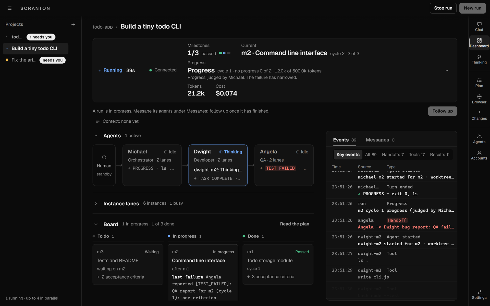
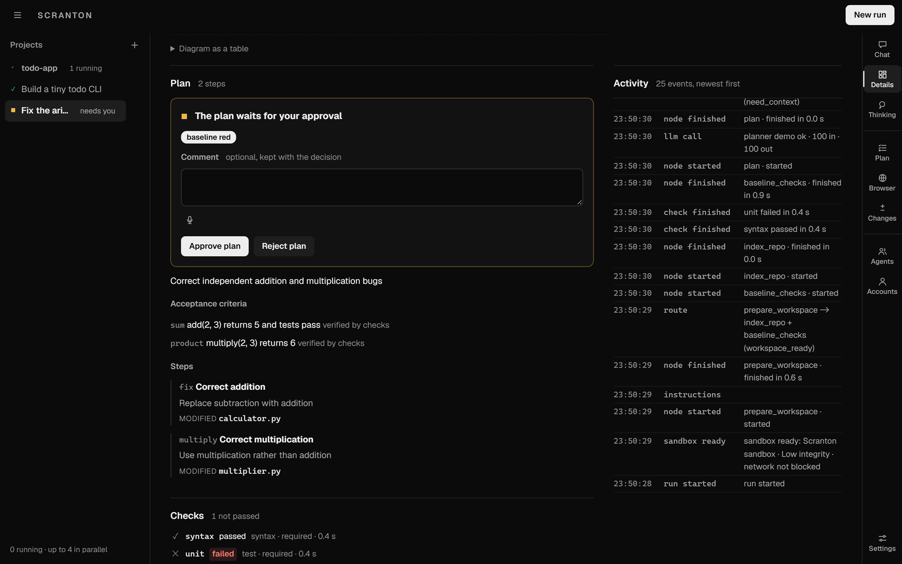
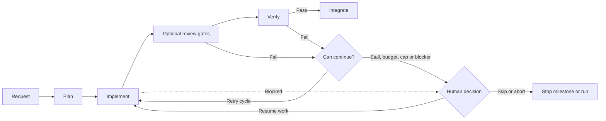

<p align="center">
  
</p>

<h1 align="center">Project Scranton</h1>

<p align="center">Plan, implement, and verify software changes with AI agents you can supervise.</p>

<p align="center">
  <a href="https://github.com/ypuma/scranton/releases/latest"></a>
  <a href="LICENSE"></a>
  <a href="#install"></a>
</p>

<p align="center">
  <a href="https://github.com/ypuma/scranton/releases/latest">Download</a> ·
  <a href="#quick-start">Quick start</a> ·
  <a href="#documentation">Documentation</a> ·
  <a href="#license">License</a>
</p>



## What is Scranton?

Scranton is an open-source harness for running AI coding agents against a local project. In Team mode, agents work in private Git worktrees by default, and only the verified developer snapshot is integrated. You can follow the run, send feedback, and answer approval requests from the dashboard. The harness runs on your machine; model requests go through the provider you configure.

### Team roles

| Role | Responsibility |
| --- | --- |
| Michael | Turns the request into a validated milestone plan. |
| Dwight | Implements a milestone and writes tests. |
| Oscar | Reviews code for correctness, maintainability, and regressions. |
| Hank | Reviews security, including trust boundaries, inputs, and secrets. |
| Angela | Verifies acceptance criteria against the exact developer snapshot. |

The Team engine defaults to Angela as its verification gate. You can add Oscar, Hank, or custom reviewers and configure which gates run in parallel.

## Highlights

| Capability | What you can do |
| --- | --- |
| Own runtime | Run agents with Scranton's own tools, model clients, and durable workflows. No Pi runtime required. |
| Three interfaces | Use the desktop app, local browser dashboard, or terminal dashboard. |
| Two execution modes | Choose dependency-aware Team milestones or a bounded, check-driven Pipeline. |
| Sandbox options | Use the default Scranton OS sandbox, opt into Docker, or explicitly trust host execution. Host mode is not OS isolation. |
| Human decisions | Intervene when Team work stalls, approve configured tool calls, and review Pipeline plans and delivery. |
| Restore points and undo | Restore affected pre-run files from bounded backups after Team worktree integration. This is not a full backup. |
| Project memory | Enable Dreaming to consolidate recorded outcomes into advisory project memory. Optional model proposals require explicit approval. |
| Context system | Give follow-up runs bounded context from project notes and prior chats without reusing execution state. |
| Offline dictation | Dictate in the Windows desktop app after downloading a local speech model. Audio stays on your machine. |
| Desktop updates | Check for and install signed updater packages on Windows x64. |
| Models and providers | Use Automatic for Team roles, pin models per agent, or add compatible custom providers. |

### Pipeline mode

Pipeline uses a separate Python/LangGraph engine. It runs bounded plan, edit, check, and review steps in a private snapshot. Independent steps can run in parallel, and revised plans require approval. Applying the final diff to your project requires a separate delivery decision. [Read the Pipeline guide](docs/guide/pipeline.md).



## How it works

A normal Team milestone follows this path. Independent milestones can run concurrently; a dependency is satisfied only after successful integration.



Gate failures can return work to Dwight. A blocked gate can also pause for a human decision; retrying that gate repeats only its stage. [See the Team workflow](docs/guide/team-roles-gates.md).

## Install

1. Open the [latest release](https://github.com/ypuma/scranton/releases/latest) and download the Windows x64 setup `.exe`.
2. Run the installer. It is not Windows code-signed, so expect a SmartScreen warning. The updater's signature is separate from Windows code signing.
3. Open Scranton, register a project folder, and connect your model provider under **Accounts**. Keep Git available for private worktrees.

Public installers are available for Windows x64 only. macOS and Linux are [build-from-source targets](docs/DESKTOP.md#macos-und-linux-lokal-vorbereiten), not verified release platforms.

## Quick start

From a Scranton checkout, use **Node.js 24**, npm, and Git. The default OS sandbox must be available before a real run: Windows requires the [native helper](native/sandbox-helper/README.md), macOS uses `sandbox-exec`, and Linux needs usable `bwrap`. See the [source setup guide](docs/guide/getting-started.md) for prerequisites, or use the installer on Windows.

```powershell
npm.cmd ci
node bin/scranton.js login chatgpt
node bin/scranton.js accounts
```

On macOS or Linux, use `npm` instead of `npm.cmd`. Choose a different [sign-in method](docs/guide/providers-and-models.md#sign-in) if you do not use ChatGPT. Team roles use Automatic unless configured. To pin a role model, for example:

```powershell
node bin/scranton.js agent set-model dwight --provider openai --model gpt-6.2-sol --hive .scranton-hive
```

Replace the workspace path with your own project. Back it up first: verified Team changes are written back as each milestone passes, and real runs use model quota or incur charges.

```powershell
node bin/scranton.js doctor --workspace "C:\Projects\MyApp" --hive .scranton-hive
node bin/scranton.js run "Add a small feature with tests" --workspace "C:\Projects\MyApp" --hive .scranton-hive --sandbox scranton
```

From a second terminal in the same checkout, open the terminal dashboard or start the read-only web dashboard at `http://127.0.0.1:1725`:

```powershell
node bin/scranton.js dashboard --hive .scranton-hive
node bin/scranton.js visualize --hive .scranton-hive
```

Want to try it without a model call? Run `node bin/scranton.js demo --hive .scranton-hive` instead. It uses scripted responses and is not a sandbox test.

## Documentation

| Guide | Covers |
| --- | --- |
| [Getting started](docs/guide/getting-started.md) | Source prerequisites, first run, demos, and troubleshooting |
| [Providers and models](docs/guide/providers-and-models.md) | Sign-in, Automatic, custom providers, and credential storage |
| [Projects, chats, and context](docs/guide/projects-chats-context.md) | Registry, follow-ups, context budgets, and repository instructions |
| [Team roles and gates](docs/guide/team-roles-gates.md) | Integration, custom roles, prompts, and human decisions |
| [Pipeline](docs/guide/pipeline.md) | Plans, check evidence, and delivery |
| [Sandboxes and approvals](docs/guide/sandbox-and-approvals.md) | Execution modes, external file access, and tool approvals |
| [Dreaming](docs/guide/memory-dreaming.md) | Local project memory and optional reviewed reflection |
| [Restore points and undo](docs/guide/restore-points.md) | Retention, conflicts, recovery, and what undo does not cover |
| [Voice dictation](docs/guide/voice.md) | Offline models, microphone setup, and privacy |
| [Desktop and updates](docs/guide/desktop-and-updates.md) | Dashboards, phone relay, and Windows updates |
| [CLI reference](docs/guide/cli-reference.md) | Run options, request files, durable streams, and recovery |
| [Configuration](docs/guide/configuration.md) | Settings, precedence, and migration limits |
| [Development](docs/guide/development.md) | Repository layout, local checks, and release verification |

| Technical reference | Covers |
| --- | --- |
| [Control API](docs/CONTROL.md) | HTTP, projects, chats, human decisions, and recovery |
| [Desktop](docs/DESKTOP.md) | Tauri, packaging, and native build targets |
| [Dreaming internals](docs/DREAMING.md) | Consolidation, provenance, replay, and reflection |
| [Dreaming research notes](docs/CLAUDE_CODE_DREAMING_RESEARCH.md) | Sources and scope of the Claude-inspired design |
| [Events](docs/EVENTS.md) | Event journal, Hive state, and dashboard contract |
| [Isolation](docs/ISOLATION.md) | Worktrees, OS enforcement, and backend limits |
| [Pipeline internals](docs/PIPELINE.md) | Engine integration, gates, API, and artifact formats |
| [Phone relay](docs/RELAY.md) | Private HTTPS setup and pairing |

## Status and limits

- **Windows x64** is the tested release platform. Native macOS and Linux targets need separate lifecycle and isolation verification.
- **Pipeline's native Scranton sandbox** is Windows-only. Windows Low mode does not block network access; read the [isolation limits](docs/ISOLATION.md) before selecting an executor.
- **Windows installers are not code-signed.** The updater separately verifies a package signature.

## Development

Run the local checks sequentially from the repository root:

```powershell
npm.cmd run app:prepare
node --test "test/**/*.test.js"
npm.cmd run test:packaging
```

The packaging check requires freshly staged resources. It does not replace an installer lifecycle test, native sandbox verification, or a real-provider smoke test. See the [development guide](docs/guide/development.md) for the test layout and the [Desktop reference](docs/DESKTOP.md) for build requirements.

## License

Scranton is released under the [MIT License](LICENSE).

## Third-party notices

See [Third-party notices](THIRD_PARTY_NOTICES.md) for bundled components, dependencies, and their licenses.
