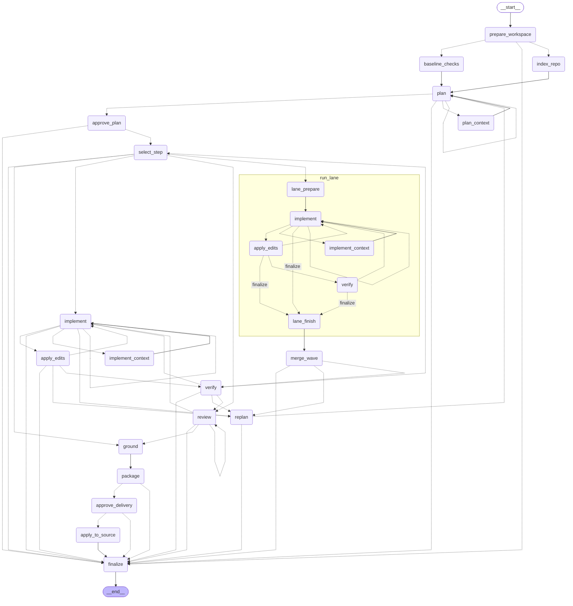

# Scranton Pipeline – Architektur des implementierten MVP

Stand: 10. November 2026, Engine 0.1.0. Maßgeblich ist `src/scranton_pipeline/`, nicht ein autonomes Agentenframework. Bedienung und reproduzierbarer Demo-Lauf: [README](../README.md). Desktop/HTTP: [PIPELINE](../../docs/PIPELINE.md).

## Teil A – Architekturentscheidung

### Verglichene Varianten

Die folgende Bewertung ist eine Entwurfsabwägung, kein gemessener Modellbenchmark. „Sicherheit“ meint die durchsetzbare Kontrollfläche, nicht die Fehlerfreiheit generierten Codes.

| Variante | Zuverlässigkeit | Sicherheit | Aufwand | Wartbarkeit | Erweiterbarkeit |
|---|---|---|---|---|---|
| Lineare Pipeline ohne Rücksprung | Einfach nachzuvollziehen; erster Fehler beendet die Arbeit | Kleine Kontrollfläche | Gering | Hoch | Reparatur erfordert zusätzliche Zustände |
| LLM-Supervisor mit Spezialisten | Routing hängt von Modellurteilen ab | Versteckte Delegation und variable Rechte | Hoch | Schwer deterministisch zu testen | Flexibel, aber jede neue Rolle vergrößert die autonome Fläche |
| Ein Agent mit offenem Tool-Loop | Abhängig von Modell und Kontext | Modell wählt Werkzeuge/Befehle | Anfangs gering | Fehlerpfade schwer einzugrenzen | Leicht neue Tools hinzuzufügen, schwer ihre Kombination zu sichern |
| Deterministische Zustandsmaschine mit begrenzten Modellschritten | Explizite Kanten, Zähler, Schemas und Wiederaufnahme | Python entscheidet über Lesen, Schreiben und Ausführung | Mittel | Reine Router und austauschbare Adapter | Neue Checks/Provider ohne neue Graphkanten möglich |
| Dasselbe mit parallelen Implementierungen in privaten Kopien | Zusätzliche Konflikt- und Mergefehler | Mehr schreibende Instanzen | Hoch | Ownership und Recovery komplexer | Für unabhängige Schritte inzwischen als begrenzte Lanes umgesetzt |

Gewählt ist die vierte Variante, erweitert um begrenzte parallele Lanes: synchroner `StateGraph(PipelineState)` mit **20 Hauptgraphknoten**. Darunter sind drei Modellknoten (`plan`, `implement`, `review`), zwei menschliche Gates, 14 Python-Knoten und der kompilierte Untergraph `run_lane`. Dieser hat **sechs Knoten**: `lane_prepare`, `implement`, `implement_context`, `apply_edits`, `verify`, `lane_finish` (ein Modellknoten, fünf Python-Knoten; START/END nicht mitgezählt). Die 20 Hauptgraphknoten heißen `prepare_workspace`, `index_repo`, `baseline_checks`, `plan`, `plan_context`, `approve_plan`, `select_step`, `implement`, `implement_context`, `apply_edits`, `verify`, `review`, `ground`, `package`, `approve_delivery`, `apply_to_source`, `finalize`, `replan`, `run_lane`, `merge_wave`. Der Graph ist keine Übersetzung des bestehenden pi-Team-Workflows. Ein Modell liefert Daten, niemals den Namen des nächsten Knotens oder einen auszuführenden Befehl.

**Deterministische Orchestrierung ist nicht deterministische Modellausgabe.** Bei gleichem Zustand sind die Router und Prüfregeln fest; Pläne, Edits und Reviews können dennoch variieren. Auch Temperatur 0 beweist keine reproduzierbare Antwort. Schema- und semantische Prüfung begrenzen die Folgen, garantieren aber keine fachliche Richtigkeit.

### Rollen und Datenfluss

| Modellrolle | Sichtbarer Kontext (`agents/prompts.py`) | Rückgabe | Nicht erlaubt |
|---|---|---|---|
| Planner | Aufgabe, Repositoryindex, Baseline einschließlich Fehlertails, gesammelte Leseevidenz, Validierungsfeedback, verbleibende Kontextzüge | `PlannerTurn`: `need_context` oder `plan`; Plan mit Annahmen, Risiken, Kriterien und Dateivorhaben je Schritt | Shell, Tools, Routing oder eigenständiges Schreiben |
| Implementer | Aufgabe, Planzusammenfassung, Kriterien, aktueller Schritt und aktuelle Dateiinhalte; in Revision stattdessen Review; Feedback und Leseevidenz | `ImplementerTurn`: `edits`, `need_context` oder `blocked` | Direkte Dateizugriffe oder freie Ausführung |
| Reviewer | Aufgabe, Planzusammenfassung, Kriterien, kumulativer Diff, Dateiliste, Abweichungen, letzte Checks, eigenes Validierungsfeedback | `Review`: `approve` oder `request_changes`, Bewertung jedes `verified_by:review`-Kriteriums genau einmal und Findings mit `citations`; Checkkriterien entscheidet Python | Implementer-Begründungen als Evidenz, Schreibrechte, freie Kontext-Toolschleife |

Es sind Rollen, keine drei dauerhaft laufenden Prozesse. Dieselbe Modell-ID kann alle Rollen bedienen. `ModelGateway` kapselt genau einen Aufruf; LangGraph besitzt Transport-Retries, die Knoten besitzen Output-Reparaturen. Nur Planung, Editvorschläge und fachliches Review brauchen ein Modell. Index, Kontextlesen, Risikoflags, Dateivalidierung, Checks, Commitverwaltung, Freigaben, Routing und Bericht brauchen keines.

Der Ablauf: Quellbytes → privater Snapshot mit Manifest und Basiskommit → Index/Baseline → validierter Plan → Planfreigabe → Schritte mit Edits/Checks, bei unabhängigen Dateivorhaben in parallelen Lanes, bei begrenzten Fehlschlägen Neuplanung mit erneuter Freigabe → optionales Review und Revisionen → `ground` (Kriterienentscheidung/Probe/Score) → Diff/Entwurfsbericht → gegebenenfalls Lieferfreigabe → vorbedingungsgeprüfte Quellübernahme → Abschlussbericht.

### Normale Python-Komponenten

`cli` übersetzt Argumente und reserviert stdout für Ergebnis-JSON (Ausnahme `graph` und Hilfe). `runner` besitzt Lebenszyklus, OS-Lock, Konfigurationskopie, Checkpointer und Interrupt-Wiederaufnahme. `graph.instrument` prüft Stop/Budgets, erfasst Dauer und projiziert `EngineError` in den Zustand. `routing` liest nur Zustand. `limits` berechnet die Rekursionsreserve. `nodes.common.Dependencies` reicht Konfiguration, Adapter und Laufpfade explizit durch; sie liegen nicht im checkpointbaren Zustand.

Die Werkzeugschicht trennt Pfad-/Byteoperationen (`fs`), Inventar/Snapshot (`git`, `snapshot`), Index/Lesen (`repo_index`, `context`), Edit-/Liefertransaktionen (`patches`), Prozessbesitz/Umgebung (`process`) und Ausführungsgrenze (`sandbox`, `checks`). `observability` und `_locking` schreiben dauerhafte Journale; `report` erzeugt Status und Berichte ohne LLM. Die Modulübersicht unten nennt alle Dateien.

### Parallelität und ihre Grenze

`index_repo` und `baseline_checks` werden nach `prepare_workspace` parallel gestartet; `add_edge(["index_repo", "baseline_checks"], "plan")` wartet auf beide. Sie liefern getrennte fachliche Schlüssel (`repo`, `baseline`); gemeinsame Metadaten besitzen Reducer. Baseline vor Planung macht vorhandene Fehler zur Planungsevidenz. Checks selbst laufen sequenziell; nach dem ersten fehlgeschlagenen Pflichtcheck wird bei der normalen Verifikation abgebrochen, die Baseline versucht dagegen alle Checks.

Der Fan-out bleibt bestehen; der Index ist beratend. Nach Baseline **und jeder Verifikation** restauriert `checked()` von Checks veränderte getrackte Dateien auf HEAD und emittiert `warning/check_modified_tracked`; der Bericht nennt die Wiederherstellung als Grenze. Das ist keine schreibgeschützte Mountgrenze: Ein Check kann während der Indexierung deren Sicht beeinflussen; ungetrackte/ignorierte Ausgaben werden nicht allgemein zurückgesetzt. `apply_edits` prüft Edits gegen die tatsächlichen Dateiinhalte. Innerhalb eines Workspace laufen Checks und Edits weiterhin nicht gleichzeitig; parallele Implementierungen besitzen eigene Workspacekopien. Vollständige Race-Freiheit wird nicht behauptet.

### Neuplanung des verbleibenden Plans

Python fordert Neuplanung an, wenn ein Schritt nach der unten beschriebenen Abwesenheitsprüfung bei `blocked` bleibt, Editversuche erschöpft sind, Pflichtchecks nach dem letzten Versuch scheitern, eine Lane entsprechend fehlschlägt oder die Integrationsreparatur erschöpft ist. `limits.max_replans` erlaubt standardmäßig eine Neuplanung (0 = aus, höchstens 3). `security`, `limit`, `infrastructure`, erschöpfte Output-/Reviewreparaturen, Cancel und Reject bleiben terminal; Fehler im Reviewmodus `revision` lösen keine Neuplanung aus.

`replan_request` führt über `replan` zurück zu `plan`: Reset auf den letzten **integrationsgeprüften** `green_commit`, gescheiterte Edits verwerfen, grüne Arbeit behalten. Der Planner erhält Grund, vorherigen Plan, abgeschlossene IDs, Diffübersicht und Checkevidenz; sein neuer Plan beschreibt nur Restarbeit. Python vergibt revisionsübergreifend eindeutige Schritt-IDs und schreibt `depends_on` entsprechend um. `artifacts/plan.json` ist der aktuelle Plan, `artifacts/plan-r<rev>.json` bewahrt jede angenommene Fassung, auch Revision 0. Plan-Kontext-/Outputbudgets sind je Revision getrennt (`plan_context:r<rev>`, `plan_repairs:r<rev>`), globale Laufbudgets bleiben unverändert.

Jeder revidierte Plan trägt **immer** das Risikoflag `replan` und benötigt auch bei `auto_low_risk` menschliche Freigabe. Das Plan-Gate nennt `revision` und `replan_reason`; Ablehnung endet als `rejected` mit dem letzten grünen Stand als partiellem Diff.

### Waves, Lanes und Integration

`PlanStep.depends_on` fehlt bzw. ist `null`: alle früheren Schritte sind Voraussetzungen; `[]`: unabhängig; eine Liste nennt explizite Voraussetzungen. Python prüft eindeutige/bekannte IDs und Zyklen. `waves.wave` berechnet rein aus Plan und erledigten IDs in Planreihenfolge eine greedy Wave: nur bereite Schritte, paarweise disjunkte deklarierte Dateimengen (normalisierte Slashes, case-insensitiv), höchstens `execution.max_parallel_steps` (Default 1, Bereich 1..4). Eine Wave mit nur einem Schritt bleibt im sequenziellen Pfad ohne Kopie.

Mehrere Schritte werden per `Send` aus einer konditionalen Kante mit fester `path_map` an den **einmal kompilierten** Untergraphen `run_lane` verteilt. Jede Lane erhält eine vollständige private Workspacekopie einschließlich ungetrackter/ignorierter Abhängigkeiten, ein eigenes externes Gitverzeichnis unter `lanes/<wave>-<slot>/git` und eine eigene Sandbox. Kurze Lane-Workspacepfade liegen neben dem Hauptworkspace. Bei Links/Junctions oder Überschreiten von `execution.max_lane_workspace_bytes` (Default 536870912 Bytes) fällt die Auswahl mit Warnung auf sequenzielle Ausführung zurück.

Lanes verwenden denselben begrenzten Implementierungsloop, aber `strict`-Dateiscope und nur `step`-Checks. Private Felder wie `workspace`, `failure`, `feedback` und `step_index` fließen nicht zum Hauptgraphen zurück: `LaneOutput` erlaubt nur `lanes`, `counters`, `history`; die Lanezeit steht im jeweiligen Ergebnis. Gateway, Usage-Ledger und Stop-Signal sind geteilt; Aufrufprüfung und Reservierung erfolgen atomar. Scope-Map-Skripte wählen Antworten nach Rolle und Scope, nicht nach zufälliger Threadreihenfolge. Lane-Events enthalten `data.lane`.

`merge_wave` ist der einzige Schreiber bei der Zusammenführung in den Hauptworkspace: bestandene Lane-Commits werden in **Planreihenfolge** dateiweise übernommen und committet. Ein defensiv erkannter gleicher Änderungspfad verwirft die spätere Laneübernahme; ihr Schritt wird später sequenziell wiederholt. Sicherheitsfehler bleiben terminal, Cancel wird weitergegeben; fachlich gescheiterte Lanes können Neuplanung auslösen. Anschließend prüft `verify` den integrierten Stand (`mode:integration`, Scope `int:<wave>`), einschließlich `final`-Checks, wenn keine Schritte offen sind. Erst eine erfolgreiche Integrationsprüfung verschiebt `green_commit`; bloß bestandene Lanechecks reichen nicht. Fehlchecks führen in eine durch `max_step_attempts` begrenzte Reparatur im Hauptworkspace, ausschließlich auf der Dateimengenunion der tatsächlich übernommenen Schritte; danach Neuplanung oder Fehler.

Die Untergraphen erben den Checkpointer. Nach Crash/Resume läuft der unvollständige innere Knoten weiter; bereits abgeschlossene Lanes werden nicht erneut ausgeführt. Eine unvollständige Lanevorbereitung wird neu aufgebaut, der Merge setzt auf den gespeicherten Ausgangscommit zurück bzw. liest seinen dauerhaften Receipt `artifacts/wave-<n>.json`. Das ist keine Exactly-once-Zusage für Events oder externe Modellaufrufe.

## Evidence grounding: Verfügbarkeit statt plausibler Behauptungen

Grundidee aus **GroundEval: A Deterministic Replacement for LLM-as-Judge in Stateful Agent Evaluation** (arXiv **2606.22737**): Ein Output kann plausibel oder sogar richtig sein und trotzdem auf etwas beruhen, das dem Modell nie gezeigt wurde, im Workspace nicht mehr stimmt oder als abwesend behauptet, aber nie gesucht wurde. Ein urteilendes Modell kann diese Zustandsverletzung aus dem Antworttext allein nicht erkennen; der aufgezeichnete Trace kann es. Deshalb entscheidet Python prüfbare Regeln selbst, verlangt für verbleibende Urteile Evidenzverweise und bewertet den Lauf ohne zusätzlichen Judge-Aufruf. Dies ist eine projektspezifische Übertragung, keine Reproduktion der Paper-Benchmarks.

### IDs, Sichtbarkeit und Frische

`E-<10 hex>` bezeichnet einen Kontextabruf (`read`, `search`, `list`), `K-<10 hex>` ein Checkergebnis, `H-<10 hex>` einen Diffhunk; das Schema für `citations` ist `^[EKH]-[0-9a-f]{10}$`. Die IDs sind inhaltsadressiert: E bindet Request, Hash, Inhalt, Erfolg und Kürzung; K bindet Check-ID, Stage, Commit, Status, Exitcode und Hash des Outputtails; H bindet Pfad und Hunktext. Keine Uhr und kein Aufrufzähler fließen ein. `evidence.jsonl` registriert eine ID einmal unter Lock mit `id`, `kind`, `path`, `start_line`, `end_line`, `query`, `check_id`, `stage`, `commit`, `sha256`, `bytes`, `truncated`, `ok`, nicht mit dem Inhalt.

„Shown“ heißt nicht angefordert oder früher einmal gelesen: Das vollständige serialisierte Evidenzitem muss **nach** FIFO-/Bytekürzung noch im tatsächlich gebauten Prompt stehen. Erfolgreiche gespeicherte `read`-Items bleiben bei gleichem Dateihash erhalten; bei geändertem Hash werden sie einzeln mit eigenem Itembudget am aktuellen Workspace erneut gelesen. Such-/Listrequests und nicht erfolgreiche Reads werden erneut erfüllt. Alte Dateiinhalte werden nicht als aktueller Stand weitergereicht. Guidance zählt niemals als Evidenz; citationförmige Tokens darin werden zu `[not evidence]`.

### Regeln ohne Modellurteil und Regeln mit `citations`

- Vor einem Planziel `modify`/`delete` muss ein erfolgreicher `read` dieses Pfads im Plannerprompt stehen; ein Zeilenbereich genügt. Der Repositorybaum genügt nicht (`unseen_target`).
- I1: Vollständiges Überschreiben (`modify` mit `content`) verlangt immer die vollständige, aktuelle, ungekürzt gezeigte Datei; andernfalls entsteht `unseen_edit` mit dem Hinweis, `replacements` zu verwenden. Für `modify` mit `replacements` und `delete` genügt ein aktueller, wenigstens teilweise gezeigter Read. Nur diese beiden Fälle sind von der Ausnahme für nicht vollständig lieferbare Python-Reads gedeckt; ein ganz fehlender Read genügt auch hier nicht. Neuanlagen benötigen keinen vorherigen Read. Python stellt Reparaturreads und bei Reviewrevisionen die Dateien der Planschritte mit eigenem Itembudget bereit; `unverifiable_target` protokolliert nicht vollständig verfügbare Python-Reads, hebt die Vollreadpflicht beim Überschreiben aber nicht auf. Beim Kürzen werden modellangeforderte Reads vor Python-eigenen Reads entfernt; deren Herkunft bleibt auch bei Deduplizierung erhalten.
- `Criterion.checks` nennt konfigurierte Check-IDs; `[]` bedeutet alle Pflichtchecks. Bei `verified_by:"checks"` entscheidet Python ausschließlich aus Ergebnissen auf `head_commit`: alle zugeordneten Checks müssen `passed` sein. Der Reviewer bewertet nur `verified_by:"review"`; zusätzliche Check-Assessments haben keine Wirkung. Der Reviewer sieht die Python-Entscheidungen als Fakten mit ID, State, Check-IDs und K-IDs. Ein `approve`, das eigenen `not_met`-Assessments oder eigenen `blocking`-Findings widerspricht, ist ungültiger Output und geht in die begrenzte Outputreparatur. Nur ein ansonsten konsistentes `approve` bei einem durch Python als nicht erfüllt entschiedenen Checkkriterium wird zu `request_changes` mit Python-Finding (Kriterium, fehlgeschlagener Check und Outputtail), nicht zu ungültigem Output. Es folgt der normale, durch `max_review_rounds` begrenzte Revisionspfad.
- Ein bestandenes Checkkriterium wird `demonstrated`, `by:"baseline"`, wenn mindestens einer seiner Checks an der Baseline `failed`, `timed_out` oder `error` war. Sonst ist es `met_not_demonstrated`, `by:"none"`: grün allein demonstriert keine Wirkung der Änderung.
- Bei `grounding.counterfactual:"auto"`, einem solchen Kriterium sowie geänderten Test- **und** Nichttestdateien läuft höchstens eine Probe je Groundingentscheidung: private Workspace-/Gitkopie, zunächst Kontrolllauf der zugeordneten Checks mit `kind:"test"` mit der Änderung. Nur wenn alle bestehen, geänderte Nichttestdateien auf `base_commit` restaurieren bzw. neue entfernen, geänderte Tests behalten und dieselben Checks erneut starten. Scheitert die Kontrolle, ist die Probe `inconclusive`. Ein fehlschlagender zugeordneter Test promoviert das Kriterium zu `demonstrated`, `by:"probe"`; weiterhin grüne Tests nicht. `test_globs` bestimmt Testdateien. Kein passender Testcheck/Dateimix ergibt `not_needed`, Abschaltung `off`, Timeout/Fehler/nicht kopierbarer Workspace `inconclusive`. Die Probe selbst macht daraus keinen Laufdefekt; aktive Zeit und Cancel gelten weiter.

Jede angegebene Citation muss im **genau diesen Output erzeugenden Prompt** gezeigt worden sein (`unknown_citation`). Für ein Review-Assessment `met` ist mindestens eine gezeigte H-/K-ID nötig (`unsupported_assessment`); mit gültiger Citation wird es `attested`, nicht automatisch testbewiesen. `major`-/`blocking`-Findings brauchen ebenfalls H-/K-Citations. Jeder Findingpfad muss zu einer geänderten Datei gehören (`unsupported_finding`); er wird dadurch nicht zu einem Dateizugriff. Weitere Kriterienstates sind `not_met`, `unclear`, `undecided`; `by` ist `baseline|probe|review|none`.

### Verifizierte Abwesenheit und begrenzte Durchsetzung

`Plan.absent` und `ImplementerTurn.blocked_claim` verwenden `AbsenceClaim {kind,subject,paths}` mit `kind:"missing_file"|"missing_symbol"` und optional einschränkenden `paths`-Globs. Bei `missing_file` vergleicht Python ausschließlich Namen (Pfad oder Basename, case-insensitiv), ohne Dateiinhalte zu lesen; auch ein vorhandenes Verzeichnis widerlegt die Behauptung. Bei `missing_symbol` durchsucht Python policy-lesbare Textdateien literal und mit Ganzwortgrenze, case-sensitiv. Treffer widerlegen die Behauptung (`false_absence`) und liefern begrenzte `path:line`-Hinweise. Globs und `missing_file`-Subjects werden normalisiert (Slashes, führendes `./`, case-insensitiver Vergleich); ungültige Pfade gehen als ungültiger Output in die normale begrenzte Reparatur, nicht in einen unmittelbaren Sicherheitsabbruch. Geschützte Pfade gehören nicht zum Suchraum; Nichttextdateien sind nur von der Inhaltssuche nach Symbolen ausgeschlossen, nicht vom Namensvergleich. Vollständige Suche mit nichtleerer Abdeckung ohne Treffer ergibt `verified` und `absence_verified`, ausdrücklich „not found in the files models may read“; unvollständige oder leere Suche (etwa ein Glob ohne Treffer) ergibt `unverifiable`, nicht bewiesene Abwesenheit.

Ein erstmals widerlegtes `blocked` im Schritt-/Lanescope wird unter `enforce` zur Outputreparatur, **nicht sofort** zur Neuplanung. Ein erneutes `blocked` folgt dem bestehenden Neuplanungs-/Fehlerpfad; der Brief führt `absence_refuted`-Treffer, verifizierte Claims als `verified_absence`. Ohne Claim bleibt `blocked` `unverifiable` ohne eigenen Verstoß und folgt dem bisherigen Pfad. Das ist kein allgemeiner Nachweis, dass ein Blocker berechtigt ist.

`grounding.mode:"enforce"` (Default) führt Verstöße in die bestehenden rollen-/scopegebundenen Output-Reparaturzähler und `limits.max_output_repairs`; kein neuer Reparaturloop. `observe` zeichnet auf und bewertet, lehnt wegen Grounding aber nichts ab. Kontextrequests normalisieren Backslashes, führendes `./`, abschließendes `/` und `.` vor Prüfung und Abruf; Evidenzregister und P1/I1 sehen denselben relativen Pfad. Ein leerer Pfad durchsucht/listet das Projekt; ein leerer `read` ergibt nur ein nicht erfolgreiches Item. Geschützte, außerhalb liegende oder ungültige Kontextpfade ergeben `protected_request` mit redigiertem Request (Art und Originalpfad, Detail höchstens 200 Zeichen) und Korrekturhinweis. Unter `observe` werden sie als nicht erfolgreiche Items beantwortet; andere Requests desselben Zugs bleiben ausführbar. Unter `enforce` wird der Zug auch bei ausgeschöpfter Outputreparatur abgewiesen; der Lauf endet dann regulär mit `llm_output / output_invalid`, nicht als Sicherheitsfehler oder `suspended`. Schema-, Schreibpfad-, Scope-, Check- und Kontextbudgetregeln bleiben aktiv, ebenso die Python-Kriterienentscheidungen. Geschlossene Verstoßliste: `unknown_citation`, `unsupported_assessment`, `unsupported_finding`, `unseen_target`, `unseen_edit`, `false_absence`, `protected_request`, `out_of_scope_edit`.

`grounding.jsonl` beginnt einmal bei Runanlage mit `settings {mode,weights}` (nicht erneut beim Resume). Pro ausgewertetem schema-gültigem Output folgt `output` mit `seq`, `ts`, `role`, `scope`, `node`, `lane`, `mode`, `weights`, `shown`, `cited`, `violations:[{kind,detail}]`, `absence:{verified,refuted,unverifiable}`, `targets:{total,seen}`, `unverifiable_target`, `accepted`. Schemafehler vor dieser Auswertung sind keine Groundingoutputs. Die letzte `criteria`-Zeile liefert Kriterien und Probe für die Bewertung. Auch verworfene Outputs bleiben im Trace und im Score. Tracezeilen und die Events `grounding`/`procedure` verwenden `plan:r<revision>` für den Planner, `review:<round>` für den Reviewer und `step:<id>`, `rev:<round>` bzw. `int:<wave>` für den Implementer.

### Score, `ground` und Lieferentscheidung

`grounding.py:score_trace` ist rein: gleicher Trace ergibt denselben Score, ohne Modell, Workspacezugriff oder Uhr. Mit `m` = Zahl der Kriterien in `demonstrated|met_not_demonstrated|attested` gilt:

```text
v = Outputs mit mindestens einem Verstoß / ausgewertete Outputs (ohne Outputs: 0)
answer = m / Anzahl Kriterien (ohne entschiedene Kriterien: 0)
citations = gezeigte zitierte IDs / zitierte IDs
targets = gesehene Ziele / alle Ziele (Plannerziele und Implementeredits)
absence = verified / (verified + refuted + unverifiable)
proof = Anzahl Kriterien in demonstrated|attested / m
trajectory = Mittel der Komponenten citations, targets, absence, proof
unadjusted = weights.answer * answer + weights.trajectory * trajectory
adjusted = unadjusted * (1 - v)^2
```

Komponenten mit leerem Nenner entfallen; ohne anwendbare Komponenten ist `trajectory=1`. Defaultgewichte `.5/.5`, Summe 1. Die Berechnung nutzt ungerundete Zwischenwerte, die Scorefelder werden auf vier Nachkommastellen gerundet. `violations` zählt einzelne Verstöße je Art, `v` dagegen Outputs mit irgendeinem Verstoß. Tiers: `clean` bei `v=0`, `minor` bei `0<v<=.10`, `major` bei `.10<v<=.25`, sonst `failing`. **Diese Namen/Grenzen sind Projektentscheidungen; das Paper legt keine Tiergrenzen fest.** Bei nur wenigen Modelloutputs pro Lauf verschiebt bereits ein einzelner verworfener Output das Tier (2 von 5 ergeben `failing`): Es beschreibt die Evidenzdisziplin der Modelle, nicht die fachliche Güte der gelieferten Änderung; unter `enforce` wurde jeder solche Output abgewiesen und repariert.

Nach freigegebenem Review (auch bei deaktiviertem Review über `select_step`) folgt der feste Pythonknoten `ground`, Phase `review`, dann `package`. Er entscheidet Kriterien/Probe, schreibt den identitätsgebundenen Receipt `artifacts/grounding.json` und emittiert `criteria_decided` und `probe_finished`; Trace/Receipt vermeiden wiederholte Probes nach Crash. `report.md` enthält **Grounding** mit Scores, Verstoßzahlen, Kriterien/Entscheidungsmethode und Probe; `report.json.grounding`, `status.grounding` und am Liefer-Gate `pending.grounding` verwenden die Zusammenfassung. Vor dem ersten Output existiert sie bereits mit null Outputs und `criteria:[]` (der Default für die dann leere Trajektorie ist 1).

Lieferflags: `criteria_not_demonstrated` genau bei mindestens einem `met_not_demonstrated`; `grounding_violations` nur, wenn ein **angenommener** Output Verstöße hatte. Unter `enforce` repariert verworfene Antworten senken weiterhin den Score, setzen aber nicht dieses zweite Flag; unter `observe` angenommene Verstöße tun es. Die Flags sind Warnungen zur menschlichen Entscheidung, kein zusätzlicher Judge. Der Gate-Digest bindet Diffhash, Grounding und Flags.

`score --run-dir DIR` liest `grounding.jsonl` und gibt eine JSON-Zeile zurück (Exit 0; kein Runverzeichnis/ungültiger Zugriff: 2, unerwarteter interner Fehler: 5). Die erste `settings`-Zeile liefert Modus und Gewichte; `score` benötigt daher keine Konfigurationsdatei. Für einen abgeschlossenen Lauf muss das Ergebnis `status.grounding` entsprechen; es ist keine erneute inhaltliche Prüfung.

### Scripted Evidence-Demo

`demo --scenario evidence --delivery apply` (HTTP `demo:true, demoScenario:"evidence"`) macht die Durchsetzung sichtbar: Der blinde Plan wird mit `unseen_target` verworfen und nach einem Python-Read repariert; anschließend widerlegt Python den falschen Claim „Symbol `add` fehlt“ mit `calculator.py:1` (`false_absence`, Event `absence_refuted` mit `hits`) und nimmt erst den korrigierten Edit an. `sum` wird über die rote Baseline und den grünen Unitcheck `demonstrated`, `by:"baseline"`; der vorher schon grüne Syntaxcheck lässt `syntax` als `met_not_demonstrated`. Nach der Planfreigabe steht am Liefer-Gate deshalb `criteria_not_demonstrated`, aber kein `grounding_violations`; nach Lieferfreigabe endet der Run `succeeded`. Das Szenario verlangt `enforce`; `--grounding observe` endet vor Runanlage mit Exit 2, die entsprechende HTTP-Anfrage mit 400.

Aufgezeichneter R9-Lauf vom 10.11.2026, hier nicht erneut ausgeführt: **answer 1.0, trajectory 0.3889, unadjusted 0.6944, violation rate 0.4, adjusted 0.25, tier `failing`, 5 outputs, violations `false_absence: 1`, `unseen_target: 1`**. Das erfolgreiche Ergebnis und das `failing`-Tier widersprechen sich nicht: Die beiden verworfenen Outputs bleiben im Trace, nicht in der Lieferung. [CLI-Aufruf und Gatebedienung](../README.md#evidence-demo-abgewiesen-repariert-trotzdem-erfolgreich).

## Judge-freie Eval-Suite

`evals/` prüft Ergebnis **und** Weg ohne urteilendes Modell. Ein operatorgeschriebenes Pack enthält `pack.json` mit `schema:1`, `name`, `tasks` (1..100). Je Task: `id`, `track:baseline|silence|perspective|counterfactual`, `split:train|val`, relativer `fixture`-Ordner, sichtbarer `task`-Text, sichtbare `checks:[CheckConfig]`, versteckte `acceptance:{checks:[CheckConfig],paths:[glob]}`, Rollenskripte `scripts:{planner,implementer,reviewer}` und `expect:{status,violations,criteria,adjusted?,min_adjusted?}` (mindestens eine Scorevorgabe). Skripte sind Turnlisten oder Scope-Maps. IDs, Pfade, Links, Größen, doppelte Checks und leere Auswahl werden vor Ausführung validiert; `{python}` wird zum Hostinterpreter bzw. Docker-`python`.

Jede Fixture erhält ein frisches Repository; der bestehende Runner liefert einen Patch, der Harness genehmigt Plan-Gates mit `by:"eval"`. Die versteckten Acceptancechecks laufen auf einer **zweiten ursprünglichen Fixture mit angewandtem Lieferpatch**, nicht auf einem möglicherweise veränderten Arbeitsbaum. Ihre Befehle werden den Modellen nicht gezeigt. `answer=1` genau bei erfolgreichem Run, allen bestandenen Hidden Checks und ausschließlich erlaubten Änderungspfaden, sonst 0; dieser Wert ersetzt für Eval die Kriterienquote in der Scoreformel. Deshalb kann ein `succeeded`-Run den Hidden-Test verfehlen und trotzdem eine erwartungsgemäß bestandene Regression sein.

Das paketierte Pack **core** enthält folgende festgeschriebene Fälle (alle Runstatus `succeeded`, Kriterium `sum`; Messwerte aus dem R8-Lauf vom 10.11.2026):

| Task | Split | Verstoß (je 1, sonst keiner) | Kriterium / `by` | `answer` | `trajectory` | `violation_rate` | `adjusted` |
|---|---|---|---|---:|---:|---:|---:|
| `baseline` | val | – | `demonstrated` / `baseline` | 1 | 1 | 0 | 1 |
| `false_absence` | train | `false_absence` | `demonstrated` / `baseline` | 1 | 0.6667 | 0.2 | 0.5333 |
| `unseen_edit` | train | `unseen_edit` | `demonstrated` / `baseline` | 1 | 0.8333 | 0.2 | 0.5867 |
| `unknown_citation` | train | `unknown_citation` | `demonstrated` / `baseline` | 1 | 0.6667 | 0.2 | 0.5333 |
| `unsupported_assessment` | train | `unsupported_assessment` | `unclear` / `review` | 1 | 1 | 0.2 | 0.64 |
| `unseen_target` | train | `unseen_target` | `demonstrated` / `baseline` | 1 | 0.8333 | 0.25 | 0.5156 |
| `already_green` | train | – | `met_not_demonstrated` / `none` | 1 | 0.5 | 0 | 0.75 |
| `probe` | val | – | `demonstrated` / `probe` | 1 | 1 | 0 | 1 |
| `hidden_failure` | val | – | `demonstrated` / `baseline` | 0 | 1 | 0 | 0.5 |

`mean_adjusted=0.6732`, Validierungsmean `.8333`. Verstöße werden repariert, nicht aus der Wertung gelöscht. `unsupported_assessment` repariert zu ehrlichem `unclear`; `hidden_failure` besteht sichtbare Positivtests, verfehlt aber einen versteckten Negativtest. Der scored Teil ist bei identischen scripted Rollouts byteidentisch, unabhängig von Run-IDs/Pfaden/Zeiten. Eine stdout-JSON-Zeile enthält `schema`, `pack`, `graph_digest`, `tasks` (inklusive `expect_met`) und `mean_adjusted`; `<out>/eval.json` ergänzt getrennt `meta` mit Zeiten, Laufpfaden und Acceptance-Diagnosen.

Exit 0 heißt alle ausgewählten Erwartungen erfüllt, 4 Erwartungsabweichung, 2 ungültiges Pack/Optionen/Konfiguration, 5 unerwarteter CLI-Fehler. `--models scripted` ist Default; `--models config` benötigt `--config` und für jede beteiligte nicht-scripted Rolle ausdrücklich `--real-calls`. Eigene Hostpacks verlangen außerdem `--trust-host`; `core` ist wie die Demo ausdrücklich vertraut. Diese Opt-ins sind keine automatischen Tests und keine implizite Erlaubnis zu Provideraufrufen.

## Prozeduraler Guidancegraph und Offline-Evolution

**Procedural Graphs: Self-Evolving Execution Structures for LLM Agents** (arXiv **2609.09153**) liefert die Idee attributierter Beziehungen, exakter Lokalisierung, lokaler Nachbarschaft und einer Offline-Verfeinerung mit Validierung und Ablehnungsgedächtnis. Hier ist die Ausprägung absichtlich enger: Der **ausführende LangGraph verändert sich nie**. Kein ACTION-Knoten verleiht neue Werkzeuge, Rechte, Routing oder Budgets. Guidance ist deterministisch gerenderter, beratender Prompttext unter `guidance`, ohne zusätzliches Guidance-Modell pro Schritt. Ein fehlender Situationsknoten ergibt keinen Text, **keinen Full-Graph-Fallback** wie im Paper. Das hält Kosten und Promptfläche begrenzt und die Kontrollentscheidung außerhalb des Modells.

`procedure.enabled` ist standardmäßig false. Der mitgelieferte Graph heißt `Scranton expert prior (unvalidated)` und ist ein unvalidierter handgeschriebener Prior (16 Knoten, 14 Kanten), kein gemessener Qualitätsgewinn. Das Paper berichtet selbst einen schädlichen Expert-Prior (MultiChallenge 87,5 → 58,9); deshalb ist eine standardmäßige Aktivierung nicht gerechtfertigt.

### Format, Validierung und Lokalisierung

```json
{"schema":1,"name":"example","nodes":[{"id":"plan.start","type":"SITUATION","description":"Plan work."},{"id":"done","type":"TERMINAL","description":"Done."}],"edges":[{"from":"plan.start","relation":"LEADS_TO","to":"done","condition":"","guidance":"Read existing targets first.","pitfalls":""}]}
```

Relationen: `LEADS_TO`, `TRIGGERS`, `PROVIDES_INPUT_FOR`, `CONVERGES_TO`. Höchstens 64 Knoten/160 Kanten; eindeutige IDs und `(from,relation,to)`-Tripel; existierende Endpunkte; jeder Knoten erreicht einen `TERMINAL`. Zyklen sind erlaubt. Alle Texte höchstens 400 Zeichen, ohne Unicode-Steuer-/Format-/Surrogatzeichen (`Cc`, `Cf`, `Cs`) und ohne `<<<`/`>>>`. `SITUATION`-IDs müssen aus der folgenden Tabelle stammen, Terminal-IDs sind nur `done`, `blocked`. Das Format erzwingt keine zusätzlichen nichtleeren Beschreibungen oder terminalen Ausgangsgrad 0.

`guidance.situation(role,state)` benutzt Rolle, letzte abgeschlossene History-Node, Feedbackart, Modus und Zähler, keine Modellprosa/Uhr. Pro Rolle gewinnt die erste passende Zeile:

| Rolle | Bedingung in Vorrangreihenfolge | Situation |
|---|---|---|
| planner | letzter Knoten `plan_context` | `plan.context` |
| planner | Feedback `output_invalid` | `plan.repair` |
| planner | `plan_context:r<aktuelle Revision>` > 0 | `plan.context` |
| planner | `plan_revision` > 0 | `plan.replan` |
| planner | sonst | `plan.start` |
| implementer | letzter Knoten `implement_context` | `implement.context` |
| implementer | Feedback `output_invalid` | `implement.repair` |
| implementer | Feedback `edits_rejected` | `implement.edits_rejected` |
| implementer | Modus `integration` | `implement.integration` |
| implementer | Feedback `checks_failed` | `implement.checks_failed` |
| implementer | Feedback `review_changes` | `implement.review_changes` |
| implementer | Modus `revision` | `implement.review_changes` |
| implementer | sonst | `implement.start` |
| reviewer | Feedback `output_invalid` | `review.repair` |
| reviewer | `review_round` > 0 | `review.recheck` |
| reviewer | sonst | `review.start` |

Der Renderer beginnt mit `Procedural guidance (advisory - the rules and the schema always win)` und aktiver ID/Beschreibung, traversiert ausgehende Kanten per BFS bis `procedure.hops` (0..2, Default 2), sortiert nach obiger Relationsreihenfolge, dann Ziel-ID, jede Kante höchstens einmal. `procedure.max_bytes` (Default 1500 UTF-8-Bytes) endet vor der ersten nicht vollständig passenden Kante; passt bereits der Header nicht, bleibt der Text leer. Der Promptbuilder begrenzt auch den serialisierten Guidanceblock auf `procedure.max_bytes`, kürzt nur ganze Zeilen/Kanten und hängt ihn **zusätzlich** zum Basispromptbudget `limits.max_prompt_bytes` an; aktivierte Guidance verdrängt keine Evidenz. Auch `agents/gateway.py:complete` berücksichtigt beim abschließenden Cap die tatsächlich gerenderten Guidancebytes dieses Prompts zusätzlich zu `max_prompt_bytes`, höchstens die aktivierte `procedure.max_bytes`-Zulage; Guidance und Abschlussdelimiter bleiben erhalten.

Bei aktiviertem Start wird `procedure.graph` (null = Paketdefault) validiert und normalisiert nach `artifacts/procedure.json` kopiert. `run.json.procedure` pinnt `enabled`, `name`, `digest` (SHA-256 kanonischen JSONs mit sortierten Nodes/Edges); Resume benutzt ausschließlich diese Kopie und prüft den Digest (`procedure_changed` bei Abweichung). Deaktiviert wird kein Graph geladen/kopiert. Jeder Rollenaufruf emittiert `procedure {role,scope,situation,matched}`, in Lanes zusätzlich `lane`; `status.procedure` enthält `enabled`, `name`, `digest`, letzte `situation`, deaktiviert false und drei null-Felder.

### Offline `evolve`

`evolve` verändert ausschließlich Ausgabedateien, **aktiviert niemals** einen Graphen und schreibt weder Paketdefault noch Operator-Konfiguration um. Ausgangspunkt ist `--graph FILE|default|skeleton`; `skeleton` besteht aus `plan.start -> done`. Zuerst wird der aktuelle Graph auf `val` bewertet, dann pro Runde:

1. Aktuellen Graphen auf `train` ausrollen; der Refiner sieht Graph, Vokabular, erfolgreiche/fehlgeschlagene Traces (Situationen, Outcome, Fehlercode, Grounding) und abgelehnte Kandidaten. Ganze Records vom Tail werden unter Bytecap behalten, nicht beliebig zerbrochenes JSON.
2. Rolle `models.refiner` schlägt ein `GraphEdit {add_nodes,delete_nodes,add_edges,delete_edges,rationale}` vor; `delete_edges` enthält `(from,relation,to)`-Tripel. Attributänderung = delete+add. `prepare_candidate` löscht vor Ergänzungen, prüft alle Regeln; fehlende Löschziele, Duplikate, hängende Kanten und `no change` werden ohne Kandidatenrollout abgewiesen.
3. Gültigen Kandidaten auf `val` prüfen; annehmen genau bei `candidate_mean_adjusted >= current_mean_adjusted`, **auch Gleichstand**. Sonst aktuellen Graphen behalten und Grund, Scores, Edit und Diagnose als auf höchstens 2048 Bytes begrenzte Ablehnungszeile an den nächsten Refiner geben; große Zeilen werden kompaktiert, statt das gesamte Ablehnungsgedächtnis zu verdrängen.

Default 3, maximal 20 Runden; `--max-seconds` positiv und endlich, Default 3600, kooperativ vor Stufen/Tasks geprüft und auf Check-/Refinerdeadlines angerechnet, keine Präemption beliebigen synchronen Pythoncodes. Je Runde ein Editvorschlag, bei ungültiger Modellantwort höchstens `max_output_repairs` zusätzliche Aufrufe, alle im Usage-Ledger; erschöpfte Reparatur verwirft die Runde. `--models scripted` benutzt `refiner.json` im Pack, `config` benötigt `models.refiner` und gegebenenfalls `--real-calls`. Ausgaben: `best.json`, angenommene `graph-r<K>.json`, `evolution.jsonl`, `rejected.jsonl`, Usage/Events und private Rolloutverzeichnisse. Beide JSONL-Dateien bewahren abgelehnte Runden vollständig mit Edit, Kandidat/Digest, Grund, Scores und Diagnose; die 2048-Byte-Kompaktierung betrifft ausschließlich die Kopie im Refinerprompt. Output muss leer sein und darf das Pack nicht überlappen. Aktivierung bleibt eine bewusste neue Run-Konfiguration mit `procedure.enabled:true` und `procedure.graph` auf den geprüften Graphen.

### Grenzen dieser drei Erweiterungen

Die beiden Fixpässe nach den Reviews (R8, R9) wurden durch Tests, Negativkontrollen und Live-Läufe verifiziert; der letzte (R9) wurde nicht nochmals unabhängig reviewed.

Grounding, Guidance und Evolution wurden hier ausschließlich mit **scripted Modellen** verifiziert; kein reales Modell hat mit diesen Funktionen gearbeitet. Der unten dokumentierte reale Bridgelauf liegt davor. Eine Citation gilt als gültig, wenn ihre ID gezeigt wurde: Das beweist Verfügbarkeit, **nicht**, dass ihr Inhalt die Behauptung trägt oder das Modell sie tatsächlich verwendete. `attested` zählt im `proof`-Anteil wie `demonstrated`, obwohl es ein Modellurteil ist. Abwesenheit gilt nur im policy-lesbaren Suchraum, nicht für geschützte/ausgelassene Quellen. Die Gegenprobe betrifft ausschließlich Kriterien mit passenden Testchecks; „fails without the change“ umfasst auch Tests, die den neu hinzugefügten Code gar nicht importieren können. Ein `demonstrated` ersetzt keinen vollständigen Korrektheitsbeweis. Der Refiner sieht Validierungsscores abgelehnter Kandidaten; über viele Runden kann dies den `val`-Split überanpassen. Ob Guidance realen Modellen hilft, ist ungemessen; bei scripted Modellen erzielt jeder gültige Kandidat Gleichstand und wird angenommen (sofern das Zeitbudget reicht). Scripted Evolution demonstriert damit den Mechanismus, keine Verbesserung. Hidden Checks hängen ihrerseits von der Qualität der operatorgeschriebenen Ground Truth ab.

## Teil B – Architekturvisualisierung

Die folgende Ausgabe wird aus `engine/docs/graph.mmd` unverändert eingebettet. Gestrichelte Kanten sind konditional; das Mermaid-Standardtheme ist Bibliotheksausgabe, keine Vorgabe für das monochrome Dashboard. Die Ausgabe nutzt `get_graph(xray=True).draw_mermaid()` und zeigt auch den Lane-Loop.



### Alle konditionalen Kanten

Vor jeder unten genannten Entscheidung gilt: gesetztes `failure` oder nichtleeres `outcome` führt nach `finalize`. Die Bedingungen stehen in `routing.py`; Budgets werden in den konsumierenden Knoten geprüft, nicht im Router. `approve_delivery` entscheidet nur dann über die Übernahme, wenn noch kein Abbruch/Fehler vorliegt.

| Ausgang | Bedingung nach dieser Vorrangregel | Ziel |
|---|---|---|
| `prepare_workspace` | sonst | Fan-out `index_repo`, `baseline_checks` |
| `plan` | `plan_requests` nicht leer | `plan_context` |
| `plan` | gültiger `plan` vorhanden | `approve_plan` |
| `plan` | sonst (reparierbarer Output) | `plan` |
| `approve_plan` | sonst (Freigabe; Ablehnung setzt `outcome`) | `select_step` |
| `select_step` | Wave mit mehreren Schritten | `Send` → `run_lane` |
| `select_step` | sonst `step_index < len(plan.steps)` | `implement` |
| `select_step` | alle Schritte erledigt, `review is None` | `review` |
| `select_step` | alle erledigt, Review bereits gesetzt, auch `disabled` | `ground` |
| `implement` | `replan_request` gesetzt | `replan` |
| `implement` | `step_requests` nicht leer | `implement_context` |
| `implement` | `pending_edits` vorhanden | `apply_edits` |
| `implement` | sonst (reparierbarer Output) | `implement` |
| `apply_edits` | `replan_request` gesetzt | `replan` |
| `apply_edits` | Feedback vorhanden | `implement` |
| `apply_edits` | sonst | `verify` |
| `verify` | `replan_request` gesetzt | `replan` |
| `verify` | Feedback vorhanden | `implement` |
| `verify` | sonst, `mode == revision` | `review` |
| `verify` | sonst | `select_step` |
| `review` | noch kein gültiges Review | `review` |
| `review` | `verdict == approve` | `ground` |
| `review` | sonst (`request_changes`, Revision vorbereitet) | `implement` |
| `replan` | sonst | `plan` |
| `merge_wave` | `replan_request` gesetzt | `replan` |
| `merge_wave` | sonst | `verify` |
| `package` | `delivery_mode == apply` | `approve_delivery` |
| `package` | sonst (`patch`) | `finalize` |
| `approve_delivery` | Entscheidung `approve` | `apply_to_source` |
| `approve_delivery` | sonst (`reject`: nur Patch behalten) | `finalize` |

Feste Kanten: START → Vorbereitung; Index/Baseline-Join → Plan; beide Kontextknoten → ihre Modellknoten; `ground` → `package`; Quellübernahme → Abschluss → END. Jede konditionale Registrierung hat eine explizite `path_map`. `run_lane` führt nach dem Join zu `merge_wave`; im Untergraphen gehen dessen `finalize`-/`replan`-Ziele nach `lane_finish`, erfolgreiche Schrittverifikation ebenfalls. Ein fachlicher Lanefehler wird erst im Hauptgraphen zur Neuplanung oder zum Abschluss.

### Schleifen, Fehlerpfade und Endzustände

| Schleife/Limit | Zähler und Standard | Ende |
|---|---|---|
| Plan-Kontext | `plan_context:r<rev>`, 3 | Weiteres `need_context` wird ungültiger Output |
| Schritt-/Revisionskontext | `context:step:<id>` bzw. `context:rev:<n>`, 2 | wie oben |
| Output-Reparatur | `plan_repairs:r<rev>`, `repairs:<scope>`, `review_repairs:<round>`, jeweils 2 | danach `llm_output/output_invalid` |
| Edit-/Checkversuche | `attempts:<scope>`, 3 | Neuplanung, falls erlaubt; sonst abgewiesene Edits: `implementation`, Pflichtchecks: `checks_failed` |
| Neuplanung | `replans`, 1 (0..3) | neuer Plan braucht menschliche Freigabe; nach Verbrauch ursprünglicher terminaler Fehler |
| Review-Revision | `review_round`, 2 Revisionen nach erstem Review | weiteres Änderungsbegehren: `implementation/review_exhausted` |
| Planumfang | höchstens 8 Schritte | ungültiger Plan wird Output-Reparatur zugeführt |
| Transport-Retry | `RetryPolicy`, 3 Versuche pro Modellknotenaufruf | danach `suspended`, explizit wiederaufnehmbar |
| Laufbudget | 40 Aufrufe, 1.500.000 Tokens, 3600 aktive Sekunden | `limit`, terminal |

Reparaturzähler werden innerhalb ihres Scopes nicht nach einer guten Antwort zurückgesetzt. Editversuche zählen angenommene **und** abgewiesene Editsets. Kontext und Reparaturen sind gesondert begrenzt. `scope_id` verwendet getrennte Namensräume `step:<id>` und `rev:<n>` (z. B. `attempts:step:R1` gegenüber `attempts:rev:1`); ein Modell-Schrittname kollidiert damit nicht mit einem Revisionszähler. Neuplanung ersetzt nur den verbleibenden Plan; Reviewrevision und Neuplanung sind getrennte Scopes.

`finalize` ist der einzige normale Endknoten. `succeeded`, `failed`, `rejected`, `cancelled` sind terminal. `awaiting_approval` und `suspended` sind nicht terminal, sondern wiederaufnehmbar. Planablehnung ergibt `rejected`; abgelehnte Lieferung ergibt dagegen `succeeded` mit `applied:false`. `blocked` kann begrenzte Neuplanung auslösen; Sicherheitsverletzungen, erschöpfte globale Budgets, nicht ausführbare Checks und Lieferkonflikte führen zum Abschluss als Fehler. Ein Cancel-Sentinel wird vor normalen Knoten und während Prozessen geprüft. `apply_to_source` und `finalize` überspringen die Stop-Prüfung bewusst: eine begonnene Übernahme muss konsistent abgeschlossen werden. Cancel ist kein Undo bereits angewandter Änderungen.

## Zustand und Ownership

`state.py:PipelineState` ist `TypedDict(total=False)`. Fehlende Schlüssel sind erlaubt; Laufzeitmodelle werden bei Zugriff wieder validiert. Gespeichert werden nur JSON-Primitiven (`dict`, `list`, Strings, Zahlen, Bool, null), keine Pfad-, Pydantic-, Modellclient- oder Verbindungsinstanzen. Das hält Checkpoints untersuchbar und vermeidet die Deserialisierung unregistrierter Python-Typen.

| Schlüssel | Hauptschreiber / Bedeutung | Reducer |
|---|---|---|
| `run_id`, `task`, `source_dir`, `delivery_mode` | Runner, einmalige Anfrage | Ersetzen |
| `workspace` | Vorbereitung: Pfad, Manifest, Basis/HEAD/Grün-Commit, Dateiinventar; Edits ändern HEAD, Verify den Grün-Commit | Ersetzen |
| `repo` | `index_repo`: Index, Baum und Checkvorschläge | Ersetzen |
| `baseline` | `baseline_checks` | Ersetzen |
| `plan_evidence`, `plan_requests` | `plan_context` sammelt Evidenz/leert Requests; `plan` fordert Kontext an | Ersetzen |
| `plan`, `plan_digest`, `risk_flags` | `plan` nach semantischer Validierung | Ersetzen |
| `plan_approval` | `approve_plan` | Ersetzen |
| `mode`, `step_index` | Vorbereitung/Schrittauswahl; `review` schaltet auf `revision`, Merge auf `integration` | Ersetzen |
| `plan_revision`, `plan_revisions`, `previous_plan`, `replan_request`, `replan_brief` | Planner/Neuplanung: Fassungen und Übergabeevidenz | Ersetzen |
| `wave`, `waves`, `serial_steps` | Auswahl/Merge: aktive Wave, Historie, defensive sequenzielle Wiederholung | Ersetzen |
| `lane` | privater Send-Kontext | Ersetzen, kein Laneoutput |
| `lanes` | Laneergebnisse, Mergezustand; leeres Update leert die Sammlung | `merge_lanes` |
| `step_evidence`, `step_requests` | Schrittauswahl, Kontextknoten, Implementer; Review leert bei Revision | Ersetzen |
| `pending_edits` | Implementer setzt, Editknoten/Schrittauswahl/Review leeren | Ersetzen |
| `feedback` | Modellvalidierung, Editablehnung, Verify, Review; nächste passende Verarbeitung leert es | Ersetzen |
| `checks` | `verify` | Ersetzen |
| `steps_done` | `verify`: Schritt-/Revisionsrecords, bei Integration erst nach erfolgreicher Prüfung | Listenaddition |
| `deviations` | `apply_edits`: deduplizierte nicht deklarierte Dateien | Ersetzen |
| `review`, `review_round` | Vorbereitung setzt deaktiviertes Review; `review` bewertet/zählt | Ersetzen |
| `delivery` | `package`, `apply_to_source`, Fehlerabschluss | Ersetzen |
| `delivery_approval` | `approve_delivery` | Ersetzen |
| `counters` | konsumierende Knoten, additive scoped Deltas | `merge_counters` |
| `active_seconds` | Instrumentierung aller regulär abgeschlossenen Knoten | Addition |
| `history` | Instrumentierung: Knotendauer | `append_bounded`, letzte 200 |
| `usage` | typisiertes Reservefeld; derzeit kein fachlicher Knotenschreiber | Ersetzen; Status liest Ledger direkt |
| `failure` | Fehlerknoten/Wrapper, Rekursions-Backstop | `keep_first`: erster nichtleerer Wert |
| `outcome` | Cancel/Planablehnung/Abschluss | `keep_first`: erster nichtleerer Wert |

Ownership ist eine sequenzielle **Knotengruppe**, nicht für jedes Feld genau eine Funktion. Index/Baseline teilen nur Reducer-Metadaten; Laneoutputs sind auf die oben genannten Reducer-Kanäle beschränkt. `history` enthält im Ist-Code Knotendauern; Routinggründe stehen separat in Events: `routing.decision()` liefert Ziel und entscheidende Tatsache gemeinsam rein aus dem Zustand; Tabellenprüfungen binden beides aneinander (z. B. `need_context`, `checks_failed`, `review_approved`, `delivery_apply`, `declined`).

## Fehlerbehandlung und Zeitgrenzen

| `FailureClass` | Beispiele | Recovery im Ist-Code |
|---|---|---|
| `infrastructure` | Setup/Git/Docker/Checkstart nicht verfügbar; Provider lehnt Anfrage ab | `EngineError` → terminal; als `TransientError` klassifizierter Transport/408/429/5xx → Modellknoten-Retry, danach Suspend |
| `llm_output` | JSON/Schema, inkonsistente Payloads, ungültiger Plan oder unvollständiges Review | sichtbare Reparaturkante; nach Budget terminal |
| `checks_failed` | Pflichtcheck fehlgeschlagen/Timeout | Implementerfeedback bis Versuchslimit, dann Neuplanung, soweit erlaubt, sonst terminal |
| `implementation` | Blocker, abgewiesene Edits, Reviewrevision erschöpft, Quellkonflikt | begrenzter Edit-/Revisionsloop, bei Schrittblockern/erschöpften Edits Neuplanung soweit erlaubt; Reviewerschöpfung/Quellkonflikt terminal, kein automatisches Rebase |
| `security` | Traversal, geschützter Pfad, Symlink-Schreibzugriff | sofort terminal, kein Modell-Retry |
| `limit` | Aufruf-/Token-/Zeit-/Datei-/Graphgrenze | terminal |
| `invalid_input` | Konfiguration, Trust, Gate-Digest, aktiver Owner | CLI-Fehler exit 2; Vorabprüfungen soweit möglich vor Runanlage |

`runner.drive` suspendiert außerdem unerwartete Exceptions: Recovery bleibt möglich, ein interner Fehler ist damit aber nicht behoben. Das `warning`-Event mit Code `suspended` und das stderr-Log enthalten Exceptiontyp, redigierte Nachricht mit laufrelativen Pfaden (externe Pfade werden maskiert), `errno`, `winerror` und den innersten Engineframe als `Modul:Funktion`. Nicht jeder Plattenfehler wird als strukturierter terminaler `infrastructure`-Fehler klassifiziert; ein gewöhnlicher `OSError` kann diese Suspend-Grenze erreichen. Nicht pauschal „jeder Fehler hat bereits einen Bericht“ behaupten: Berichte entstehen bei erfolgreicher Finalisierung, nicht bei einem weiterhin suspendierten oder beim Schreiben selbst beschädigten Lauf.

LangGraphs `add_node(timeout=...)` ist in der verwendeten API nur für **async**-Knoten zulässig. `step_timeout` unterbricht synchrones Python nicht sicher (API-Spike, zusätzlich nachprüfbar in der installierten Bibliothek). Dieser Graph bleibt synchron, um Locks, SQLite und Windows-Prozessbesitz einfach zu halten. Stattdessen:

- Direkter HTTP-/Scripted-Modellaufruf im Daemon-Thread, Wartefrist `ModelConfig.timeout_s` (Standard 180 s, maximal 600 s). Nach Ablauf erhält der Aufrufer `TransientError`. **Der darunterliegende Providerthread lässt sich damit nicht zwangsweise abbrechen**; verspätete externe Arbeit/Kosten bleiben möglich.
- Der `command`-Modellprovider läuft dagegen über einen eigenen Subprozess mit Gesamtdeadline und Prozessbaum-Cleanup vor einem Retry, nicht über den Daemon-Thread. Pro Aufruf entstehen private Request-/Responsedateien unter `tmp/provider`, die anschließend gelöscht werden. Exit 75 ist transient; andere Fehler oder ungültige Antworten sind `provider_rejected`. `SuspendRequested` passiert den Gateway unverändert: Parent-EOF während eines Commandaufrufs führt nach Cleanup zu Exit 5 / `suspended` statt terminalem Fehler; Resume wiederholt den unvollendeten Knoten.
- Subprozesse erhalten `timeout_s`; Windows startet suspendiert, ordnet vor dem Fortsetzen ein Job Object mit `KILL_ON_JOB_CLOSE` zu. POSIX benutzt eine eigene Prozessgruppe. Checks/Setup: Standard 600 s, maximal 3600 s; Gitadapter erhält `Limits.git_timeout_s` (Default 30 s); Docker-Preflight je 15 s, Cleanup/Sweep je Dockeraufruf 10 s.
- `max_active_seconds` wird an Knotengrenzen geprüft. Es ist weder eine Wallclock-Frist über menschliche Wartezeit noch eine harte Unterbrechung beliebiger Python-I/O. Lanezeiten zählen gegen dasselbe `limits.max_active_seconds`; ein gemeinsamer Wave-Zeitanker begrenzt die parallele Arbeit, beim Merge wird die längste Lanezeit übernommen statt überlappende Lanezeiten zu addieren; fehlgeschlagene Retries/Interrupts liefern nicht dieselben Zustandsupdates wie regulär abgeschlossene Knoten.
- `recursion_limit(limits)` setzt `planning = 1 + 2*max_plan_context_rounds + max_output_repairs`, `work = 1 + max_output_repairs + 2*max_step_context_rounds + 3*max_step_attempts` und `reviews = (max_review_rounds + 1)*(1 + max_output_repairs)`. Ergebnis: `17 + (max_replans + 1) * (planning + max_plan_steps * (2*work + 6) + 2) + max_review_rounds*work + reviews`, mit Defaults **688**. Die Reserve enthält pro Plangeneration vollständige Lane- und Integrationsarbeit samt Kontrollknoten; innere Lane-Supersteps zählen ebenfalls. Damit zählen Output-Reparaturen auch beim ersten Review und Kontext-/Reparaturbudgets nur einmal je Scope, nicht je Editversuch. `GraphRecursionError` finalisiert außerhalb des Graphen mit `limit/recursion_limit`.

Datei-/Promptgrenzen aus `Limits`: Datei 1 MB, Snapshot 20.000 Dateien/100 MB, geänderte Dateien 25, Kontextabruf 100 KB/Item 20 KB, 100 Suchtreffer, Prompt 200 KB. Harte Konfigurationsobergrenzen stehen in `config.py`. `WorkspaceRepo` verwendet bei Initialisierung und weiteren Repooperationen `Limits.git_timeout_s`. Checks und Setup reichen `max_log_bytes`/`max_output_tail_bytes` bis zum Prozessadapter durch. Bei `json_text` wird das Schema vor dem Bounding eingerechnet; der Gateway prüft zusätzlich System+User inklusive Schema gegen `max_prompt_bytes` zuzüglich der tatsächlich gerenderten Guidancebytes innerhalb ihrer eigenen Zulage (keine Grenze für HTTP-Hüllenbytes).

## Sicherheit und Replay

### Dateien und Ausführung

Der Snapshot kopiert reale Bytes samt SHA-256-Manifest, nicht Git-Historie/Index. Bei Git werden getrackte und nicht ignorierte ungetrackte Dateien inventarisiert, sonst ein gefilterter Walk. Symlinks/Junctions, geschützte und zu große Dateien werden ausgelassen. Quell-, Lauf- und externe Workspacepfade dürfen nicht ineinander liegen (Demo-Ausnahme nur für ihre eigene Fixture). Das Workspace-Repository ist privat; seine Gitmetadaten liegen außerhalb des Workspace unter `<run-dir>/git`, der leere engine-eigene Hookordner unter `<run-dir>/git-hooks`. `WorkspaceRepo` setzt explizit `--git-dir`/`--work-tree`, deaktiviert globale/Systemkonfiguration und committet mit `--no-verify`. Eine später im Workspace angelegte `.git`-Struktur wird für diese Repooperationen ignoriert und einmal pro Lauf als `warning/workspace_git_ignored` gemeldet (auch über Wiederaufnahme hinweg). Docker mountet nur den Workspace, nicht diese Metadaten. Reset/Clean und interne Commits betreffen nur dieses Repository. Quell-Git erhält keinen Commit, Indexeintrag oder Push.

`PathPolicy` verlangt relative POSIX-Pfade ohne Backslash, Doppelpunkt, absolute Wurzel, `..`, leere/`.`-Komponenten, NUL, Steuerzeichen, Windows-Gerätenamen oder abschließenden Punkt/Leerraum. Nach realpath muss der Pfad im Root bleiben. Schutzmuster werden unabhängig vom Host case-insensitiv gegen lexikalische **und aufgelöste** Pfade geprüft.

- Nicht kopieren/lesen/schreiben: `.pipeline/**`, `.git/**`, `.env`, `.env.*`, `**/*.pem`, `**/*.key`, `**/*.p12`, `**/*.pfx`, `**/id_rsa*`, `**/id_ed25519*`, `.ssh/**`, `.npmrc`, `.pypirc`, `**/credentials.json`, `**/auth.json` plus `protected_paths`.
- Lesbar, nicht durch Edits schreibbar: `package-lock.json`, `yarn.lock`, `pnpm-lock.yaml`, `poetry.lock`, `uv.lock`, `Cargo.lock`, `.github/**`, `.gitlab-ci.yml` plus `write_protected_paths`.
- Manifeständerungen müssen deklariert sein; andernfalls wird das Editset mit reparierbarem `edits_rejected` abgewiesen, nicht sofort als `security`. `is_dependency_manifest` prüft den aufgelösten Dateinamen case-insensitiv: `package.json`, `pyproject.toml`, `requirements*.txt`, `setup.py`, `setup.cfg`, `Pipfile`, `Cargo.toml`, `go.mod`, `pom.xml`, `build.gradle`, `build.gradle.kts`, `Gemfile`, `composer.json`, `*.csproj`. Standard-Scope erlaubt höchstens zwei nicht deklarierte Dateien und meldet diese als Abweichung; `strict` verbietet sie.

Editsets werden vor dem Schreiben vollständig geprüft: vorhandene/neue Ziele, UTF-8, eindeutiges Suchstück, No-op, Syntax von `.py`/`.json`, Scope und Größen. Ein neu eingeführtes `[REDACTED]` in einer zuvor markerfreien Datei wird als `edits_rejected` zurückgegeben, damit maskierter Kontext nicht als Quellcode zurückgeschrieben wird. Reviewer-Findingpfade sind dagegen nur Anzeigedaten: `review()` normalisiert Backslashes zu Slashes und entfernt nicht druckbare Zeichen, ohne daraus einen Dateizugriff oder einen `security`-Abbruch zu machen. `tools/fs.py:write_bytes_atomic` wiederholt `os.replace` bei Windows-`PermissionError` mit WinError 5/32/33 höchstens 40-mal nach je 50 ms (insgesamt 2 Sekunden Wartezeit, maximal 41 Ersetzungsversuche); danach wird die ursprüngliche Exception weitergereicht. Andere Fehler werden nicht verzögert. Atomare Ersetzung gilt **pro Datei**; bei I/O-Fehler wird ein Set zurückgerollt, nicht als atomare Mehrdatei-Dateisystemtransaktion veröffentlicht.

Nur Betreiberkonfiguration bzw. feste Python-Argumente erzeugen argv. `shell=False` verhindert Shellinterpretation; es verhindert nicht, dass ein ausdrücklich konfigurierter Interpreter gefährlichen Code ausführt. Unter Windows dürfen direkt oder über PATH aufgelöste `.cmd`/`.bat` über das native `cmd.exe /d /s /c` laufen, aber nur mit Argumenten gemäß `[A-Za-z0-9_./:=+,@\\-]+`; Leerraum, Quotes, leere Argumente, Steuer- und weitere Shellzeichen werden verweigert (`invalid_input/unsafe_shim_arguments` im Prozessadapter). Der Shimpfad wird gesondert auf gefährliche Zeichen geprüft. Für komplexe Argumente ein natives Executable verwenden. `run_checks` erfasst Adapterfehler als `error`; ein Pflichtfehler wird anschließend `infrastructure/check_error` mit Diagnose. Checks sind vertrauenswürdige Betreiberrezepte, führen aber modellgeschriebenen Repositorycode aus.

### Docker-Sandbox

Der Sandboxmodus ist standardmäßig `host` (keine OS-Isolation); direkte Engineaufrufe verlangen weiterhin `--trust-host`. Explizit konfiguriertes Docker bleibt ohne Hostfallback. Das Docker-Standardimage ist `scranton-pipeline-sandbox:<engine version>` (aktuell `0.1.0`), optional durch `sandbox.docker.image` ersetzt. Das Paket enthält `sandbox_image/Dockerfile`: Debian slim, CPython mit pip/venv/pytest, Node.js LTS/npm und Git, UID/GID 10001, kein ENTRYPOINT. Die Basisimages sind per Digest gepinnt; das ist keine Garantie bitidentischer künftiger apt-Repositories. `sandbox build` baut bewusst nur Tags `scranton-pipeline-sandbox:<tag>` aus diesem Kontext; Ausführung pullt/baut nie still (`--pull never`).

Jeder Befehl erhält einen ephemeren `--rm`-Container: `--read-only` Root, größenbegrenztes ausführbares tmpfs `/tmp` (`sandbox.docker.tmpfs_mb`, Default 512), `--user 10001:10001`, `--cap-drop ALL`, `--security-opt no-new-privileges`, CPU-/RAM-/PID-Limits, Swap gleich RAM und `--log-driver none`. Checks haben `--network none`; nur explizit netzfreigegebene Setuprezepte verwenden `bridge`. Der Workspace wird nach `/workspace` gemountet, zusätzlich nur der unten beschriebene externe Installationszustand; keine externen Gitmetadaten, kein Docker-Socket und keine Hostumgebung. `--entrypoint argv[0]` setzt das Betreiberexecutable; eine feste Umgebung legt HOME/Caches nach `/tmp`.

Der Installationszustand liegt einmal pro Lauf im von der Engine angelegten `<run-dir>/sandbox-state` außerhalb des Workspace; nur dieses Verzeichnis wird nach `/workspace/.pipeline` gemountet: read-write für Setup, read-only für Checks und alle Lanes, die denselben Laufzustand verwenden. Der Mountpunkt im schreibbaren Workspace bleibt geschützt, git-ausgeschlossen und aus Snapshot, Diff, Modellkontext und Modelledits ausgeschlossen. Userinstallationen nutzen `PYTHONUSERBASE=/workspace/.pipeline/python` und `NPM_CONFIG_PREFIX=/workspace/.pipeline/npm`; ihre Binpfade stehen auf PATH. Ignorierte Setupausgaben wie `node_modules` bleiben zwischen Versuchen bestehen.

Preflight unterscheidet `docker_unavailable` und `image_missing` vor dem Snapshot. Container tragen `scranton.pipeline.run=<run-id>` und `scranton.pipeline.deadline=<deadline>`; der CLI-Start von run/resume/demo und sandbox check versucht abgelaufene gelabelte Reste zu entfernen. Runstart, Resume und Finalisierung bereinigen zusätzlich eigene Runcontainer, Timeout/Stop beendet den benannten Container. Cleanup ist Best effort bei Docker-/Daemon-Ausfällen, keine allgemeine Löschgarantie.

Docker teilt den Kernel der Docker-Desktop-VM und ist keine vollständige Sicherheitszertifizierung. Netzwerkfähiges Setup kann Internet und Hostdienste über `host.docker.internal` erreichen, **einschließlich der lokalen Control-API dieser App**; ein Token für diese API ist ein offener Folgepunkt. Der schreibbare Workspace und persistente ignorierte Abhängigkeiten bleiben Angriffsflächen. Hostmodus verlangt `--trust-host` je Run/Resume und bietet **keine OS-Isolation**, keine erzwungene Netzsperre und keine Beschränkung der Benutzer-Dateirechte.


Ein Wallclock-Sprung von mehr als 30 Sekunden kann dazu führen, dass der Sweep einer anderen Engine einen noch aktiven Checkcontainer entfernt.

Checkcode kann Dockers Fehlerpräfix bzw. Exit 125 imitieren; schlimmstenfalls endet der Lauf dadurch als Infrastrukturfehler, niemals als falscher Erfolg.

### Geheimnisse und untrusted Inhalte

Konfiguration nennt Umgebungsvariablen statt Keys. Prozessumgebung ist allowlist-basiert; Credential-/Token-/Secretnamen bleiben auch bei Passthrough gesperrt. `Redactor` maskiert bekannte Werte und Credentialmuster, nicht beliebige Geheimnisse. Der Planner beschränkt seine Repositoryübersicht separat auf `min(40000, max_prompt_bytes // 4)` Bytes; volle Datei-/Symbolinventare werden nicht in diese Übersicht aufgenommen. Feedback, Restbudget und Kriterien stehen vor den Bulk-Daten; Baseline-/Checktails werden einzeln begrenzt. Der letzte Byte-Fallback schneidet dadurch zunächst Bulk-Daten statt Steuerdaten. Beliebig große Steuerdaten sind dennoch keine unbeschränkte Erhaltungsgarantie innerhalb eines endlichen Promptbudgets. Repositorytext wird JSON-kodiert in `<<<FILE ...>>>`-Blöcke gestellt; Systemregeln verwerfen darin enthaltene Anweisungen. Das ist Prompt-Injection-Abwehr in mehreren Schichten, kein Beweis, dass ein Modell die Regeln immer befolgt. Pfad- und Ausführungsrechte werden deshalb außerhalb des Modells geprüft.

Der optionale `command`-Provider ist eine **vertrauenswürdige Providerintegration**, keine Check-Sandbox: Er erhält die Engineumgebung ohne `SCRANTON_PIPELINE_KEY_*`, nicht die Check-Allowlist. Die Desktop-pi-Bridge läuft in leerem CWD mit `--no-tools`, ohne Sessions, Skills, MCP, Extensions und Kontextdateien; sie liest Pis eigenes Authprofil. Der Supervisor reicht zusätzlich nur die in `PROVIDER_ENV_NAMES` benannten Credentials der ausgewählten pi-Provider weiter; die Check-/Setup-Allowlist bleibt unverändert credentialfrei. Request-/Responsedateien enthalten Prompttext bis zum Cleanup. Ein anderer konfigurierter Completion-Befehl ist ebenso mächtig wie ein normaler Hostprozess; seine Vertrauenswürdigkeit muss der Betreiber sicherstellen.

Runverzeichnisse enthalten Aufgabe, Kontext in Checkpoints, Diffs und Prüfausgaben. Sie sind sensible lokale Daten, keine sichere öffentliche Telemetrieablage. Events enthalten Metadaten statt vollständiger Prompts; Fehler-/Dateinamen können trotzdem vertrauliche Informationen enthalten.

### Menschliche Gates und Idempotenz

Plan: SHA-256 des kanonischen Plans, Freigabe standardmäßig immer. `auto_low_risk` greift nur ohne die Python-Flags `dependency_manifest_change`, `deletes_files`, `many_files` (>10), `ci_or_build_config`, `baseline_red`, bei Neuplanung immer `replan`. „Keine Flags“ ist kein Sicherheitsnachweis. Lieferung: nur bei `apply`, nie automatisch; Digest bindet den Diffhash, die Groundingzusammenfassung und die Liefer-Risikoflags; `delivery.diff_sha256` bleibt der reine Diffhash. Resume vergleicht Gate/Digest mit Status, Checkpoint-Interrupt und Artefaktdatei, bevor es fortsetzt.

Vor Edits wird auf den im Zustand aufgezeichneten HEAD zurückgesetzt. Quellübernahme prüft alle Zielpfade vorab: Änderungen/Löschungen verlangen den ursprünglichen Manifesthash, Neuanlagen Abwesenheit; Originale werden gesichert, Fortschritt journalisiert und bei I/O-Fehler zurückgerollt. Wiederholung prüft Journal-/Backup-/Zielhashes. Dies ist kein Lock gegen einen fremden Editor, der zwischen Prüfung und Schreiben dieselben Dateien verändert; menschliche Paralleländerungen vermeiden.

Die Usage-Datei überlebt Prozesswechsel; vor jedem Aufruf wird unter Lock eine dauerhafte Reservierung geschrieben und anschließend durch das Ergebnis ersetzt. Scripted-Modelle zählen ihren Rollen-/Scopecursor darüber. Dennoch besteht kein Exactly-once-Protokoll mit einem externen Modellservice: ein Crash kann eine Reservierung ohne vollständige tatsächliche Tokenabrechnung zurücklassen; ein erneut ausgeführter Modellknoten kann eine andere Antwort liefern. Replay-Sicherheit der Dateioperationen und externe Aufruf-Idempotenz sind verschiedene Eigenschaften.

## Persistenz und Observability

`SqliteSaver(sqlite3.connect(..., check_same_thread=False))`, `thread_id = run_id` und `invoke(..., durability="sync")` sichern abgeschlossene Supersteps. Ein OS-Dateilock begrenzt Run/Resume auf einen Owner. Ein toter Owner mit `running`-Status wird bei `status` zu `suspended`; keine Wiederaufnahme ohne Benutzeraktion. Parent-stdin-EOF/`stop` fordert Suspend an; der Node-Supervisor wartet beim Schließen bis zu fünf Sekunden, dann beendet er den Prozessbaum.

| Datei | Zweck |
|---|---|
| `run.json`, `config.json` | Anfrage/Workspacepfad und validierte Konfigurationskopie; Digestkontrolle beim Resume |
| `checkpoints.sqlite` | Zustand und Interrupts |
| `events.jsonl` | sequenzierte, gelockte, pro Append geflushte/fsyncte Events |
| `usage.jsonl` | Aufruf-/Tokenledger, auch Fehler; fehlende Modellusage wird geschätzt |
| `status.json` | atomarer, abfragbarer Lebenszyklussnapshot, einschließlich `grounding` und `procedure` |
| `evidence.jsonl` | gelockte Registry der erstmals gezeigten Evidenz-IDs, Metadaten/Hashes ohne Inhalt |
| `grounding.jsonl` | gelockter append-only Trace: `settings`, `output`, `criteria`; Quelle der Scores |
| `artifacts/grounding.json` | identitätsgebundener Receipt mit Kriterien, Probe und Score für Replay |
| `artifacts/procedure.json` | bei aktivierter Guidance normalisierte Laufkopie des Graphen, Digest in `run.json` |
| `artifacts/` | aktueller Plan, `plan-r<rev>.json`, `wave-<n>.json`, Index, Quellmanifest, Reviewrunden, Check-/Setuplogs |
| `lanes/<wave>-<slot>/git` | private Lane-Gitmetadaten während einer Wave; Workspacekopien liegen neben dem Hauptworkspace |
| `delivery/` | Diff, deterministische JSON-/Markdownberichte, Applyjournal/Backups; bei Nichterfolg `partial.diff` des letzten Grün-Commits |
| `git/`, `git-hooks/` | externe private Gitmetadaten und leerer Hookordner, nicht im Check-Mount |
| `tmp/provider/call-*/` | kurzlebige Request-/Response- und Bridge-Promptdateien, Cleanup je Modellaufruf |
| `lock`, `cancel.requested` | Owner und kooperativer Abbruch |

Eventtypen: `run_started`, `run_resumed`, `node_started`, `node_finished`, `route`, `llm_call`, `context`, `edits_applied`, `edits_rejected`, `check_finished`, `gate_waiting`, `gate_decided`, `warning`, `failure`, `run_finished`, `replan_requested`, `replanned`, `wave_started`, `lane_started`, `lane_finished`, `wave_merged`, `grounding`, `absence_verified`, `absence_refuted`, `criteria_decided`, `probe_finished`, `procedure`. Status ergänzt `progress.plan_revision`, `progress.replans_left`, `progress.steps_done` und `progress.lanes` mit `step_id`, `title`, `state`, `attempt`; außerhalb einer Wave ist die Liste leer. `pending` am Plan-Gate nennt `revision` und `replan_reason`. `sandbox` enthält `mode`, `isolated`, `image`, `isolation`, `setup_network`. Die HTTP-UI pollt diese Pipeline-Dateien; sie sind **nicht** das Hive-v1-SSE-Protokoll eines Team-Chats. Status während des Fan-out ist beratend und kann zuletzt die Sicht eines Teilzweigs zeigen; der Checkpoint-Join ist maßgeblich. `RunStatus.checks[*].output_tail` ist für nicht bestandene Checks nach Redaktion auf die letzten 4096 Zeichen begrenzt, für bestandene Checks leer. Status-Aufgabentext wird ebenfalls erst redigiert, dann auf 500 Zeichen gekürzt; die sichtbare Schrittposition wird auf den letzten Planschritt geklemmt und zeigt dessen Versuchsscope. Beim Resume stammt die erste Phase aus `checkpoint.next`. `report.md` ist lesbares Markdown (Tabellen, Befunde, Fehlertails), kein JSON-Codeblock; `report.json` bleibt die Maschinenform. Beide entstehen aus demselben redigierten Record. Bericht umfasst Baseline/letzte Checks, Kriterien/Assessment, Schritte, Änderungen, Review, Usage, Timeline und Grenzen; Kosten nur mit konfigurierten Modellpreisen, sonst null.

## Teil C – Tatsächliche Projektstruktur

Unter `engine/`:

```text
pyproject.toml                   Paket, direkte Abhängigkeiten und Qualitätskonfiguration
requirements.lock                Runtime-Closure mit Hashes für Packaging
runtime-lock.json                Windows-Python-Archividentität für Packaging
examples/config.openai.json      Beispiel: direkter OpenAI-Adapter, Docker
examples/config.local-endpoint.json Beispiel: lokaler kompatibler HTTP-Endpunkt, Host
README.md                        Installation, CLI und reale Demoausgabe
docs/ARCHITECTURE.md              diese Entscheidung und Grenzen
docs/graph.mmd                    generierter kompilierter Graph
src/scranton_pipeline/
  __init__.py                    Paketversion
  __main__.py                    Python-Modul-Einstieg
  cli.py                         Argumente, JSON-Ausgabe, Detect/Graph/Version
  config.py                      Operator-Schemas, Defaults, Grenzen und Digest
  models.py                      LLM-/Runtime-Schemas und Payloadkonsistenz
  errors.py                      Fehlerklassen und Lifecycle-Ausnahmen
  state.py                       JSON-Zustand, Reducer und typisierte Zugriffe
  graph.py                       20 Hauptgraphknoten, 6 Lane-Knoten, Retry und Joins
  grounding.py                   Evidenz-IDs, Registry und reine Tracebewertung
  guidance.py                    Situationslokalisierung und gepinnte Guidance
  procedure/                     Graphschema, Validierung, Rendering, default.json
  evals/                         Packvalidierung, Hidden Checks, Offline-Evolution, packs/core
  waves.py                       reine Dependency-/Waveberechnung
  routing.py                     reine konditionale Entscheidungen
  limits.py                      berechnete Rekursionsreserve
  runner.py                      Owner, Checkpoints, Start/Resume/Cancel/Status
  report.py                      deterministische Berichte und Statusprojektion
  observability.py               Events, Usage, Status-I/O und JSON-Logging
  agents/command.py              Completion-Subprozessprotokoll v1 und private Promptdateien
  agents/gateway.py              begrenzter Modellaufruf und Outputvalidierung
  agents/providers.py            Modelladapter und scripted Replay
  agents/prompts.py              versionierte, begrenzte Promptbuilder
  nodes/common.py                Dependencies und Schritt-/Revisionsscope
  nodes/planner.py               Planvalidierung, Risikoflags und Outputreparatur
  nodes/workflow.py              Arbeits-/Gateknoten und Neuplanung
  nodes/parallel.py              Lane-Kopien, Ergebnisübergabe und Merge
  nodes/grounding.py             Outputregeln, Abwesenheitsprüfung, Kriterien und Probe
  demo/fixture.py                buggy Rechner und festgeschriebene Antworten
  tools/__init__.py              Werkzeugpaket
  tools/_locking.py              Thread-/Prozess-Dateilock
  tools/fs.py                    Pfadpolitik, Hashes, Text- und atomare Byte-I/O
  tools/git.py                   isolierte lokale Gitbefehle und Workspace-Repo
  tools/snapshot.py              Bytekopie und Quellmanifest
  tools/repo_index.py            Repositoryindex und feste Checkvorschläge
  tools/context.py               read/list/literale Suche unter Pfadpolitik
  tools/patches.py               validierte Edits und journalisierte Quellübernahme
  tools/process.py               begrenzte Subprozesse, Prozessbaum, Envfilter
  tools/sandbox.py               Host-/Dockeradapter, Preflight, Build und Cleanup
  sandbox_image/Dockerfile        paketiertes Pipeline-Image
  tools/checks.py                sequenzielle Checkausführung und Ergebnisstatus
  tools/secrets.py               Muster-/Wertredaktion
tests/conftest.py                 lokale temporäre Fixtures
tests/unit/test_fs_context.py     Pfade, Junctions und Kontext
tests/unit/test_kernel.py         Konfiguration, Schemas und Reducer
tests/unit/test_observability_checks.py Journale und Checks
tests/unit/test_patches.py        Edits, Konflikte, Rollback und Replay
tests/unit/test_process_git.py    Prozesse, Job Objects, Git und Sandboxargv
tests/unit/test_fix1.py           externe Gitmetadaten, Shims und Manifeste
tests/flow/__init__.py            Flow-Testpaket
tests/flow/conftest.py            CLI-/Modellfixtures
tests/flow/test_agents.py         Prompts, Gateway und offline native Outputs
tests/flow/test_command_provider.py echte lokale Completion-Prozesse, Cleanup und Fehlerzuordnung
tests/flow/test_fix1.py           Reviewkorrekturen: Budgets, Prompts, Restore, Status und Bericht
tests/flow/test_examples.py       Laden der Beispielkonfigurationen
tests/flow/test_graph.py          Graphform, Mermaid, Join und Grenzen
tests/flow/test_lifecycle.py      getrennte Prozesse, Gates, Recovery und Abbruch
tests/flow/test_routing.py        tabellarische Routerzweige
```

Generierte `egg-info`-/Bytecodeverzeichnisse sind keine Architekturkomponenten. Node-Auflösung/Supervision, Registry-Routen und `pipeline-{form,model,view}.js` stehen im [Integrationsdokument](../../docs/PIPELINE.md).

## Technologieentscheidungen

Direkte Runtime-Abhängigkeiten aus `pyproject.toml`: `langgraph==1.2.20` für Graph/Interrupts/Retry; `langgraph-checkpoint==4.3.1` für Persistenzprotokolle; `langgraph-checkpoint-sqlite==3.1.3` für lokale Wiederaufnahme; `langchain-core==1.7.6` für `BaseChatModel`/Nachrichten; `langchain-openai==1.7.4` für den kompatiblen HTTP-Adapter; `pydantic==2.14.3` für validierte Operator-, Modell- und Runtimeformen. Die Runtime-Closure einschließlich transitiver Bibliotheken steht im Hash-Lock; direkte Pins allein ersetzen sie nicht. Build: `setuptools>=75`; Dev: `pytest==9.2.0`, `ruff==0.17.4`, `mypy==2.4.1` (strict).

Bewusst nicht verwendet: `langchain`-Metapaket (keine Agenten-/Chain-Fabrik nötig), GitPython (feste Git-CLI-Operationen reichen), asynchroner Graph (synchrones Lock-/SQLite-/Subprozessmodell), LLM-Router, freie ReAct-Tools, LangGraph.js oder separater Python-HTTP-Dienst. Node beaufsichtigt kurzlebige CLI-Prozesse; eine zusätzliche Rust-IPC-/Python-Service-Schicht würde Aufsicht und Berechtigungen duplizieren. Das ist eine Designbegründung, kein Leistungsvergleich.

## Selbst-Review

| Frage | Antwort aus dem Ist-Code |
|---|---|
| Sind alle Agenten erforderlich? | Für das gewählte offene Aufgabenspektrum plausibel; Reviewer ist bereits abschaltbar. Keine Messung belegt, dass drei Rollen immer besser sind. |
| Können Python-Funktionen Rollen ersetzen? | Bei festen Rezepten könnten Plan/Edits vorgegeben werden; die Demo tut dies scripted. Für beliebige Aufgaben fehlt eine solche deterministische Spezifikation. Checks/Routing/Bericht sind schon Python. |
| Ist der Graph unnötig kompliziert? | Kontext-, Reparatur-, Check- und Revisionsloops kosten Knoten, machen Wiederaufnahme und Grenzen aber explizit. Für reine Ein-Datei-Rezepte wäre er groß. |
| Versteckte autonome Entscheidungen? | Modell entscheidet Inhalte, Leseanfragen und Urteil; Python validiert, wählt Kanten und Befehle. Auch bei `command` ist pi nur Completionclient ohne Tools/Sessions; eigene Completionbefehle bleiben vertrauenswürdige Hostprogramme. Ein freigegebener Plan garantiert keine fachlich sinnvollen Kriterien. |
| Können Races entstehen? | Ja: Check/Index-Dateisicht, beratende Statusupdates, fremde Quellschreiber, nicht zwangsweise beendete Modellthreads. Getrackte Checkänderungen werden nach Baseline/Verify restauriert und gemeldet; das verhindert nicht ihre vorübergehende Wirkung auf den Index. Owner-/Journallocks und sequenzielle Edits reduzieren, beseitigen nicht alle Races. |
| Sind Abbruchbedingungen vollständig? | Alle modellabhängigen Graphloops sind begrenzt; harte Abbrüche können suspendieren. Die Rekursionsreserve zählt Lane-/Integrationsloops, Neuplanungen und das erste Review. Commandaufrufe besitzen Deadline/Prozessbaum-Cleanup; beliebige synchrone I/O und direkte HTTP-Providerthreads sind keine global präemptierbare Einheit. |
| Rechte ausreichend beschränkt? | Modell hat keine direkten Tools; Hostchecks haben volle Benutzerrechte. Externe Gitmetadaten, Pfadschutz und Markerprüfung härten die Dateigrenze. Docker ist eine zusätzliche Grenze; ein begrenzter lokaler Opt-in-Test wurde erfolgreich protokolliert, keine allgemeine Sandbox-Freigabe. |
| Nachvollziehbar/testbar? | Reine Router, Scripted-Modelle, lokale Command-/Fake-pi-Prozesse, Gitfixtures und Journale erlauben Offlineprüfungen. Markdownbericht und Checktails machen Ergebnisse lesbar; Modellqualität bleibt gesondert zu bewerten; ein einzelner realer Bridgelauf ist unten eingegrenzt dokumentiert. |
| Kleine lokale Modelle? | JSON-Text, ignorierte Zusatzfelder und begrenzte Reparaturen helfen. Kein lokaler Modellbenchmark wurde ausgeführt; Context-/Schemaqualität ist eine Annahme. |
| Später erweiterbar? | Adapter/Checks/Reviewprompts sind getrennt. Neuplanung und parallele Lanes haben eigene Zustände/Kanten/Tests; weitere menschliche Gates benötigen denselben expliziten Ausbau. |

## MVP, Produktion und Verifikationsgrenzen

Der historische scripted CLI-Lauf vom 09.11.2026 durch beide Gates endete mit exit 3 → 3 → 0 und änderte erst nach Lieferfreigabe den Fixture-Rechner. Die Implementierungsnachweise vom 10.11.2026 ergänzen scripted Szenarien `basic`, `replan` (zusätzliches Plan-Gate), `parallel` und `evidence` (Groundingablehnung und Reparatur) sowie opt-in Liveprüfungen unter `tests/docker/` mit `scranton-pipeline-sandbox:0.1.0`: Rootfs/User/Netz, Workspace, lokale Installationen, Timeout/Cleanup und Dockerdemos einschließlich paralleler Lanes. Diese Nachweise wurden in diesem Dokumentationspass nicht neu ausgeführt und sind keine umfassende Sandbox-Freigabe.

**Modellverhalten paralleler Lanes ist nur mit scripted Modellen geprüft.** Der frühere einzelne reale Bridgelauf unten war sequenziell; er belegt weder reale Neuplanung noch reale parallele Modellarbeit oder Docker-Modellbetrieb. Betrieb außerhalb Windows und Installer-End-to-End bleiben separat zu prüfen. Kein autonomes Command-Tool, Multi-Host-Scheduler oder getrennte Security-/QA-LLM-Linsen sind eingebaut.

Für Produktion wären unter anderem zu prüfen: migrationsfähige Postgres-Checkpoints statt lokaler SQLite-/Dateiannahmen, zentraler Log-/Metrik-Sink mit Retention und Zugriffsschutz, robuste externe Aufruf-Idempotenz, strengere Sandbox-/Egress-/Usergrenzen, Quellübernahmesperren, Provider-/Modellmatrix samt Auth-/Usagefehlern und reproduzierbares Packaging aus der vorhandenen hashgesperrten Runtime-Closure. Lockfiles existieren bereits; ihre Existenz ist kein Beleg für einen verifizierten Installer. Weitere aktuelle Modelladapter und ihr Verifikationsstand: siehe die abschließende Providersektion der [Engine-Anleitung](../README.md#modelle-und-provider).

## Abgleich mit dem Entwurfsvertrag

Die Umsetzung ist maßgeblich. Die Tabelle unterscheidet verbliebene Abweichungen und Prüfgrenzen von Regeln, die §14/15 inzwischen präzisiert und die Umsetzung erfüllt hat:

| Stelle im Code | Unterschied / aktuelle Grenze |
|---|---|
| `nodes/workflow.py:checked`, `tools/git.py:WorkspaceRepo.restore_tracked` | §1/2 nennt den Fan-out read-only; §15o präzisiert nachträgliches Restore/Warnung. Dies ist umgesetzt, bleibt aber keine Mount-Schreibsperre; der Index ist beratend. |
| `agents/prompts.py:bounded/build_planner_prompt` | §15n: Overviewcap, begrenzte Checktails und Steuerdaten vor Bulk-Daten; JSON-Schema ist im System-/User-Promptbudget enthalten. |
| `runner.py:drive`, `cli.py:main` | §2: unerwartete Graphfehler suspendieren statt immer terminal zu finalisieren; I/O beim Berichtschreiben kann einen Abschlussbericht verhindern. Der Status-Exitcode aus §15h ist dagegen umgesetzt. |
| `state.py:PipelineState`, `graph.py:instrument/build_graph` | §3: `usage` bleibt ein Reservefeld; Status liest das Ledger. `history` enthält Knotendauern; Routingevents nennen nun die entscheidende Zustandstatsache statt `state`. |
| `nodes/workflow.py:checked`, `tools/git.py:WorkspaceRepo.__init__` | Konfigurierte Log-/Tailgrenzen werden bis zum Checkprozess durchgereicht; Repooperationen verwenden `Limits.git_timeout_s`. |
| `tools/patches.py:validate_and_apply` | §7 fordert deklarierte Manifeste; undeclarierte Manifeständerungen liefern reparierbares `edits_rejected`, keine unmittelbare `security`-Failure. Das Sicherheitsziel ist erfüllt; §7 legt für diesen Fall keine eigene Fehlerklasse fest. |
| `agents/gateway.py:deadline_call/complete` | §13 nennt eine harte Gesamtdeadline: der Aufrufer endet rechtzeitig, ein direkter HTTP-Providerthread kann jedoch weiterlaufen. Für `command` gilt stattdessen besessenes Prozessbaum-Cleanup. |
| `agents/gateway.py:complete` | §7s Replay-Budgetversprechen ist nicht Exactly-once: dauerhafte Reservierungen schützen das Aufrufbudget, ein Crash kann aber tatsächliche externe Tokenkosten unvollständig erfasst lassen. Das JSON-Schema ist jetzt Teil der Promptbegrenzung. |
| `tools/pipeline-pi-complete.js:main`, `src/core/pipeline-supervisor.js:modelCatalog/credentials` | §14 ersetzt den früheren Abo-Ausschluss aus §9; Bridge und Packaging sind umgesetzt. Automatisierte Prüfungen bleiben offline; der unten dokumentierte reale Bridgelauf ist ein separater Einzelfall, keine Providerfreigabe. |

Frühere Dokumentationsprüfung vom 09.11.2026: scripted Demo in drei Prozessen, **3 → 3 → 0**, Quellrechner bis Lieferfreigabe unverändert; realer Bericht in der [Engine-Anleitung](../README.md). Historischer Gesamtprüfstand **2026-11-09 abends** laut abgeschlossenen Codegates (hier nicht erneut als Vollsuiten ausgeführt): Engine **272 bestanden, 1 übersprungen** (Opt-in-Docker), Ruff sauber, mypy strict sauber auf **33 Quelldateien**; Node Server **128**, Core **415 bestanden + 1 Skip**, Visualizer **400**, Packaging **6**. Die Enginegates meldeten 13 LangSmith-Deprecationwarnungen zu `asyncio.iscoroutinefunction` (Entfernung in Python 3.16 angekündigt); künftige Dependency-Kompatibilitätsaufgabe, kein Testfehler. Keine allgemeine Provider-/Abo- oder Installerfreigabe durch diese Dokumentationsprüfung; der separate reale Einzellauf ist oben eingegrenzt.

Erster echter Modelllauf mit Grounding (10.11.2026, `enforce`, `gpt-6.1-sol` über pi): in der Planung gescheitert (`output_invalid`), weil eine projektweite Suche oder Liste (leerer Pfad) fälschlich als `protected_request` abgelehnt wurde; behoben (ein leerer Pfad ist für `list` und `search` gültig, Pfade werden einmal normalisiert, die Rückmeldung nennt die betroffene Anfrage). Mit einem echten Modell seither nicht wiederholt - ob reale Modelle mit Zitaten, `Criterion.checks` und Abwesenheitsclaims zurechtkommen, ist weiterhin ungemessen.

Aktueller Engine-Prüfstand vom **10.11.2026**, gemessen nach dieser Korrektur: **949 bestanden, 12 übersprungen**. Der Stand davor, nach den Paket-Korrekturen am eingebauten Eval-Pack: **910 bestanden, 12 übersprungen** (11 Opt-in-Dockertests, 1 Symlinktest mit erforderlichem Windows-Privileg); Ruff und mypy strict ohne Befund. Der Stand nach R9 davor: 894 bestanden, 12 übersprungen. Das eingebaute Pack läuft auch mit dem ausgelieferten Interpreter der Desktop-App (`eval --pack core`: 9 von 9 Erwartungen, identische Scores); zwei Paketfehler, die erst dieser Lauf zeigte (ein vom Staging-Filter entfernter Ordner, versteckte Prüfkommandos ohne Arbeitsverzeichnis im Importpfad), sind behoben und durch Engine-Tests abgesichert.

## Separater realer pi-Bridge-Lauf

Ein echter Lauf wurde am **2026-11-09 um 22:37** über die Desktop-HTTP-API auf dem Drei-Dateien-Projekt `.scratch/pipeline/real-smoke/project` ausgeführt: alle drei Rollen `openai/gpt-6.1-sol` **via pi**, ChatGPT-Subscription des Benutzers, Trusted-Host-Sandbox. Planner: 2 Aufrufe (ein Kontextzug), Implementer: 1, Reviewer: 1; pi meldete **7647 Input-/601 Outputtokens**. Baselinecheck rot, finaler Check grün, Ein-Zeilen-Diff; die Quelldatei änderte sich erst nach Lieferfreigabe; Abschluss **`succeeded`**. Dieser eine Lauf belegt **nicht** andere Provider, größere Repositories, Reparatur-/Revisionsschleifen mit echten Modellen oder Dockerbetrieb mit echten Modellen.

## Conversation-Modus (11. November 2026)

Ein einziger Schalter `EngineConfig.conversation` (striktes Boolean, Default false) aktiviert Transkriptprojektion und direkte Antworten. `exclude_if` lässt das falsche Defaultfeld bei der Konfigurationsserialisierung weg; `RunStatus.reply` wird bei `None` ebenfalls ausgelassen. Der bestehende `PlannerTurn` und der normale Plannerprompt bleiben bytegleich. Nur im aktiven Zweig während initialer Planung (Revision 0, kein versuchter/abgeschlossener Schritt, keine Neuplanung) werden `ConversationPlannerTurn` (zusätzlicher `Answer`) und die ergänzende Plannerinstruktion verwendet. Die neuen Ereignisse und die neue Datei sind ausschließlich hinter diesem Schalter erreichbar; kein neues Node, kein neues Modell und keine Änderung am Mermaidgraphen nötig, weil `plan -> finalize` bereits existiert.

`Answer` enthält nichtleeren `text` (32.768 Zeichen), bis 100 `citations` (`EvidenceId`) und optional `summary` (1.024 Zeichen). Der separate Turnvalidator verlangt genau ein zur Art passendes Payload. Nach der bestehenden Groundingprüfung wird die Antwort als JSON-Primitivenobjekt unter `PipelineState.answer` checkpointbar gespeichert. Citations sind optional, auch bei gezeigter Evidenz. Der existierende generische Citationwalker prüft jede angegebene ID gegen `Prompt.shown`, inklusive `unknown_citation`, Observeaufzeichnung und Enforce-Reparaturbudget. `after_plan` priorisiert Fehler/Outcome, dann die Antwort und routet mit `direct_answer` nach `finalize`. Damit entfallen Planfreigabe, Schrittauswahl, Implementierung, Edits, Verify, Review, `ground`, Paketierung, Lieferfreigabe und Quellübernahme. Vorbereitung/Snapshot/Setup/Baseline vor der Planung bleiben unverändert; die Quellsicherheit hat weiterhin die dokumentierte Betreiber-/Hostvertrauensgrenze.

`conversation.py` projiziert nur nach semantischer Validierung und Grounding angenommene Outputs zu `agent_message`. Abgewiesene Outputs bleiben ausschließlich durch die bisherigen Validierungs-/Groundingereignisse sichtbar; bei wiederholt widerlegtem `blocked` folgt weiterhin der bestehende Neuplanungs-/Fehlerpfad, ohne Rollenmessage. Auch angenommene Blockaden und angenommene Reparaturantworten sind sichtbar, nicht aber ungeparste Outputs, Transportfehler oder engine-eigenes Feedback. Darstellung: Plannerplan `plan.summary`, Kontext `rationale` mit Requestfallback, direkte Antwort `answer.text`; Implementer `summary` mit Schritt-/Requestfallback bzw. `blocked_reason`; Reviewer `summary`. Kontext nennt Revision, Requestzahl, Schritt/Versuch oder Reviewrunde. Alle Texte werden vor Ausgabe redigiert; Bodycap 16.000 Zeichen, Kontextcap 1.024, Kürzung explizit `truncated`. Nur Events, keine zweite Messagejournaldatei. Bestehender Lane-Eventwrapper ergänzt die Lane-ID.

`report.finalize_out_of_band` ist weiter der gemeinsame Abschluss für Erfolg/Fehler/Ablehnung/Abbruch. Der aktive Zweig erzeugt deterministisch `terminal_reply` aus dem endgültigen Zustand (bei Fehler auch dem letzten grünen Partialdiff). `make_status` verwendet dieselbe Projektion; die separate Datei `delivery/reply.json` und `run_reply.data` haben exakt denselben Inhalt wie `status.reply`: `{from,kind,text,citations,truncated}`. `run_reply` steht unmittelbar vor `run_finished`; danach kann der vorhandene Nodewrapper noch `node_finished` schreiben. Ohne terminalen Status gibt es keine Reply. Vor terminalem Status wird der vollständige Abschlussstatus als interner Receipt `delivery/final-status.json` atomar geschrieben, danach Replydatei, `run_reply` und `run_finished`, zuletzt `status.json`. Resume erkennt den Receipt vor dem Graphstart und vervollständigt fehlende Kopien ohne neue Modellaufrufe oder ein zweites `run_reply`; ein vorhandenes Replyevent ist kanonisch. Auch Legacy-Terminalstatus mit Reply wird repariert. Andere Events/Modellaufrufe haben weiterhin keine globale Exactly-once-Zusage.

Tests: `tests/flow/test_conversation.py` prüft Defaultprompt-/Schemasignaturen und gegen archivierte COMMITTED-HEAD-Quellen verifizierte Legacyprojektionen (`.scratch/pipeline/chat-fix/BASELINE.md`), alle Demos mit/ohne Schalter, Kontextantwort/Quellbytes/übersprungene Nodes, Citation-Enforce/Observe, Terminalgründe, Suspend/Resume, Redaktion und Caps. Die Legacyprojektion entfernt volatile Gitdaten/Zeitfelder; unabhängige Fan-out-/Lane-Events haben keine feste Totalordnung. Vorhandene Tests und das Corepack werden nicht umgeschrieben. Desktopstaging kopiert das neue Pythonmodul unter `src/scranton_pipeline` unverändert; es benötigt keine neue Paketdatenregel und trifft kein `pipelineForbidden`-Muster.

## Project dreaming bridge (typed observations, no Python replay)

`dreaming.py` emits `dream_attempt` through the existing event log at two authoritative
workflow boundaries: rejected edit sets in `apply_edits`, and completed ordinary
step/review-revision verification in `verify`. The data is:

```json
{"schema":1,"scope":"[0,\"step:fix\",null]","ordinal":1,"result":"passed","quality":1,"plan_revision":0,"retry_ceiling":3}
```

`scope` is a compact JSON tuple `[plan_revision, scope_id, lane_identity]`;
`lane_identity` is `null` or `[wave, slot, step_id]`. Pair it with the enclosing
run identity. Sequential steps, review rounds, revised plans and parallel lanes
cannot share that identity. `scope_id` is `step:<exact step ID>` or
`rev:<review round>`. IDs retain their full model `Short` bound (1024 characters),
including Unicode and JSON escaping; consumers must parse the tuple, not truncate
or split it on punctuation. Revision/wave/slot are nonnegative integers; review
rounds start at one. `ordinal` uses a separate additive counter keyed by the full
tuple (plus one while rejecting the current edit set). `retry_ceiling` is the
configured `limits.max_step_attempts` minus attempts spent outside this tuple on
the same execution-budget key. Both values are within 1..10, ordinal <= ceiling;
the ceiling stays fixed within a scope. A reused step ID after replan starts at
ordinal one with only its remaining allowance. Existing execution counters and
routing are unchanged: replan never restores spent retries.

Passed/quality 1 means all currently applicable required checks passed. Failed/
quality 0 means an identifiable edit set was rejected, or at least one applicable
required check failed or timed out (including cheap-first fail-fast). Missing,
duplicate, unknown or infrastructure-error required results are omitted, not
successes. No applicable required checks means no observation, including rejected
edit sets. `run_resumed.data` contains `{gate,decision,has_feedback}` from the
validated choice: gate/decision are null for ungated resume or cancellation;
`has_feedback` is true iff the actual gate comment is nonempty (whitespace counts).
No feedback text is emitted. Consumers exclude unknown/legacy metadata and any
intervention; only explicit clean approvals establish non-intervention. Baseline checks,
integration verification/repairs, output-format repairs, context requests, human
approvals and cancellation are not coding attempts. Lane event logs additionally
retain their existing `lane` field. No check output, edit text, prompt or delivered
change claim is included. In particular a failed attempt is not delivered work;
a passed lane is not a promise that integration or delivery succeeded.

Node owns the Dream-RSI replay, evaluator cohort/recipe identity, human-intervention
exclusion and opt-in retry reduction. Python does not implement replay scores or
procedural graph evolution. Legacy `check_finished` events lack attempt scope and
cannot reconstruct complete per-attempt histories. A crash can replay an event
before its node checkpoint: consumers must reject ambiguous/duplicate chains rather
than invent continuations. Unknown or omitted attempts can leave coverage incomplete.

Schema-1 `--history-file` additionally accepts optional `project_memory`, at most
16 `{id,text,sources}` entries (text at most 400 characters, at most three source
references of at most 240 characters; complete snapshot at most 32768 UTF-8 bytes).
Old three-key snapshots retain their shape. Empty `runs` is accepted only with
nonempty memory or conversation context, never by fabricating a prior run. IDs/text/source references are
redacted, E/K/H citation-shaped tokens are removed, and JSON framing prevents forged
prompt delimiters. Node validates live source provenance before passing memory;
Python treats those references as advisory strings, never opens them as evidence.
The planner's existing historical-data section labels memory advisory, historical,
non-evidence and subordinate to the current task. Prompt budgeting drops memory
entries before shortening same-chat priority task/plan/outcome context. Memory-only
snapshots work through the unchanged CLI/run.json/checkpoint path; no approvals,
finished steps or evidence IDs are inherited.

The same schema-1 history object also accepts optional `context` (closed keys):
`notes` (at most 2000 code points), `earlier` (at most 16 condensed own-chat lines,
240 code points each, oldest first), `omitted` (integer 0..100000, only with nonempty
`earlier`) and `other_chats` (at most six `{title,engine,turns}` objects: title at most
120 code points, engine `team|pipeline`, at most three 240-code-point lines).
At least notes, earlier lines or sibling chats must be nonempty. Same-project
siblings contribute condensed lines only, never `runs`; `earlier` excludes the
final selected `runs`. Node emits at most 8000 compact UTF-8 JSON bytes of context,
Python accepts 8192; the complete history stays at 32768 bytes. `historical_text`
sanitizes every string before persistence in `cross_run_history`.

Only the planner renders this as a separate `conversation_context` FILE block after
`historical_data`, with explicit advisory authority and its own allowance
`min(4000, max_prompt_bytes // 32)` bytes, bounded by remaining prompt room. It never
shrinks or borrows the history budget. Trimming drops sibling chats from the end,
then oldest earlier lines (counting omissions), then halves notes; no content means
no block. Implementer/reviewer prompts and the fresh-workspace, evidence, check and
approval guarantees are unchanged. No execution state or Pi sessions are reused.
Project sharing and per-chat reset affect selection on the Node side; other
projects never contribute. [Wire details and controls](../../docs/PIPELINE.md#cross-run-continuity).
