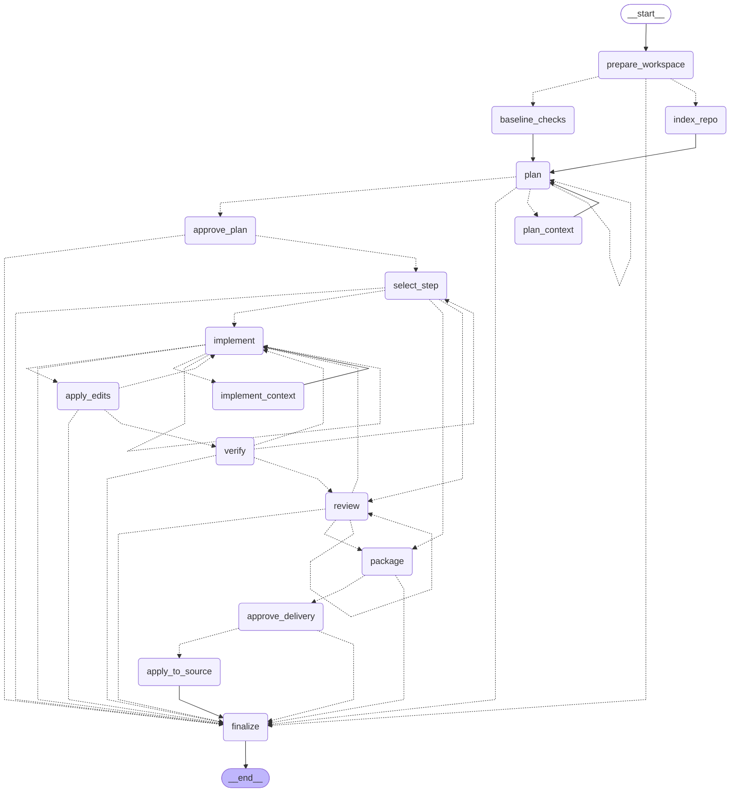

# Scranton Pipeline – Architektur des implementierten MVP

Stand: 9. November 2026, Engine 0.1.0. Maßgeblich sind `src/scranton_pipeline/`, nicht ein autonomes Agentenframework und nicht das ältere Paket `langgraph-engine/`. Bedienung und reproduzierbarer Demo-Lauf: [README](../README.md). Desktop/HTTP: [PIPELINE](../../docs/PIPELINE.md).

## Teil A – Architekturentscheidung

### Verglichene Varianten

Die folgende Bewertung ist eine Entwurfsabwägung, kein gemessener Modellbenchmark. „Sicherheit“ meint die durchsetzbare Kontrollfläche, nicht die Fehlerfreiheit generierten Codes.

| Variante | Zuverlässigkeit | Sicherheit | Aufwand | Wartbarkeit | Erweiterbarkeit |
|---|---|---|---|---|---|
| Lineare Pipeline ohne Rücksprung | Einfach nachzuvollziehen; erster Fehler beendet die Arbeit | Kleine Kontrollfläche | Gering | Hoch | Reparatur erfordert zusätzliche Zustände |
| LLM-Supervisor mit Spezialisten | Routing hängt von Modellurteilen ab | Versteckte Delegation und variable Rechte | Hoch | Schwer deterministisch zu testen | Flexibel, aber jede neue Rolle vergrößert die autonome Fläche |
| Ein Agent mit offenem Tool-Loop | Abhängig von Modell und Kontext | Modell wählt Werkzeuge/Befehle | Anfangs gering | Fehlerpfade schwer einzugrenzen | Leicht neue Tools hinzuzufügen, schwer ihre Kombination zu sichern |
| Deterministische Zustandsmaschine mit begrenzten Modellschritten | Explizite Kanten, Zähler, Schemas und Wiederaufnahme | Python entscheidet über Lesen, Schreiben und Ausführung | Mittel | Reine Router und austauschbare Adapter | Neue Checks/Provider ohne neue Graphkanten möglich |
| Dasselbe mit parallelen Implementierungen in Worktrees | Zusätzliche Konflikt- und Mergefehler | Mehr schreibende Instanzen | Hoch | Ownership und Recovery komplexer | Für unabhängige Aufgaben interessant, hier nicht implementiert |

Gewählt ist die vierte Variante: synchroner `StateGraph(PipelineState)` mit 16 festen Knoten. Drei Knoten verwenden Modelle, zwei sind menschliche Freigaben, die übrigen elf sind normale Python-Verarbeitung. Der Graph ist keine Übersetzung des bestehenden pi-Team-Workflows. Ein Modell liefert Daten, niemals den Namen des nächsten Knotens oder einen auszuführenden Befehl.

**Deterministische Orchestrierung ist nicht deterministische Modellausgabe.** Bei gleichem Zustand sind die Router und Prüfregeln fest; Pläne, Edits und Reviews können dennoch variieren. Auch Temperatur 0 beweist keine reproduzierbare Antwort. Schema- und semantische Prüfung begrenzen die Folgen, garantieren aber keine fachliche Richtigkeit.

### Rollen und Datenfluss

| Modellrolle | Sichtbarer Kontext (`agents/prompts.py`) | Rückgabe | Nicht erlaubt |
|---|---|---|---|
| Planner | Aufgabe, Repositoryindex, Baseline einschließlich Fehlertails, gesammelte Leseevidenz, Validierungsfeedback, verbleibende Kontextzüge | `PlannerTurn`: `need_context` oder `plan`; Plan mit Annahmen, Risiken, Kriterien und Dateivorhaben je Schritt | Shell, Tools, Routing oder eigenständiges Schreiben |
| Implementer | Aufgabe, Planzusammenfassung, Kriterien, aktueller Schritt und aktuelle Dateiinhalte; in Revision stattdessen Review; Feedback und Leseevidenz | `ImplementerTurn`: `edits`, `need_context` oder `blocked` | Direkte Dateizugriffe oder freie Ausführung |
| Reviewer | Aufgabe, Planzusammenfassung, Kriterien, kumulativer Diff, Dateiliste, Abweichungen, letzte Checks, eigenes Validierungsfeedback | `Review`: `approve` oder `request_changes`, Bewertung jedes Kriteriums genau einmal und Findings | Implementer-Begründungen als Evidenz, Schreibrechte, freie Kontext-Toolschleife |

Es sind Rollen, keine drei dauerhaft laufenden Prozesse. Dieselbe Modell-ID kann alle Rollen bedienen. `ModelGateway` kapselt genau einen Aufruf; LangGraph besitzt Transport-Retries, die Knoten besitzen Output-Reparaturen. Nur Planung, Editvorschläge und fachliches Review brauchen ein Modell. Index, Kontextlesen, Risikoflags, Dateivalidierung, Checks, Commitverwaltung, Freigaben, Routing und Bericht brauchen keines.

Der Ablauf: Quellbytes → privater Snapshot mit Manifest und Basiskommit → Index/Baseline → validierter Plan → Planfreigabe → sequenzielle Schritte mit Edits/Checks → optionales Review und Revisionen → Diff/Entwurfsbericht → gegebenenfalls Lieferfreigabe → vorbedingungsgeprüfte Quellübernahme → Abschlussbericht.

### Normale Python-Komponenten

`cli` übersetzt Argumente und reserviert stdout für Ergebnis-JSON (Ausnahme `graph` und Hilfe). `runner` besitzt Lebenszyklus, OS-Lock, Konfigurationskopie, Checkpointer und Interrupt-Wiederaufnahme. `graph.instrument` prüft Stop/Budgets, erfasst Dauer und projiziert `EngineError` in den Zustand. `routing` liest nur Zustand. `limits` berechnet die Rekursionsreserve. `nodes.common.Dependencies` reicht Konfiguration, Adapter und Laufpfade explizit durch; sie liegen nicht im checkpointbaren Zustand.

Die Werkzeugschicht trennt Pfad-/Byteoperationen (`fs`), Inventar/Snapshot (`git`, `snapshot`), Index/Lesen (`repo_index`, `context`), Edit-/Liefertransaktionen (`patches`), Prozessbesitz/Umgebung (`process`) und Ausführungsgrenze (`sandbox`, `checks`). `observability` und `_locking` schreiben dauerhafte Journale; `report` erzeugt Status und Berichte ohne LLM. Die Modulübersicht unten nennt alle Dateien.

### Parallelität und ihre Grenze

Nur `index_repo` und `baseline_checks` werden nach `prepare_workspace` parallel gestartet; `add_edge(["index_repo", "baseline_checks"], "plan")` wartet auf beide. Sie liefern getrennte fachliche Schlüssel (`repo`, `baseline`); gemeinsame Metadaten besitzen Reducer. Baseline vor Planung macht vorhandene Fehler zur Planungsevidenz. Checks selbst laufen sequenziell; nach dem ersten fehlgeschlagenen Pflichtcheck wird bei der normalen Verifikation abgebrochen, die Baseline versucht dagegen alle Checks.

Der Fan-out bleibt bestehen; der Index ist beratend. Nach Baseline **und jeder Verifikation** restauriert `checked()` von Checks veränderte getrackte Dateien auf HEAD und emittiert `warning/check_modified_tracked`; der Bericht nennt die Wiederherstellung als Grenze. Das ist keine schreibgeschützte Mountgrenze: Ein Check kann während der Indexierung deren Sicht beeinflussen; ungetrackte/ignorierte Ausgaben werden nicht allgemein zurückgesetzt. `apply_edits` prüft Edits gegen die tatsächlichen Dateiinhalte. Deshalb keine gleichzeitigen Build-/Implementierungsschritte und keine Behauptung vollständiger Race-Freiheit.

## Teil B – Architekturvisualisierung

Die folgende Ausgabe wird aus `engine/docs/graph.mmd` unverändert eingebettet. Gestrichelte Kanten sind konditional; das Mermaid-Standardtheme ist Bibliotheksausgabe, keine Vorgabe für das monochrome Dashboard. Die Self-Edges stehen am Ende der generierten Ausgabe.



### Alle konditionalen Kanten

Vor jeder unten genannten Entscheidung gilt: gesetztes `failure` oder nichtleeres `outcome` führt nach `finalize`. Die Bedingungen stehen in `routing.py`; Budgets werden in den konsumierenden Knoten geprüft, nicht im Router. `approve_delivery` entscheidet nur dann über die Übernahme, wenn noch kein Abbruch/Fehler vorliegt.

| Ausgang | Bedingung nach dieser Vorrangregel | Ziel |
|---|---|---|
| `prepare_workspace` | sonst | Fan-out `index_repo`, `baseline_checks` |
| `plan` | `plan_requests` nicht leer | `plan_context` |
| `plan` | gültiger `plan` vorhanden | `approve_plan` |
| `plan` | sonst (reparierbarer Output) | `plan` |
| `approve_plan` | sonst (Freigabe; Ablehnung setzt `outcome`) | `select_step` |
| `select_step` | `step_index < len(plan.steps)` | `implement` |
| `select_step` | alle Schritte erledigt, `review is None` | `review` |
| `select_step` | alle erledigt, Review bereits gesetzt, auch `disabled` | `package` |
| `implement` | `step_requests` nicht leer | `implement_context` |
| `implement` | `pending_edits` vorhanden | `apply_edits` |
| `implement` | sonst (reparierbarer Output) | `implement` |
| `apply_edits` | Feedback vorhanden | `implement` |
| `apply_edits` | sonst | `verify` |
| `verify` | Feedback vorhanden | `implement` |
| `verify` | sonst, `mode == revision` | `review` |
| `verify` | sonst | `select_step` |
| `review` | noch kein gültiges Review | `review` |
| `review` | `verdict == approve` | `package` |
| `review` | sonst (`request_changes`, Revision vorbereitet) | `implement` |
| `package` | `delivery_mode == apply` | `approve_delivery` |
| `package` | sonst (`patch`) | `finalize` |
| `approve_delivery` | Entscheidung `approve` | `apply_to_source` |
| `approve_delivery` | sonst (`reject`: nur Patch behalten) | `finalize` |

Feste Kanten: START → Vorbereitung; Index/Baseline-Join → Plan; beide Kontextknoten → ihre Modellknoten; Quellübernahme → Abschluss → END. Jede konditionale Registrierung hat eine explizite `path_map`.

### Schleifen, Fehlerpfade und Endzustände

| Schleife/Limit | Zähler und Standard | Ende |
|---|---|---|
| Plan-Kontext | `plan_context`, 3 | Weiteres `need_context` wird ungültiger Output |
| Schritt-/Revisionskontext | `context:step:<id>` bzw. `context:rev:<n>`, 2 | wie oben |
| Output-Reparatur | `plan_repairs`, `repairs:<scope>`, `review_repairs:<round>`, jeweils 2 | danach `llm_output/output_invalid` |
| Edit-/Checkversuche | `attempts:<scope>`, 3 | abgewiesene Edits: `implementation`; erschöpfte Pflichtchecks: `checks_failed` |
| Review-Revision | `review_round`, 2 Revisionen nach erstem Review | weiteres Änderungsbegehren: `implementation/review_exhausted` |
| Planumfang | höchstens 8 Schritte | ungültiger Plan wird Output-Reparatur zugeführt |
| Transport-Retry | `RetryPolicy`, 3 Versuche pro Modellknotenaufruf | danach `suspended`, explizit wiederaufnehmbar |
| Laufbudget | 40 Aufrufe, 1.500.000 Tokens, 3600 aktive Sekunden | `limit`, terminal |

Reparaturzähler werden innerhalb ihres Scopes nicht nach einer guten Antwort zurückgesetzt. Editversuche zählen angenommene **und** abgewiesene Editsets. Kontext und Reparaturen sind gesondert begrenzt. `scope_id` verwendet getrennte Namensräume `step:<id>` und `rev:<n>` (z. B. `attempts:step:R1` gegenüber `attempts:rev:1`); ein Modell-Schrittname kollidiert damit nicht mit einem Revisionszähler. Der veröffentlichte Plan wird nicht neu geplant.

`finalize` ist der einzige normale Endknoten. `succeeded`, `failed`, `rejected`, `cancelled` sind terminal. `awaiting_approval` und `suspended` sind nicht terminal, sondern wiederaufnehmbar. Planablehnung ergibt `rejected`; abgelehnte Lieferung ergibt dagegen `succeeded` mit `applied:false`. `blocked`, Sicherheitsverletzungen, erschöpfte Budgets, nicht ausführbare Checks und Lieferkonflikte führen zum Abschluss als Fehler. Ein Cancel-Sentinel wird vor normalen Knoten und während Prozessen geprüft. `apply_to_source` und `finalize` überspringen die Stop-Prüfung bewusst: eine begonnene Übernahme muss konsistent abgeschlossen werden. Cancel ist kein Undo bereits angewandter Änderungen.

## Zustand und Ownership

`state.py:PipelineState` ist `TypedDict(total=False)`. Fehlende Schlüssel sind erlaubt; Laufzeitmodelle werden bei Zugriff wieder validiert. Gespeichert werden nur JSON-Primitiven (`dict`, `list`, Strings, Zahlen, Bool, null), keine Pfad-, Pydantic-, Modellclient- oder Verbindungsinstanzen. Das hält Checkpoints untersuchbar und vermeidet die Deserialisierung unregistrierter Python-Typen.

| Schlüssel | Hauptschreiber / Bedeutung | Reducer |
|---|---|---|
| `run_id`, `task`, `source_dir`, `delivery_mode` | Runner, einmalige Anfrage | Ersetzen |
| `workspace` | Vorbereitung: Pfad, Manifest, Basis/HEAD/Grün-Commit, Dateiinventar; Edits ändern HEAD, Verify den Grün-Commit | Ersetzen |
| `repo` | `index_repo`: Index, Baum und Checkvorschläge | Ersetzen |
| `baseline` | `baseline_checks` | Ersetzen |
| `plan_evidence`, `plan_requests` | `plan_context` sammelt Evidenz/leert Requests; `plan` fordert Kontext an | Ersetzen |
| `plan`, `plan_digest`, `risk_flags` | `plan` nach semantischer Validierung | Ersetzen |
| `plan_approval` | `approve_plan` | Ersetzen |
| `mode`, `step_index` | Vorbereitung/Schrittauswahl; `review` schaltet auf Revision | Ersetzen |
| `step_evidence`, `step_requests` | Schrittauswahl, Kontextknoten, Implementer; Review leert bei Revision | Ersetzen |
| `pending_edits` | Implementer setzt, Editknoten/Schrittauswahl/Review leeren | Ersetzen |
| `feedback` | Modellvalidierung, Editablehnung, Verify, Review; nächste passende Verarbeitung leert es | Ersetzen |
| `checks` | `verify` | Ersetzen |
| `steps_done` | `verify`: Schritt-/Revisionsrecords | Listenaddition |
| `deviations` | `apply_edits`: deduplizierte nicht deklarierte Dateien | Ersetzen |
| `review`, `review_round` | Vorbereitung setzt deaktiviertes Review; `review` bewertet/zählt | Ersetzen |
| `delivery` | `package`, `apply_to_source`, Fehlerabschluss | Ersetzen |
| `delivery_approval` | `approve_delivery` | Ersetzen |
| `counters` | konsumierende Knoten, additive scoped Deltas | `merge_counters` |
| `active_seconds` | Instrumentierung aller regulär abgeschlossenen Knoten | Addition |
| `history` | Instrumentierung: Knotendauer | `append_bounded`, letzte 200 |
| `usage` | typisiertes Reservefeld; derzeit kein fachlicher Knotenschreiber | Ersetzen; Status liest Ledger direkt |
| `failure` | Fehlerknoten/Wrapper, Rekursions-Backstop | `keep_first`: erster nichtleerer Wert |
| `outcome` | Cancel/Planablehnung/Abschluss | `keep_first`: erster nichtleerer Wert |

Ownership ist eine sequenzielle **Knotengruppe**, nicht für jedes Feld genau eine Funktion. Die beiden Fan-out-Knoten teilen nur Reducer-Metadaten. `history` enthält im Ist-Code Knotendauern; Routinggründe stehen separat in Events: `routing.decision()` liefert Ziel und entscheidende Tatsache gemeinsam rein aus dem Zustand; Tabellenprüfungen binden beides aneinander (z. B. `need_context`, `checks_failed`, `review_approved`, `delivery_apply`, `declined`).

## Fehlerbehandlung und Zeitgrenzen

| `FailureClass` | Beispiele | Recovery im Ist-Code |
|---|---|---|
| `infrastructure` | Setup/Git/Docker/Checkstart nicht verfügbar; Provider lehnt Anfrage ab | `EngineError` → terminal; als `TransientError` klassifizierter Transport/408/429/5xx → Modellknoten-Retry, danach Suspend |
| `llm_output` | JSON/Schema, inkonsistente Payloads, ungültiger Plan oder unvollständiges Review | sichtbare Reparaturkante; nach Budget terminal |
| `checks_failed` | Pflichtcheck fehlgeschlagen/Timeout | Implementerfeedback bis Versuchslimit, dann terminal |
| `implementation` | Blocker, abgewiesene Edits, Reviewrevision erschöpft, Quellkonflikt | begrenzter Edit-/Revisionsloop oder terminaler Konflikt; kein automatisches Rebase |
| `security` | Traversal, geschützter Pfad, Symlink-Schreibzugriff | sofort terminal, kein Modell-Retry |
| `limit` | Aufruf-/Token-/Zeit-/Datei-/Graphgrenze | terminal |
| `invalid_input` | Konfiguration, Trust, Gate-Digest, aktiver Owner | CLI-Fehler exit 2; Vorabprüfungen soweit möglich vor Runanlage |

`runner.drive` suspendiert außerdem unerwartete Exceptions: Recovery bleibt möglich, ein interner Fehler ist damit aber nicht behoben. Nicht jeder Plattenfehler wird als strukturierter terminaler `infrastructure`-Fehler klassifiziert; ein gewöhnlicher `OSError` kann diese Suspend-Grenze erreichen. Nicht pauschal „jeder Fehler hat bereits einen Bericht“ behaupten: Berichte entstehen bei erfolgreicher Finalisierung, nicht bei einem weiterhin suspendierten oder beim Schreiben selbst beschädigten Lauf.

LangGraphs `add_node(timeout=...)` ist in der verwendeten API nur für **async**-Knoten zulässig. `step_timeout` unterbricht synchrones Python nicht sicher (API-Spike, zusätzlich nachprüfbar in der installierten Bibliothek). Dieser Graph bleibt synchron, um Locks, SQLite und Windows-Prozessbesitz einfach zu halten. Stattdessen:

- Direkter HTTP-/Scripted-Modellaufruf im Daemon-Thread, Wartefrist `ModelConfig.timeout_s` (Standard 180 s, maximal 600 s). Nach Ablauf erhält der Aufrufer `TransientError`. **Der darunterliegende Providerthread lässt sich damit nicht zwangsweise abbrechen**; verspätete externe Arbeit/Kosten bleiben möglich.
- Der `command`-Modellprovider läuft dagegen über einen eigenen Subprozess mit Gesamtdeadline und Prozessbaum-Cleanup vor einem Retry, nicht über den Daemon-Thread. Pro Aufruf entstehen private Request-/Responsedateien unter `tmp/provider`, die anschließend gelöscht werden. Exit 75 ist transient; andere Fehler oder ungültige Antworten sind `provider_rejected`. `SuspendRequested` passiert den Gateway unverändert: Parent-EOF während eines Commandaufrufs führt nach Cleanup zu Exit 5 / `suspended` statt terminalem Fehler; Resume wiederholt den unvollendeten Knoten.
- Subprozesse erhalten `timeout_s`; Windows startet suspendiert, ordnet vor dem Fortsetzen ein Job Object mit `KILL_ON_JOB_CLOSE` zu. POSIX benutzt eine eigene Prozessgruppe. Checks/Setup: Standard 600 s, maximal 3600 s; Gitadapter erhält `Limits.git_timeout_s` (Default 30 s); Docker-Preflight/Cleanup 15 s.
- `max_active_seconds` wird an Knotengrenzen geprüft. Es ist weder eine Wallclock-Frist über menschliche Wartezeit noch eine harte Unterbrechung beliebiger Python-I/O. Parallel-Knotendauern werden addiert; fehlgeschlagene Retries/Interrupts liefern nicht dieselben Zustandsupdates wie regulär abgeschlossene Knoten.
- `recursion_limit(limits)` setzt `planning = 1 + 2*max_plan_context_rounds + max_output_repairs`, `work = 1 + max_output_repairs + 2*max_step_context_rounds + 3*max_step_attempts` und `reviews = (max_review_rounds + 1)*(1 + max_output_repairs)`. Ergebnis: `16 + planning + max_plan_steps*work + max_review_rounds*work + reviews`, mit Defaults **194**. Damit zählen Output-Reparaturen auch beim ersten Review und Kontext-/Reparaturbudgets nur einmal je Scope, nicht je Editversuch. `GraphRecursionError` finalisiert außerhalb des Graphen mit `limit/recursion_limit`.

Datei-/Promptgrenzen aus `Limits`: Datei 1 MB, Snapshot 20.000 Dateien/100 MB, geänderte Dateien 25, Kontextabruf 100 KB/Item 20 KB, 100 Suchtreffer, Prompt 200 KB. Harte Konfigurationsobergrenzen stehen in `config.py`. `WorkspaceRepo` verwendet bei Initialisierung und weiteren Repooperationen `Limits.git_timeout_s`. Checks und Setup reichen `max_log_bytes`/`max_output_tail_bytes` bis zum Prozessadapter durch. Bei `json_text` wird das Schema vor dem Bounding eingerechnet; der Gateway prüft zusätzlich System+User inklusive Schema gegen `max_prompt_bytes` (keine Grenze für HTTP-Hüllenbytes).

## Sicherheit und Replay

### Dateien und Ausführung

Der Snapshot kopiert reale Bytes samt SHA-256-Manifest, nicht Git-Historie/Index. Bei Git werden getrackte und nicht ignorierte ungetrackte Dateien inventarisiert, sonst ein gefilterter Walk. Symlinks/Junctions, geschützte und zu große Dateien werden ausgelassen. Quell-, Lauf- und externe Workspacepfade dürfen nicht ineinander liegen (Demo-Ausnahme nur für ihre eigene Fixture). Das Workspace-Repository ist privat; seine Gitmetadaten liegen außerhalb des Workspace unter `<run-dir>/git`, der leere engine-eigene Hookordner unter `<run-dir>/git-hooks`. `WorkspaceRepo` setzt explizit `--git-dir`/`--work-tree`, deaktiviert globale/Systemkonfiguration und committet mit `--no-verify`. Eine später im Workspace angelegte `.git`-Struktur wird für diese Repooperationen ignoriert und einmal pro Lauf als `warning/workspace_git_ignored` gemeldet (auch über Wiederaufnahme hinweg). Docker mountet nur den Workspace, nicht diese Metadaten. Reset/Clean und interne Commits betreffen nur dieses Repository. Quell-Git erhält keinen Commit, Indexeintrag oder Push.

`PathPolicy` verlangt relative POSIX-Pfade ohne Backslash, Doppelpunkt, absolute Wurzel, `..`, leere/`.`-Komponenten, NUL, Steuerzeichen, Windows-Gerätenamen oder abschließenden Punkt/Leerraum. Nach realpath muss der Pfad im Root bleiben. Schutzmuster werden unabhängig vom Host case-insensitiv gegen lexikalische **und aufgelöste** Pfade geprüft.

- Nicht kopieren/lesen/schreiben: `.git/**`, `.env`, `.env.*`, `**/*.pem`, `**/*.key`, `**/*.p12`, `**/*.pfx`, `**/id_rsa*`, `**/id_ed25519*`, `.ssh/**`, `.npmrc`, `.pypirc`, `**/credentials.json`, `**/auth.json` plus `protected_paths`.
- Lesbar, nicht durch Edits schreibbar: `package-lock.json`, `yarn.lock`, `pnpm-lock.yaml`, `poetry.lock`, `uv.lock`, `Cargo.lock`, `.github/**`, `.gitlab-ci.yml` plus `write_protected_paths`.
- Manifeständerungen müssen deklariert sein; andernfalls wird das Editset mit reparierbarem `edits_rejected` abgewiesen, nicht sofort als `security`. `is_dependency_manifest` prüft den aufgelösten Dateinamen case-insensitiv: `package.json`, `pyproject.toml`, `requirements*.txt`, `setup.py`, `setup.cfg`, `Pipfile`, `Cargo.toml`, `go.mod`, `pom.xml`, `build.gradle`, `build.gradle.kts`, `Gemfile`, `composer.json`, `*.csproj`. Standard-Scope erlaubt höchstens zwei nicht deklarierte Dateien und meldet diese als Abweichung; `strict` verbietet sie.

Editsets werden vor dem Schreiben vollständig geprüft: vorhandene/neue Ziele, UTF-8, eindeutiges Suchstück, No-op, Syntax von `.py`/`.json`, Scope und Größen. Ein neu eingeführtes `[REDACTED]` in einer zuvor markerfreien Datei wird als `edits_rejected` zurückgegeben, damit maskierter Kontext nicht als Quellcode zurückgeschrieben wird. Reviewer-Findingpfade sind dagegen nur Anzeigedaten: `review()` normalisiert Backslashes zu Slashes und entfernt nicht druckbare Zeichen, ohne daraus einen Dateizugriff oder einen `security`-Abbruch zu machen. Atomare Ersetzung gilt **pro Datei**; bei I/O-Fehler wird ein Set zurückgerollt, nicht als atomare Mehrdatei-Dateisystemtransaktion veröffentlicht.

Nur Betreiberkonfiguration bzw. feste Python-Argumente erzeugen argv. `shell=False` verhindert Shellinterpretation; es verhindert nicht, dass ein ausdrücklich konfigurierter Interpreter gefährlichen Code ausführt. Unter Windows dürfen direkt oder über PATH aufgelöste `.cmd`/`.bat` über das native `cmd.exe /d /s /c` laufen, aber nur mit Argumenten gemäß `[A-Za-z0-9_./:=+,@\\-]+`; Leerraum, Quotes, leere Argumente, Steuer- und weitere Shellzeichen werden verweigert (`invalid_input/unsafe_shim_arguments` im Prozessadapter). Der Shimpfad wird gesondert auf gefährliche Zeichen geprüft. Für komplexe Argumente ein natives Executable verwenden. `run_checks` erfasst Adapterfehler als `error`; ein Pflichtfehler wird anschließend `infrastructure/check_error` mit Diagnose. Checks sind vertrauenswürdige Betreiberrezepte, führen aber modellgeschriebenen Repositorycode aus.

Docker verwendet ausschließlich ein vorhandenes Image (`--pull never`), bindet den Workspace nach `/workspace`, überschreibt mit `--entrypoint argv[0]` den Image-Einstiegspunkt und übergibt die restlichen argv nach dem Imagenamen, setzt CPU/RAM/PID-Limits, `--cap-drop ALL`, `no-new-privileges` und standardmäßig `--network none`. Nur Setup kann `bridge` anfordern. Cleanup versucht im `finally` den benannten Container zu töten; keine hier verifizierte Garantie gegen jeden Docker-/Daemon-Ausfall. Hostmodus verlangt `--trust-host` je Run/Resume und gibt **keine OS-Isolation**, keinen erzwungenen Netzabschluss und keine Beschränkung der Benutzer-Dateirechte. Auch Docker ersetzt keine vollständige Sandbox-Härtung (kein read-only Rootfs, kein expliziter unprivilegierter User im Adapter).

### Geheimnisse und untrusted Inhalte

Konfiguration nennt Umgebungsvariablen statt Keys. Prozessumgebung ist allowlist-basiert; Credential-/Token-/Secretnamen bleiben auch bei Passthrough gesperrt. `Redactor` maskiert bekannte Werte und Credentialmuster, nicht beliebige Geheimnisse. Der Planner beschränkt seine Repositoryübersicht separat auf `min(40000, max_prompt_bytes // 4)` Bytes; volle Datei-/Symbolinventare werden nicht in diese Übersicht aufgenommen. Feedback, Restbudget und Kriterien stehen vor den Bulk-Daten; Baseline-/Checktails werden einzeln begrenzt. Der letzte Byte-Fallback schneidet dadurch zunächst Bulk-Daten statt Steuerdaten. Beliebig große Steuerdaten sind dennoch keine unbeschränkte Erhaltungsgarantie innerhalb eines endlichen Promptbudgets. Repositorytext wird JSON-kodiert in `<<<FILE ...>>>`-Blöcke gestellt; Systemregeln verwerfen darin enthaltene Anweisungen. Das ist Prompt-Injection-Abwehr in mehreren Schichten, kein Beweis, dass ein Modell die Regeln immer befolgt. Pfad- und Ausführungsrechte werden deshalb außerhalb des Modells geprüft.

Der optionale `command`-Provider ist eine **vertrauenswürdige Providerintegration**, keine Check-Sandbox: Er erhält die Engineumgebung ohne `SCRANTON_PIPELINE_KEY_*`, nicht die Check-Allowlist. Die Desktop-pi-Bridge läuft in leerem CWD mit `--no-tools`, ohne Sessions, Skills, MCP, Extensions und Kontextdateien; sie liest Pis eigenes Authprofil. Der Supervisor reicht zusätzlich nur die in `PROVIDER_ENV_NAMES` benannten Credentials der ausgewählten pi-Provider weiter; die Check-/Setup-Allowlist bleibt unverändert credentialfrei. Request-/Responsedateien enthalten Prompttext bis zum Cleanup. Ein anderer konfigurierter Completion-Befehl ist ebenso mächtig wie ein normaler Hostprozess; seine Vertrauenswürdigkeit muss der Betreiber sicherstellen.

Runverzeichnisse enthalten Aufgabe, Kontext in Checkpoints, Diffs und Prüfausgaben. Sie sind sensible lokale Daten, keine sichere öffentliche Telemetrieablage. Events enthalten Metadaten statt vollständiger Prompts; Fehler-/Dateinamen können trotzdem vertrauliche Informationen enthalten.

### Menschliche Gates und Idempotenz

Plan: SHA-256 des kanonischen Plans, Freigabe standardmäßig immer. `auto_low_risk` greift nur ohne die Python-Flags `dependency_manifest_change`, `deletes_files`, `many_files` (>10), `ci_or_build_config`, `baseline_red`. „Keine Flags“ ist kein Sicherheitsnachweis. Lieferung: nur bei `apply`, nie automatisch; Digest bindet `candidate.diff`. Resume vergleicht Gate/Digest mit Status, Checkpoint-Interrupt und Artefaktdatei, bevor es fortsetzt.

Vor Edits wird auf den im Zustand aufgezeichneten HEAD zurückgesetzt. Quellübernahme prüft alle Zielpfade vorab: Änderungen/Löschungen verlangen den ursprünglichen Manifesthash, Neuanlagen Abwesenheit; Originale werden gesichert, Fortschritt journalisiert und bei I/O-Fehler zurückgerollt. Wiederholung prüft Journal-/Backup-/Zielhashes. Dies ist kein Lock gegen einen fremden Editor, der zwischen Prüfung und Schreiben dieselben Dateien verändert; menschliche Paralleländerungen vermeiden.

Die Usage-Datei überlebt Prozesswechsel; Scripted-Modelle zählen ihren Cursor darüber. Dennoch besteht kein Exactly-once-Protokoll mit einem externen Modellservice: ein harter Prozessabbruch zwischen Providerantwort und `finally`-Ledgerappend kann eine verbrauchte Anfrage unverbucht lassen; ein erneut ausgeführter Modellknoten kann eine andere Antwort liefern. Replay-Sicherheit der Dateioperationen und externe Aufruf-Idempotenz sind verschiedene Eigenschaften.

## Persistenz und Observability

`SqliteSaver(sqlite3.connect(..., check_same_thread=False))`, `thread_id = run_id` und `invoke(..., durability="sync")` sichern abgeschlossene Supersteps. Ein OS-Dateilock begrenzt Run/Resume auf einen Owner. Ein toter Owner mit `running`-Status wird bei `status` zu `suspended`; keine Wiederaufnahme ohne Benutzeraktion. Parent-stdin-EOF/`stop` fordert Suspend an; der Node-Supervisor wartet beim Schließen bis zu fünf Sekunden, dann beendet er den Prozessbaum.

| Datei | Zweck |
|---|---|
| `run.json`, `config.json` | Anfrage/Workspacepfad und validierte Konfigurationskopie; Digestkontrolle beim Resume |
| `checkpoints.sqlite` | Zustand und Interrupts |
| `events.jsonl` | sequenzierte, gelockte, pro Append geflushte/fsyncte Events |
| `usage.jsonl` | Aufruf-/Tokenledger, auch Fehler; fehlende Modellusage wird geschätzt |
| `status.json` | atomarer, abfragbarer Lebenszyklussnapshot |
| `artifacts/` | Plan, Index, Quellmanifest, Reviewrunden, Check-/Setuplogs |
| `delivery/` | Diff, deterministische JSON-/Markdownberichte, Applyjournal/Backups; bei Nichterfolg `partial.diff` des letzten Grün-Commits |
| `git/`, `git-hooks/` | externe private Gitmetadaten und leerer Hookordner, nicht im Check-Mount |
| `tmp/provider/call-*/` | kurzlebige Request-/Response- und Bridge-Promptdateien, Cleanup je Modellaufruf |
| `lock`, `cancel.requested` | Owner und kooperativer Abbruch |

Eventtypen: `run_started`, `run_resumed`, `node_started`, `node_finished`, `route`, `llm_call`, `context`, `edits_applied`, `edits_rejected`, `check_finished`, `gate_waiting`, `gate_decided`, `warning`, `failure`, `run_finished`. Die HTTP-UI pollt diese Pipeline-Dateien; sie sind **nicht** das Hive-v1-SSE-Protokoll eines Team-Chats. Status während des Fan-out ist beratend und kann zuletzt die Sicht eines Teilzweigs zeigen; der Checkpoint-Join ist maßgeblich. `RunStatus.checks[*].output_tail` ist für nicht bestandene Checks nach Redaktion auf die letzten 4096 Zeichen begrenzt, für bestandene Checks leer. Status-Aufgabentext wird ebenfalls erst redigiert, dann auf 500 Zeichen gekürzt; die sichtbare Schrittposition wird auf den letzten Planschritt geklemmt und zeigt dessen Versuchsscope. Beim Resume stammt die erste Phase aus `checkpoint.next`. `report.md` ist lesbares Markdown (Tabellen, Befunde, Fehlertails), kein JSON-Codeblock; `report.json` bleibt die Maschinenform. Beide entstehen aus demselben redigierten Record. Bericht umfasst Baseline/letzte Checks, Kriterien/Assessment, Schritte, Änderungen, Review, Usage, Timeline und Grenzen; Kosten nur mit konfigurierten Modellpreisen, sonst null.

## Teil C – Tatsächliche Projektstruktur

Unter `engine/`:

```text
pyproject.toml                   Paket, direkte Abhängigkeiten und Qualitätskonfiguration
requirements.lock                Runtime-Closure mit Hashes für Packaging
runtime-lock.json                Windows-Python-Archividentität für Packaging
examples/config.openai.json      Beispiel: direkter OpenAI-Adapter, Docker
examples/config.local-endpoint.json Beispiel: lokaler kompatibler HTTP-Endpunkt, Host
README.md                        Installation, CLI und reale Demoausgabe
docs/ARCHITECTURE.md              diese Entscheidung und Grenzen
docs/graph.mmd                    generierter kompilierter Graph
src/scranton_pipeline/
  __init__.py                    Paketversion
  __main__.py                    Python-Modul-Einstieg
  cli.py                         Argumente, JSON-Ausgabe, Detect/Graph/Version
  config.py                      Operator-Schemas, Defaults, Grenzen und Digest
  models.py                      LLM-/Runtime-Schemas und Payloadkonsistenz
  errors.py                      Fehlerklassen und Lifecycle-Ausnahmen
  state.py                       JSON-Zustand, Reducer und typisierte Zugriffe
  graph.py                       16 Knoten, Instrumentierung, Retry und Join
  routing.py                     reine konditionale Entscheidungen
  limits.py                      berechnete Rekursionsreserve
  runner.py                      Owner, Checkpoints, Start/Resume/Cancel/Status
  report.py                      deterministische Berichte und Statusprojektion
  observability.py               Events, Usage, Status-I/O und JSON-Logging
  agents/command.py              Completion-Subprozessprotokoll v1 und private Promptdateien
  agents/gateway.py              begrenzter Modellaufruf und Outputvalidierung
  agents/providers.py            Modelladapter und scripted Replay
  agents/prompts.py              versionierte, begrenzte Promptbuilder
  nodes/common.py                Dependencies und Schritt-/Revisionsscope
  nodes/planner.py               Planvalidierung, Risikoflags und Outputreparatur
  nodes/workflow.py              übrige Arbeits-/Gateknoten
  demo/fixture.py                buggy Rechner und festgeschriebene Antworten
  tools/__init__.py              Werkzeugpaket
  tools/_locking.py              Thread-/Prozess-Dateilock
  tools/fs.py                    Pfadpolitik, Hashes, Text- und atomare Byte-I/O
  tools/git.py                   isolierte lokale Gitbefehle und Workspace-Repo
  tools/snapshot.py              Bytekopie und Quellmanifest
  tools/repo_index.py            Repositoryindex und feste Checkvorschläge
  tools/context.py               read/list/literale Suche unter Pfadpolitik
  tools/patches.py               validierte Edits und journalisierte Quellübernahme
  tools/process.py               begrenzte Subprozesse, Prozessbaum, Envfilter
  tools/sandbox.py               Host-/Dockeradapter und Preflight
  tools/checks.py                sequenzielle Checkausführung und Ergebnisstatus
  tools/secrets.py               Muster-/Wertredaktion
tests/conftest.py                 lokale temporäre Fixtures
tests/unit/test_fs_context.py     Pfade, Junctions und Kontext
tests/unit/test_kernel.py         Konfiguration, Schemas und Reducer
tests/unit/test_observability_checks.py Journale und Checks
tests/unit/test_patches.py        Edits, Konflikte, Rollback und Replay
tests/unit/test_process_git.py    Prozesse, Job Objects, Git und Sandboxargv
tests/unit/test_fix1.py           externe Gitmetadaten, Shims, Manifeste und opt-in Docker
tests/flow/__init__.py            Flow-Testpaket
tests/flow/conftest.py            CLI-/Modellfixtures
tests/flow/test_agents.py         Prompts, Gateway und offline native Outputs
tests/flow/test_command_provider.py echte lokale Completion-Prozesse, Cleanup und Fehlerzuordnung
tests/flow/test_fix1.py           Reviewkorrekturen: Budgets, Prompts, Restore, Status und Bericht
tests/flow/test_examples.py       Laden der Beispielkonfigurationen
tests/flow/test_graph.py          Graphform, Mermaid, Join und Grenzen
tests/flow/test_lifecycle.py      getrennte Prozesse, Gates, Recovery und Abbruch
tests/flow/test_routing.py        tabellarische Routerzweige
```

Generierte `egg-info`-/Bytecodeverzeichnisse sind keine Architekturkomponenten. Node-Auflösung/Supervision, Registry-Routen und `pipeline-{form,model,view}.js` stehen im [Integrationsdokument](../../docs/PIPELINE.md).

## Technologieentscheidungen

Direkte Runtime-Abhängigkeiten aus `pyproject.toml`: `langgraph==1.2.20` für Graph/Interrupts/Retry; `langgraph-checkpoint==4.3.1` für Persistenzprotokolle; `langgraph-checkpoint-sqlite==3.1.3` für lokale Wiederaufnahme; `langchain-core==1.7.6` für `BaseChatModel`/Nachrichten; `langchain-openai==1.7.4` für den kompatiblen HTTP-Adapter; `pydantic==2.14.3` für validierte Operator-, Modell- und Runtimeformen. Die Runtime-Closure einschließlich transitiver Bibliotheken steht im Hash-Lock; direkte Pins allein ersetzen sie nicht. Build: `setuptools>=75`; Dev: `pytest==9.2.0`, `ruff==0.17.4`, `mypy==2.4.1` (strict).

Bewusst nicht verwendet: `langchain`-Metapaket (keine Agenten-/Chain-Fabrik nötig), GitPython (feste Git-CLI-Operationen reichen), asynchroner Graph (synchrones Lock-/SQLite-/Subprozessmodell), LLM-Router, freie ReAct-Tools, LangGraph.js oder separater Python-HTTP-Dienst. Node beaufsichtigt kurzlebige CLI-Prozesse; eine zusätzliche Rust-IPC-/Python-Service-Schicht würde Aufsicht und Berechtigungen duplizieren. Das ist eine Designbegründung, kein Leistungsvergleich.

## Selbst-Review

| Frage | Antwort aus dem Ist-Code |
|---|---|
| Sind alle Agenten erforderlich? | Für das gewählte offene Aufgabenspektrum plausibel; Reviewer ist bereits abschaltbar. Keine Messung belegt, dass drei Rollen immer besser sind. |
| Können Python-Funktionen Rollen ersetzen? | Bei festen Rezepten könnten Plan/Edits vorgegeben werden; die Demo tut dies scripted. Für beliebige Aufgaben fehlt eine solche deterministische Spezifikation. Checks/Routing/Bericht sind schon Python. |
| Ist der Graph unnötig kompliziert? | Kontext-, Reparatur-, Check- und Revisionsloops kosten Knoten, machen Wiederaufnahme und Grenzen aber explizit. Für reine Ein-Datei-Rezepte wäre er groß. |
| Versteckte autonome Entscheidungen? | Modell entscheidet Inhalte, Leseanfragen und Urteil; Python validiert, wählt Kanten und Befehle. Auch bei `command` ist pi nur Completionclient ohne Tools/Sessions; eigene Completionbefehle bleiben vertrauenswürdige Hostprogramme. Ein freigegebener Plan garantiert keine fachlich sinnvollen Kriterien. |
| Können Races entstehen? | Ja: Check/Index-Dateisicht, beratende Statusupdates, fremde Quellschreiber, nicht zwangsweise beendete Modellthreads. Getrackte Checkänderungen werden nach Baseline/Verify restauriert und gemeldet; das verhindert nicht ihre vorübergehende Wirkung auf den Index. Owner-/Journallocks und sequenzielle Edits reduzieren, beseitigen nicht alle Races. |
| Sind Abbruchbedingungen vollständig? | Alle modellabhängigen Graphloops sind begrenzt; harte Abbrüche können suspendieren. Die Rekursionsreserve zählt auch das erste Review. Commandaufrufe besitzen Deadline/Prozessbaum-Cleanup; beliebige synchrone I/O und direkte HTTP-Providerthreads sind keine global präemptierbare Einheit. |
| Rechte ausreichend beschränkt? | Modell hat keine direkten Tools; Hostchecks haben volle Benutzerrechte. Externe Gitmetadaten, Pfadschutz und Markerprüfung härten die Dateigrenze. Docker ist eine zusätzliche Grenze; ein begrenzter lokaler Opt-in-Test wurde erfolgreich protokolliert, keine allgemeine Sandbox-Freigabe. |
| Nachvollziehbar/testbar? | Reine Router, Scripted-Modelle, lokale Command-/Fake-pi-Prozesse, Gitfixtures und Journale erlauben Offlineprüfungen. Markdownbericht und Checktails machen Ergebnisse lesbar; Modellqualität bleibt gesondert zu bewerten; ein einzelner realer Bridgelauf ist unten eingegrenzt dokumentiert. |
| Kleine lokale Modelle? | JSON-Text, ignorierte Zusatzfelder und begrenzte Reparaturen helfen. Kein lokaler Modellbenchmark wurde ausgeführt; Context-/Schemaqualität ist eine Annahme. |
| Später erweiterbar? | Adapter/Checks/Reviewprompts sind getrennt. Parallel schreibende Schritte, Replanning oder weitere menschliche Gates benötigen bewusst neue Zustände/Kanten/Tests. |

## MVP, Produktion und Verifikationsgrenzen

Der hier selbst ausgeführte scripted CLI-Lauf durch beide Gates endete mit exit 3 → 3 → 0 und änderte erst nach Lieferfreigabe den Fixture-Rechner. Das belegt keine realen Provider, Aboauthentifizierung, Linux-/macOS-Lifecycle-Funktion oder Installer-End-to-End-Funktion. Zusätzlich existiert `tests/unit/test_fix1.py:test_opt_in_docker_network_timeout_and_no_git_mount` (`SCRANTON_PIPELINE_DOCKER_TEST=1`): trivialer Befehl, nur Loopback-Netzinterface, keine Gitmetadaten im Mount und Timeout/Cleanup des eigenen Containers. Für das lokale Image `scranton-sandbox:1.5.0` ist am 09.11.2026 ein erfolgreicher Lauf protokolliert; in dieser Dokumentationsprüfung wurde er nicht wiederholt. Das ist keine umfassende Docker-Sicherheitsprüfung. Offline `MockTransport`-Tests sind keine Providerfreigabe. Kein Replanning, keine parallele Schrittimplementierung, kein autonomes Command-Tool, kein Multi-Host-Scheduler und keine getrennten Security-/QA-LLM-Linsen sind eingebaut.

Für Produktion wären unter anderem zu prüfen: migrationsfähige Postgres-Checkpoints statt lokaler SQLite-/Dateiannahmen, zentraler Log-/Metrik-Sink mit Retention und Zugriffsschutz, robuste externe Aufruf-Idempotenz, strengere Sandbox-/Egress-/Usergrenzen, Quellübernahmesperren, Provider-/Modellmatrix samt Auth-/Usagefehlern und reproduzierbares Packaging aus der vorhandenen hashgesperrten Runtime-Closure. Lockfiles existieren bereits; ihre Existenz ist kein Beleg für einen verifizierten Installer. Weitere aktuelle Modelladapter und ihr Verifikationsstand: siehe die abschließende Providersektion der [Engine-Anleitung](../README.md#modelle-und-provider).

## Abgleich mit dem Entwurfsvertrag

Die Umsetzung ist maßgeblich. Die Tabelle unterscheidet verbliebene Abweichungen und Prüfgrenzen von Regeln, die §14/15 inzwischen präzisiert und die Umsetzung erfüllt hat:

| Stelle im Code | Unterschied / aktuelle Grenze |
|---|---|
| `nodes/workflow.py:checked`, `tools/git.py:WorkspaceRepo.restore_tracked` | §1/2 nennt den Fan-out read-only; §15o präzisiert nachträgliches Restore/Warnung. Dies ist umgesetzt, bleibt aber keine Mount-Schreibsperre; der Index ist beratend. |
| `agents/prompts.py:bounded/build_planner_prompt` | §15n: Overviewcap, begrenzte Checktails und Steuerdaten vor Bulk-Daten; JSON-Schema ist im System-/User-Promptbudget enthalten. |
| `runner.py:drive`, `cli.py:main` | §2: unerwartete Graphfehler suspendieren statt immer terminal zu finalisieren; I/O beim Berichtschreiben kann einen Abschlussbericht verhindern. Der Status-Exitcode aus §15h ist dagegen umgesetzt. |
| `state.py:PipelineState`, `graph.py:instrument/build_graph` | §3: `usage` bleibt ein Reservefeld; Status liest das Ledger. `history` enthält Knotendauern; Routingevents nennen nun die entscheidende Zustandstatsache statt `state`. |
| `nodes/workflow.py:checked`, `tools/git.py:WorkspaceRepo.__init__` | Konfigurierte Log-/Tailgrenzen werden bis zum Checkprozess durchgereicht; Repooperationen verwenden `Limits.git_timeout_s`. |
| `tools/patches.py:validate_and_apply` | §7 fordert deklarierte Manifeste; undeclarierte Manifeständerungen liefern reparierbares `edits_rejected`, keine unmittelbare `security`-Failure. Das Sicherheitsziel ist erfüllt; §7 legt für diesen Fall keine eigene Fehlerklasse fest. |
| `agents/gateway.py:deadline_call/complete` | §13 nennt eine harte Gesamtdeadline: der Aufrufer endet rechtzeitig, ein direkter HTTP-Providerthread kann jedoch weiterlaufen. Für `command` gilt stattdessen besessenes Prozessbaum-Cleanup. |
| `agents/gateway.py:complete` | §7s Replay-Budgetversprechen ist nicht Exactly-once: harter Abbruch vor dem Ledgerappend kann externe Kosten unverbucht lassen. Das JSON-Schema ist jetzt Teil der Promptbegrenzung. |
| `tools/pipeline-pi-complete.js:main`, `src/core/pipeline-supervisor.js:modelCatalog/credentials` | §14 ersetzt den früheren Abo-Ausschluss aus §9; Bridge und Packaging sind umgesetzt. Automatisierte Prüfungen bleiben offline; der unten dokumentierte reale Bridgelauf ist ein separater Einzelfall, keine Providerfreigabe. |

Dokumentationsprüfung: neue scripted Demo in drei Prozessen, **3 → 3 → 0**, Quellrechner bis Lieferfreigabe unverändert; realer Bericht in der [Engine-Anleitung](../README.md). Gesamtprüfstand **2026-11-09 abends** laut abgeschlossenen Codegates (hier nicht erneut als Vollsuiten ausgeführt): Engine **272 bestanden, 1 übersprungen** (Opt-in-Docker), Ruff sauber, mypy strict sauber auf **33 Quelldateien**; Node Server **128**, Core **415 bestanden + 1 Skip**, Visualizer **400**, Packaging **6**. Die Enginegates meldeten 13 LangSmith-Deprecationwarnungen zu `asyncio.iscoroutinefunction` (Entfernung in Python 3.16 angekündigt); künftige Dependency-Kompatibilitätsaufgabe, kein Testfehler. Keine allgemeine Provider-/Abo- oder Installerfreigabe durch diese Dokumentationsprüfung; der separate reale Einzellauf ist oben eingegrenzt.

## Separater realer pi-Bridge-Lauf

Ein echter Lauf wurde am **2026-11-09 um 22:37** über die Desktop-HTTP-API auf dem Drei-Dateien-Projekt `.scratch/pipeline/real-smoke/project` ausgeführt: alle drei Rollen `openai/gpt-6.1-sol` **via pi**, ChatGPT-Subscription des Benutzers, Trusted-Host-Sandbox. Planner: 2 Aufrufe (ein Kontextzug), Implementer: 1, Reviewer: 1; pi meldete **7647 Input-/601 Outputtokens**. Baselinecheck rot, finaler Check grün, Ein-Zeilen-Diff; die Quelldatei änderte sich erst nach Lieferfreigabe; Abschluss **`succeeded`**. Dieser eine Lauf belegt **nicht** andere Provider, größere Repositories, Reparatur-/Revisionsschleifen mit echten Modellen oder Dockerbetrieb mit echten Modellen.
